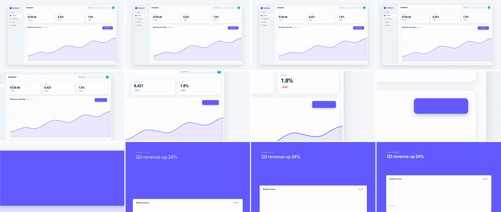

# SaaS Transitions

A library of 34 scene transitions for SaaS and product videos, packaged as a [Claude Code](https://claude.com/claude-code) skill for [HyperFrames](https://hyperframes.heygen.com). Each transition comes with the timing broken down frame by frame, copy-paste GSAP code, a working two-scene demo, and a rendered 60fps preview.



*UI Deep Zoom, 12 frames across the transition.*

## Install

Clone it into your Claude Code skills folder:

```bash
git clone https://github.com/johnbhiggins7/saas-transitions ~/.claude/skills/saas-transitions
```

Claude Code picks it up as one skill, `saas-transitions`. Ask for a product video, a feature launch or a specific transition ("deep zoom into the dashboard, then a shared-element move to the detail page"), and the skill routes Claude to the right transition, its code and its demo. You can also call it directly with `/saas-transitions`.

To render demos yourself you need the HyperFrames CLI (`npm i -g hyperframes`), Node.js 22+ and FFmpeg.

## What's in each transition

Every transition lives in `transitions/<slug>/`:

| File | What it is |
| --- | --- |
| `SKILL.md` | When to use it, frame-by-frame anatomy at 60fps, the GSAP code, tuning ranges, pitfalls, variants and a sound pairing |
| `demo.html` | A working HyperFrames composition: two scenes of mock SaaS UI and the transition between them |
| `preview.mp4` | The rendered demo, 1920×1080 at 60fps |
| `contact.png` | 12 frames spanning the transition, for reading it at a glance |

All demos share one light UI kit ([`shared/ui-kit.css`](shared/ui-kit.css)) and one fictional product, "Northwind", so the transitions are easy to compare.

## Catalog

Durations are the transition move itself, not the whole demo.

### Camera & Spatial

| Transition | Duration | What happens |
| --- | --- | --- |
| [UI Deep Zoom](transitions/ui-deep-zoom/SKILL.md) | 0.6s | The camera rushes into one small UI element until its fill becomes the next scene's background |
| [Contextual Pullback](transitions/contextual-pullback/SKILL.md) | 0.8s | Snaps back from a macro UI action and tilts to 2.5D, revealing the surfaces it updated |
| [Infinite Canvas Pan](transitions/infinite-canvas-pan/SKILL.md) | 1s | Glides across one dot-grid canvas between node clusters, with a slight mid-pan zoom-out |
| [Whip Pan](transitions/whip-pan/SKILL.md) | 0.43s | Whips to peak speed under horizontal motion blur, with a hard cut on the fastest frame |
| [Z-Space Push](transitions/z-space-push/SKILL.md) | 0.8s | Flies through blurred foreground layers to land sharp on a panel deep behind them |
| [Rack Focus](transitions/rack-focus/SKILL.md) | 0.7s | Focus pulls from a foreground card to the dashboard behind it, with almost no movement |
| [3D Card Flip](transitions/card-flip-3d/SKILL.md) | 0.7s | A UI card flips 180° to show the API request or config behind it |
| [Perspective Tilt & Extrusion](transitions/perspective-tilt/SKILL.md) | 0.8s | The window tilts back as an extruded slab while the next swings in and flattens |
| [Isometric Stack Explosion](transitions/isometric-stack-explosion/SKILL.md) | 1.6s | Tips into isometric, splits into labelled layers, then flattens one into the next scene |
| [Device-to-Canvas Wrap](transitions/device-to-canvas-wrap/SKILL.md) | 0.8s | Full-bleed UI pulls back into a 3D laptop screen as the device assembles around it |

### Morphing

| Transition | Duration | What happens |
| --- | --- | --- |
| [UI-to-UI Component Morph](transitions/ui-component-morph/SKILL.md) | 0.65s | One container stretches and re-rounds into another component without ever cutting the surface |
| [Icon-to-Scene Morph](transitions/icon-to-scene-morph/SKILL.md) | 0.8s | The parts of a brand icon travel and reshape into the matching parts of real UI |
| [Prompt-to-UI Render](transitions/prompt-to-ui-render/SKILL.md) | 1.1s | A typed prompt compiles, the prompt bar opens into a card, and skeletons resolve into UI |
| [Liquid Blob Morph](transitions/liquid-blob-morph/SKILL.md) | 0.8s | A button melts into a wobbling blob that floods the frame, then the next scene opens through it |

### UI-Native

| Transition | Duration | What happens |
| --- | --- | --- |
| [Shared-Element Transition](transitions/shared-element/SKILL.md) | 0.6s | One card travels intact from its grid slot into the header of its detail page |
| [Component Restructuring](transitions/component-reflow/SKILL.md) | 0.7s | A table collapses into a sidebar widget while a Kanban board grows into the freed space |
| [Bento Cascade](transitions/bento-cascade/SKILL.md) | 0.8s | Bento tiles resize and reposition one after another into a new layout, swapping content mid-move |
| [Cursor-Triggered Expansion](transitions/cursor-click-expand/SKILL.md) | 0.5s | A cursor clicks a button, and the button's box grows into a modal that fills the frame |
| [Toggle & Theme Shift](transitions/toggle-theme-shift/SKILL.md) | 0.6s | A toggle sends a circular reveal from its knob that repaints the screen into a new state |
| [Dropdown & Accordion Wipe](transitions/dropdown-accordion-wipe/SKILL.md) | 0.7s | A nav dropdown keeps growing until it covers the frame, with the chosen item as the headline |

### Masking, Wipes & Mattes

| Transition | Duration | What happens |
| --- | --- | --- |
| [Expanding Container Mask](transitions/container-mask-expand/SKILL.md) | 0.6s | A card already showing the next scene grows its mask to full frame while the dashboard recedes |
| [Border & Navigation Rail Wipe](transitions/border-rail-wipe/SKILL.md) | 0.6s | The sidebar rail slides across as the wipe edge, then docks as the next view's panel |
| [Kinetic Typography Mask](transitions/kinetic-type-mask/SKILL.md) | 1.4s | A headline slams in with the next scene inside its letters, then the camera pushes through a stem |
| [Text Split Reveal](transitions/text-split/SKILL.md) | 0.9s | A headline slams in, then the frame splits along the type and the halves slide apart |
| [Geometric & Brand Ribbon Wipe](transitions/geometric-ribbon-wipe/SKILL.md) | 0.6s | Staggered diagonal brand ribbons cover the frame for the swap, then trail off |
| [X-Ray Scanline](transitions/xray-scanline/SKILL.md) | 0.8s | A glowing scanline strips the UI's skin to reveal the same layout as wireframes and data |
| [Split-Screen Takeover](transitions/split-screen-takeover/SKILL.md) | 0.6s | The divider of an old-vs-new split is dragged across, and the winning panel takes the frame |

### Match Cuts, Momentum & Leading

| Transition | Duration | What happens |
| --- | --- | --- |
| [Geometric Match Cut](transitions/graphic-match-cut/SKILL.md) | 0.4s | A pulsing donut hard-cuts on its peak frame to a round clock at the same position and size |
| [Directional Momentum (Speed Match Cut)](transitions/speed-match-cut/SKILL.md) | 0.53s | A card exits right at full speed, and after a hard cut the next enters left at the same speed |
| [Path & Stroke Leading](transitions/path-stroke-leading/SKILL.md) | 0.9s | A glowing data packet draws a wire across the frame, and the next scene builds behind its head |
| [Layered Parallax Push](transitions/parallax-push/SKILL.md) | 0.6s | The next screen pushes the old one out with background, UI and foreground at staggered speeds |

### Soft & Atmospheric

| Transition | Duration | What happens |
| --- | --- | --- |
| [Cross-Dissolve](transitions/cross-dissolve/SKILL.md) | 0.8s | The next scene fades in over an opaque scene A with opposite scale drift, so luminance never dips |
| [Soft Blur Transition](transitions/soft-blur/SKILL.md) | 0.7s | Scene A defocuses into a brief haze and scene B resolves out of it |
| [Light & Glow Sweep](transitions/light-sweep/SKILL.md) | 0.7s | An oversized soft light band sweeps across and the scene swaps under its brightest moment |

## Choosing

Pick two or three signature transitions per video and repeat them; a different transition at every cut reads as a template pack. Use wipes and type masks for chapter breaks. The [router `SKILL.md`](SKILL.md) has a "need → transition" table, the house rules every transition follows (hard easing, 20–40 frames at 60fps, the transition is the exit), and the difference between a match cut, a morph, a shared element and a deep zoom.

## Previewing and adding transitions

```bash
scripts/render.sh <slug>     # render one demo to preview.mp4 + contact.png (60fps)
scripts/render.sh --all      # render every demo
node scripts/gallery.mjs     # rebuild review/index.html
python3 -m http.server 8765  # then open http://localhost:8765/review/
```

The gallery shows every transition's preview with slow-motion controls and its review status: **draft** (never committed), **approved** (committed, unchanged) or **changed** (committed, then edited).

To add a transition, follow [`shared/AUTHORING.md`](shared/AUTHORING.md): build `demo.html` on the shared UI kit, write the subskill from the template, render it, and check the contact sheet against the self-check list. A transition is committed and added to the index only after someone has reviewed its render.
