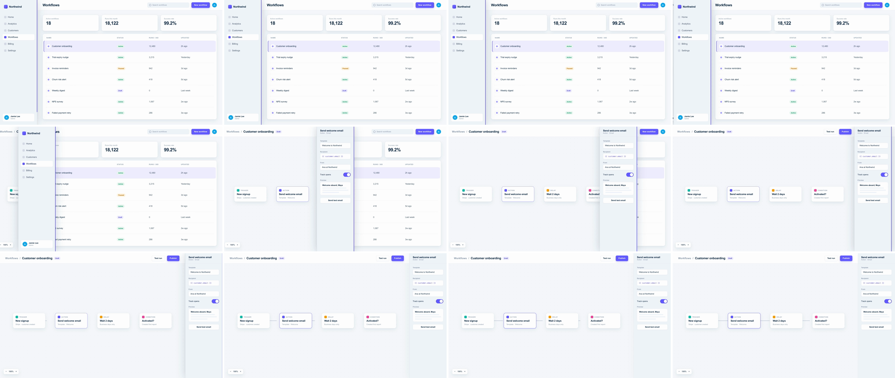

# Border & Navigation Rail Wipe (sidebar wipe)

A wipe whose edge is a real piece of the app's interface. The navigation rail lifts off the layout and slides from the left edge to the right edge. Scene B is clipped to the rail's trailing edge, so the next view appears to be uncovered by the sidebar itself. The rail then docks as scene B's inspector. The rail's panel stays on screen the whole time, changing from navigation to inspector, so the viewer reads the cut as moving to another part of the same app, not as a jump to a new scene.



## Use it when

- Going from browsing to editing: list → builder, inbox → thread, table → record. The nav rail turning into the inspector shows the mode change.
- Chapter breaks in a product video where the app shell is the constant. Save it for those: it is a strong, horizontal move.
- Switching layout modes (browse → focus mode, a panel opening). For a menu or panel that grows downward, use [dropdown-accordion-wipe](../dropdown-accordion-wipe/SKILL.md).
- Following one object across views. Combine with [shared-element](../shared-element/SKILL.md) by keeping the selected item's name in the rail before and after the swap.

Avoid it when scene A has no visible rail, border or panel edge (a hero, a full-bleed chart). A grey slab crossing the frame then reads as a generic wipe. Use [geometric-ribbon-wipe](../geometric-ribbon-wipe/SKILL.md) or [light-sweep](../light-sweep/SKILL.md) instead.

## Anatomy (30fps)

| Beat | Frames | What happens |
| --- | --- | --- |
| Telegraph | −17 → 0 | The row being opened highlights at −17. From −9 the rail lifts: a 72px shadow fades in over 9f, and a 4px indigo line draws down its leading edge (scaleY 0 → 1, 7f). |
| Break away | 0 → 6 | One `--x` tween (`power3.inOut`) moves the rail and scene B's clip edge together. They cover only 237px in 6f: the rail is easing out of the layout. |
| Peak | 6 → 12 | Speed climbs to about 270–300px per frame at f9–f10. At f9 the rail's contents hard-swap from nav to inspector. The motion hides the cut, and every frame shows a complete panel. |
| Reveal | 0 → 27 | Scene B drifts x −140 → 0 behind the edge (`power3.out`, 27f), slower than the rail, so it reads as a layer underneath. |
| Dock | 12 → 18 | The rail decelerates into x = 1600 and becomes scene B's right-hand inspector. The edge line fades from f15, the lift shadow from f16.5, and scene A is hidden at f18. |
| Land | 16.5 → 32 | Wires between nodes draw on (10.5f each, 2.4f stagger). The selected node's focus ring pops at f18 (`back.out(2)`). |

## Build it

Structure: `#s1` (scene A, its layout starts at `RAIL_W`) · `#s2` (scene B, clipped, with a `.cam` inside for the drift) · `#rail` (on top, full height, holding `.rail-nav` and `.rail-insp`). Scene A has no sidebar of its own: the rail is its sidebar.

```css
#rail, #s2 { --x: 0px; }                         /* one variable drives the rail AND scene B's reveal edge */
#rail { position: absolute; left: 0; top: 0; width: 320px; height: 1080px; z-index: 10; background: var(--surface-2);
        transform: translate3d(var(--x), 0, 0);
        box-shadow: -1px 0 0 var(--border), 1px 0 0 var(--border); } /* hairlines outside: off-frame when docked */
#s2   { z-index: 2; clip-path: inset(0 calc(1920px - var(--x) - 8px) 0 0); } /* edge tucked 8px under the rail */
```

```js
const T = 1.5, D = 0.6;                 // 18f
const RAIL_W = 320;
const TRAVEL = 1920 - RAIL_W;           // dock flush right as scene B's inspector

tl.to("#rail-lift", { opacity: 1, duration: 0.3, ease: "power2.out" }, T - 0.3);
tl.fromTo("#rail-edge", { scaleY: 0 }, { scaleY: 1, duration: 0.25, ease: "power2.out" }, T - 0.3);

tl.set("#s2", { opacity: 1 }, T);
// One tween, two targets: rail x and clip edge read the same --x, so they cannot drift apart.
tl.fromTo(["#rail", "#s2"], { "--x": "0px" }, { "--x": `${TRAVEL}px`, duration: D, ease: "power3.inOut" }, T);
tl.fromTo("#s2 .cam", { x: -140 }, { x: 0, duration: D + 0.3, ease: "power3.out" }, T); // drift inside the clip, never on #s2

tl.set(".rail-nav", { opacity: 0 }, T + D / 2);   // hard swap at the velocity peak
tl.set(".rail-insp", { opacity: 1 }, T + D / 2);

tl.to("#rail-lift", { opacity: 0, duration: 0.35, ease: "power2.out" }, T + D - 0.05);
tl.to("#rail-edge", { opacity: 0, duration: 0.2, ease: "power1.out" }, T + D - 0.1);
tl.set("#s1", { visibility: "hidden" }, T + D);
```

The full working composition is in [demo.html](demo.html).

## Tuning

- **Duration.** 0.5–0.7s for a full 1600px crossing. Below 0.5s the peak goes past 320px per frame and the rail strobes. 0.6s already peaks near 300px per frame; if the rail text judders on playback, switch to `power2.inOut` (peak about 180px per frame). A shorter crossing (docking mid-frame) can drop to 0.4s.
- **Ease.** `power3.inOut` gives a visible break-away and dock. `power2.inOut` is calmer. Avoid `expo.inOut`: it creeps 37px in the first 5f, then peaks near 600px per frame and strobes.
- **Rail width.** 240–360px. Narrower reads as a line wipe and loses the "it's the sidebar" read. Wider than about 400px reads as a panel push.
- **Scene B drift.** 80–200px. At 0, scene B looks like a still plate being uncovered. Above 200px it competes with the rail and starts to read as a [split-screen-takeover](../split-screen-takeover/SKILL.md).
- **Tuck.** 4–12px. It only has to cover the anti-aliased clip edge, and it must stay under the rail's opaque body.

## Pitfalls

- **Fading the rail contents mid-travel.** The first build faded the nav out and staggered the inspector in. Stills then showed a half-transparent ghost nav, then an empty grey slab for a frame. A hard `tl.set` swap at f9 (peak speed) can't be seen in motion and keeps every frame clean.
- **Drifting the clipped element.** `clip-path` is in the element's own coordinates. Put the parallax `x` on `#s2` itself and the reveal edge slides away from the rail. Move a `.cam` child instead.
- **Clip edge flush with the rail.** When the clip and the rail end on the same subpixel x, both edges are anti-aliased against scene A underneath. In this light palette, a measured flush render brightened that one column by about 4 grey levels. Against a dark scene B, the same column shows as a visible line. Tucking the edge 8px under the rail costs nothing.
- **Two tweens for one edge.** Animating the rail's `x` and the clip inset separately lets subpixel rounding (or a later ease tweak) open a seam. Drive both from one CSS variable in one tween.
- **A `border-right` on the rail.** Once the rail docks on the right, that border sits on the frame edge and the divider against the canvas disappears. Use outside `box-shadow` hairlines on both sides, so whichever one is off-frame does not matter.
- **Scene A with its own sidebar.** If scene A paints a sidebar or a coloured backdrop under the rail's start position, it is exposed in the gap behind the rail. The rail has to be the only sidebar.

## Variants

- **Return wipe.** Run it right to left for back navigation: the inspector slides home and becomes the nav again. Pair it with the forward wipe in the same video.
- **Clean exit.** Set `TRAVEL = 1920` so the rail leaves the frame. Scene B then needs no right-hand panel, and its own sidebar can slide in on the landing.
- **Modal edge.** The same `--x` trick works vertically: a sheet's top edge drops down with `clip-path: inset(var(--y) 0 0 0)` on the scene above it.
- **Window border.** A browser or desktop window frame slides across. Its title bar is the wipe edge, and the next app is behind it.

## Sound

A short, low-passed air swish whose peak lands on f9 (the content swap), then a soft panel click as the rail docks at f18.
