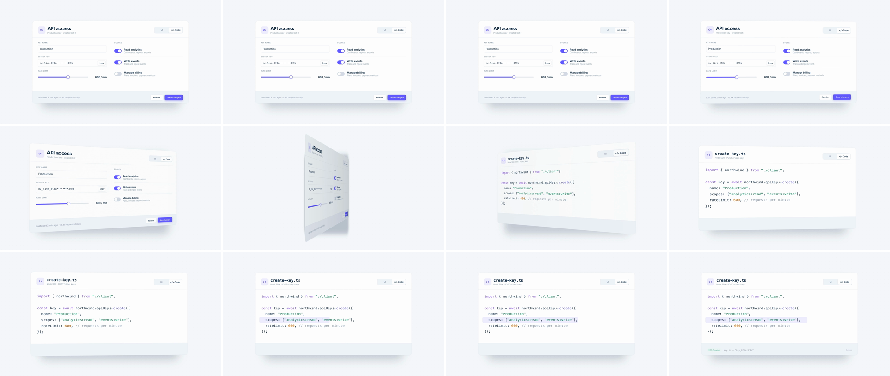

# 3D Card Flip (front/back reveal)

A large UI card rotates 180° about its vertical axis in real CSS perspective, dipping away from camera at the edge-on point. Its back face shows what the front is made of, such as the API call, the JSON config or the SQL. It says "same thing, other side": the settings you just watched become code.



## Use it when

- Showing a pair that are two sides of one object: settings ↔ API request, no-code builder ↔ generated code, chart ↔ its query, pricing card ↔ feature list.
- The card can be the hero, at 60–75% of frame width. A small card flipping inside a busy page reads as a UI micro-interaction, not a scene change.
- For "what's underneath" across a whole screen, use [xray-scanline](../xray-scanline/SKILL.md). For a gentler angle on one UI without swapping content, use [perspective-tilt](../perspective-tilt/SKILL.md).

Avoid it when scene B isn't the reverse of the same object, for example moving to another page. A flip there feels arbitrary, so use [z-space-push](../z-space-push/SKILL.md) or [shared-element](../shared-element/SKILL.md) instead. Never flip the full 1920×1080 frame: it reads as a slideshow preset.

## Anatomy (30fps)

| Beat | Frames | What happens |
| --- | --- | --- |
| Telegraph | −10 → −3 | The card's segmented control slides its pill from UI to Code (`power3.inOut`, 7f) and the labels swap colour. The eye is on the card, and the reason for the flip is on screen. |
| Turn | 0 → 10 | `#flip` rotationY 0 → 78° on the first half of `power3.inOut`. It barely moves for 4f, then accelerates. Scale dips toward 0.92, the floor shadow narrows with \|cos θ\| and its blur tightens 36 → 12px (horizontally it also squashes with the shadow's scaleX), and the front darkens toward its receding right edge. |
| Edge-on | 10 → 11 | 78° → 102°. The 90° midpoint falls *between* frames, so no frame shows a culled, empty card. The back face takes over. |
| Reveal | 11 → 16 | The back decelerates through 125°, 160° to 179°. Shading lifts and the shadow widens again under the card. |
| Settle | 16 → 21 | Overshoots to 183.4° at f18, with scale rebounding to 1.005, then eases back to exactly 180° at f21. |
| Land | 20 → 41 | Scene B confirms itself. The `scopes` line highlight wipes in from the left (f20, `expo.out`, 15f) and the "201 Created" response row rises into the footer (f26 → f41). |

## Build it

Structure: `.stage` (perspective, origin at the card centre) › `#shadow` (flat, painted first) + `#flip` (`preserve-3d`) › `.face.front` + `.face.back`, each with a `.shade` overlay. Only the stage gets opacity or filter, never `#flip`.

```css
.stage { position: absolute; inset: 0; perspective: 2000px; perspective-origin: 960px 540px; }
#flip { position: absolute; left: 280px; top: 180px; width: 1360px; height: 720px; transform-style: preserve-3d; }
.face { position: absolute; inset: 0; backface-visibility: hidden; -webkit-backface-visibility: hidden; }
.back { transform: rotateY(180deg); } /* pre-flipped, so at #flip 180° it reads the right way round */
```

```js
const T = 1.6, D = 0.7;                      // 21f: odd, so 90° lands between f10 and f11
const CARD = { x: 280, y: 180, w: 1360, h: 720 };
const PERSPECTIVE = 2000, OVERSHOOT = 0.05;  // 0.05 ≈ 3.4° past 180

// power3.inOut plus a sin² bump on the second half: same midpoint, lands past 180°, eases back.
const io = gsap.parseEase("power3.inOut");
const flipEase = (p) => io(p) + OVERSHOOT * Math.sin(Math.PI * Math.max(0, p * 2 - 1)) ** 2;
// Secondary props are eases of the card's angle, so they can't drift out of sync with it.
// They return to 0 at p=1, so each tween ends on its from-value.
const angle = (p) => Math.PI * flipEase(p);
const edgeOn = (p) => 1 - Math.abs(Math.cos(angle(p)));  // 0 face-on, 1 edge-on
const sinA = (p) => Math.sin(angle(p));                  // goes negative in the overshoot: scale rebound
const SHIFT = CARD.w ** 2 / (8 * PERSPECTIVE);           // projected centre drift toward the near edge (~116px)
const sin2A = (p) => Math.sin(2 * angle(p));

tl.to("#seg-pill", { x: 124, duration: 0.24, ease: "power3.inOut" }, T - 0.34); // telegraph

tl.fromTo("#flip", { rotationY: 0 }, { rotationY: 180, duration: D, ease: flipEase }, T);
tl.fromTo("#flip", { scale: 1 }, { scale: 0.92, duration: D, ease: sinA }, T);
tl.fromTo(".shade", { opacity: 0 }, { opacity: 0.3, duration: D, ease: edgeOn }, T);
tl.fromTo("#shadow", { scaleX: 1, opacity: 0.7, filter: "blur(36px)" }, { scaleX: 0.06, opacity: 1, filter: "blur(12px)", duration: D, ease: edgeOn }, T);
tl.fromTo("#shadow", { x: 0 }, { x: -SHIFT, duration: D, ease: sin2A }, T);

tl.fromTo("#hl", { scaleX: 0, transformOrigin: "0% 50%" }, { scaleX: 1, duration: 0.5, ease: "expo.out" }, T + D - 0.05);
tl.fromTo("#resp", { y: 16, opacity: 0 }, { y: 0, opacity: 1, duration: 0.5, ease: "power3.out" }, T + D + 0.15);
```

The `.shade` is a gradient (45% → 100% ink) running toward each face's receding edge: to the right on the front, to the left on the back. The full working composition is in [demo.html](demo.html).

## Tuning

- **Duration.** 0.63–0.77s, at an odd frame count (19, 21 or 23f). At 0.6s or 0.8s the midpoint lands on a whole frame at exactly 90°.
- **Perspective.** 1600–2500px for a ~1360px card, about 1.2–1.8× the card width. Lower than that and the near edge balloons past the frame at 45°. Above ~3000px the turn starts to read as a horizontal squash.
- **`OVERSHOOT`.** 0–0.08. 0.05 gives a 3.4° settle at f18. Above 0.08 the card wobbles like a door.
- **Dip.** Scale 0.90–0.95 at edge-on. It hides the near edge's perspective swell and sells weight.
- **Shade peak.** 0.2–0.35. It is what makes the turn read as rotation and not a `scaleX` squash.

## Pitfalls

- **Shadow centred on the pivot.** Perspective pulls the projected card toward its near edge (~105px at 57°), so a shadow that only scales pokes out past the far edge like a grey slab. Shift it by `SHIFT · sin 2θ`.
- **Uniform shading.** A flat 0.32 ink overlay turned the whole face a dirty grey at 57°. A gradient toward the receding edge reads as light falloff at a lower peak.
- **Mirrored back.** The back needs `rotateY(180deg)` in CSS, and GSAP must never tween that face's transform. GSAP would rewrite the transform and drop the pre-flip. Animate its children instead.
- **Flattened 3D.** `opacity < 1`, `filter` or `overflow: hidden` on `#flip` collapses `preserve-3d`. Even `opacity: 0.99` does it: the back face never appears, and the card lands showing the *front, mirrored*. Put entrance fades on `.stage`.
- **Separately eased secondaries.** Give the shadow its own `sine.inOut` half-tween and it is already half-width at f5, when the card has turned only 10°. Derive secondaries from the flip angle.
- **Empty edge-on frame.** With an even frame count (D = 0.6s puts f9 at exactly 90°), one frame shows no card, only the shadow sliver. It reads as a blink.

## Variants

- **Flip back.** Continue to `rotationY: 360` to return to the UI, keeping the spin direction. Rewinding to 0 reads as an undo.
- **Vertical flip.** Use rotationX with the back pre-rotated `rotateX(180deg)`. This suits tall cards and phone screens.
- **Bento flip.** A grid of cards flips with a 0.05s stagger from the corner nearest the cursor, revealing per-card config. It pairs with [bento-cascade](../bento-cascade/SKILL.md).
- **Flip and dive.** After landing, zoom into one token of the code with [ui-deep-zoom](../ui-deep-zoom/SKILL.md).

## Sound

A short card-flick swish peaking on the edge-on frame (f10–11), plus a soft tick on the settle at f18.
