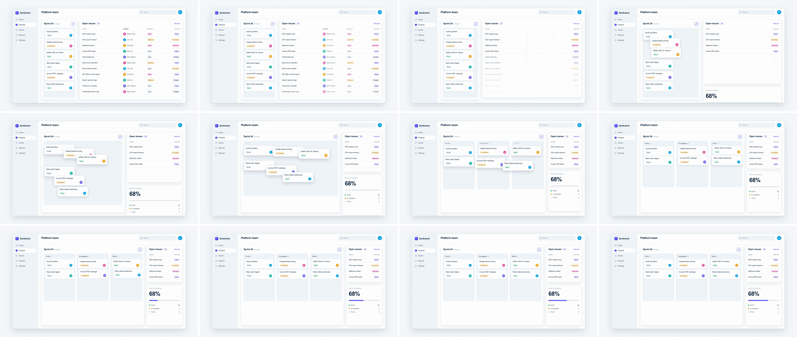

# Component Restructuring (state reflow)

The frame never cuts. The components inside it change size and position like a responsive layout: one gives up space, its neighbour takes it, and the content inside each re-lays itself out. Neighbours share their moving edges and one ease, so the 24px gutter between the board and the right-hand column never changes width. That tells the viewer "same product, new arrangement": the content they were reading is still there, rearranged for a new task.



## Use it when

- Switching views of the same data: list → board, table → widget, chart → KPI tile.
- Opening a mode that rebalances the screen: focus mode, a details panel pushing the list aside, or a sidebar collapsing to a rail.
- Selling flexibility: "customise your dashboard", "works at any size".
- Use [shared-element](../shared-element/SKILL.md) to follow one object while everything around it changes. Use [bento-cascade](../bento-cascade/SKILL.md) when a whole grid re-tiles and there is no clear giver and taker.

Avoid it when scene B is a different screen. Reflow implies the same content persists. Use [cursor-click-expand](../cursor-click-expand/SKILL.md) or [ui-deep-zoom](../ui-deep-zoom/SKILL.md) to navigate somewhere new.

## Anatomy (30fps)

| Beat | Frames | What happens |
| --- | --- | --- |
| Telegraph | −14 → 0 | A ring pulses off the board's expand control. At −7 the control presses (scale 0.9 yoyo, 6f) and tints indigo. |
| Drop | −2 → 6 | The table fades out the Owner and Priority columns by f3, before the right-anchored Status column slides over them. Rows 5–11 fade out bottom-up by f6, so the rising bottom edge never slices text. |
| Reflow | 0 → 18 | Board width 348 → 996. Table x +648, width 996 → 348, height 780 → 360. All of it runs on one ease: 25% by f3, 88% by f9, 3.7% overshoot at f14, settled at f18. The board-to-table gutter stays 24px throughout. Columns 2 and 3 slide out from under column 1. The progress card rides up from below the window edge on the table's x, width and bottom edge, so both right-column cards share a left edge every frame. It starts 8px low so nothing shows at f0; that extra gap closes by f9. |
| Lanes | 4.5 → 19.5 | The columns shorten 680 → 460 on the same ease, 0.15s late, so their bottom edge never passes a ticket still leaving the lower slots. |
| Re-deal | 1 → 21 | Each ticket flies to its status column, staggered 0.025s (0.75f), 16.5f each. Each lifts to 1.04 scale with a deeper shadow mid-flight, then sets down with the same overshoot. The last one lands at f21. |
| Land | 9 → 38 | Column titles drop in (f9–22) and the progress bar fills to 68% (f17–38). |

## Build it

Structure: one `.scene` and no second scene. Both components are absolutely placed in app pixels and animated on real `width`/`height`/`x`. Their children are anchored with `left`/`right` so they re-lay themselves out instead of stretching. Tickets sit in their A slots and move by hard-coded deltas.

```js
const T = 1.6, D = 0.6;                       // containers 18f; tickets trail to T + 0.7
const SHIFT = 996 - 348;                      // the gutter travels 648px right
const TABLE = { a: { width: 996, height: 780 }, b: { width: 348, height: 360 } };
const COL = 324;                              // column pitch: 308 + 16 gap
const MOVES = [[0, 40], [COL, -62], [2 * COL, -164], [0, -164], [COL, -266], [2 * COL, -368]]; // A slot -> B column
const REST = "0 1px 2px rgba(10, 37, 64, 0.06)", LIFT = "0 14px 32px rgba(10, 37, 64, 0.16)";

// One spring for everything: back.out(1) on a p^1.5 clock (soft first frame, 3.7% overshoot, settles at p = 1).
const backOut = gsap.parseEase("back.out(1)");
const reflow = (p) => backOut(Math.pow(p, 1.5));
const ir = { immediateRender: false };

// Same ease + duration on both neighbours, so the gutter between them is exact every frame.
tl.fromTo("#board", { width: 348 }, { width: 996, duration: D, ease: reflow, ...ir }, T);
tl.fromTo("#table", { x: 0, ...TABLE.a }, { x: SHIFT, ...TABLE.b, duration: D, ease: reflow, ...ir }, T);
tl.fromTo("#col2", { x: 0 }, { x: COL, duration: D, ease: reflow, ...ir }, T);
tl.fromTo("#col3", { x: 0 }, { x: 2 * COL, duration: D, ease: reflow, ...ir }, T);
// Lanes fit two tickets in B; trail 0.15s so the rising bottom edge clears the last tickets out.
tl.fromTo(".col", { height: 680 }, { height: 460, duration: 0.5, ease: reflow, ...ir }, T + 0.15);
// Next item in the right-hand column, docked on both axes: the table's x and width, riding its bottom edge.
// +8 keeps it fully under the window clip at T; the extra gap is gone by f9.
tl.set("#progress", { opacity: 1 }, T);
tl.fromTo("#progress", { x: -SHIFT, width: TABLE.a.width, y: TABLE.a.height - TABLE.b.height + 8 },
  { x: 0, width: TABLE.b.width, y: 0, duration: D, ease: reflow, ...ir }, T);

// Drop what the narrow layout can't hold before the moving edges reach it.
tl.fromTo("#table .mid", { opacity: 1 }, { opacity: 0, duration: 0.18, ease: "power2.out", ...ir }, T - 0.08);
tl.fromTo("#table .extra", { opacity: 1 }, { opacity: 0, duration: 0.2, stagger: { each: 0.015, from: "end" }, ease: "power2.out", ...ir }, T - 0.08);

MOVES.forEach(([dx, dy], i) => {
  const at = T + 0.03 + i * 0.025;
  tl.fromTo(`#tk${i + 1}`, { x: 0, y: 0 }, { x: dx, y: dy, duration: 0.55, ease: reflow, ...ir }, at);
  tl.fromTo(`#tk${i + 1}`, { scale: 1, boxShadow: REST }, { scale: 1.04, boxShadow: LIFT, duration: 0.22, ease: "power2.out", yoyo: true, repeat: 1, ...ir }, at);
});
tl.fromTo(".col-title", { opacity: 0, y: -6 }, { opacity: 1, y: 0, duration: 0.35, stagger: 0.04, ease: "power2.out" }, T + 0.3);
```

The full working composition is in [demo.html](demo.html).

## Tuning

- **Overshoot (`back.out(s)`).** s = 0.8 gives 2.3% overshoot, 1.0 gives 3.7% and 1.2 gives 5.3%. Above about 5% the containers wobble and it reads as bouncy rather than a layout settling.
- **Clock exponent (`p^1.5`).** At 1, back.out jumps to 21% on frame 1 (5% with p^1.5) and the move pops. At 2 the start goes soft, but the overshoot drifts late and the move feels lazy.
- **Duration.** 0.5–0.7s for the containers. Below 0.45s the tickets' paths are unreadable. Over 0.8s it reads as an animated resize, not a reflow.
- **Ticket stagger.** 0.02–0.04s. Past 0.05s the last ticket lands after the board has settled and reads as a second beat.

## Pitfalls

- **Fading the newcomer in.** An opacity fade on the progress card ghosted "68%" over white for about 4 frames. Revealing it from under the shrinking table showed a blank card for 3 frames. Dock it to the edge that is moving instead, so it travels like the next item in a flex column.
- **`scale` instead of `width`/`height`.** Scaling stretches the borders, the radius and the text. Animate the real box and anchor the children to its edges.
- **Separate eases for neighbours.** If the board and the table use different curves, the gutter between them breathes, and they collide or open a gap during the overshoot. Give every container one shared ease and duration.
- **Docking on one axis only.** The progress card rode up with the table's bottom edge but kept its own left edge, so the right column stacked a wide table over a narrow card (f2–f10), and the board's overshoot ran within 2px of the card at f14. Dock the newcomer on both axes: the same x and width tween as the item above it.
- **Resizing the columns.** Columns that grow with the board squash the ticket text. Fixed 308px columns slide out from under column 1 instead. The trade-off: they read as one grey slab until about f11, when the gaps open. Their height can shrink, but late: started on T, the lane's bottom edge rose 38px past tk6 at f5.
- **Edge-anchored content colliding.** When the card narrows, the right-anchored Status pill slides over the middle columns by about f3. Fade those columns out from −2f. Rows below the target height get sliced mid-glyph by the rising `overflow: hidden` edge, so fade them out bottom-up first.
- **Parked elements peeking out.** Docked exactly, the progress card's top 8px sits inside the window in A. Keep it at `opacity: 0` until `T`, and start its rise 8px lower, or that strip pops in on f0.

## Variants

- **Panel push.** A details drawer grows from 0 width at the right and pushes the list narrower. It uses the same shared ease, with the list dropping columns first.
- **Focus mode.** The nav sidebar collapses to a 72px icon rail while the canvas grows. Fade the nav labels out the same way as Owner and Priority here.
- **Chart → KPI.** A wide chart card shrinks into a stat tile while a table expands beneath it. Drop the axis and legend first.
- **Return trip.** Play it B → A with the same ease, so the widget grows back into the table.

## Sound

A soft slide whoosh peaking around f8, a click on the −7f press, and light card-shuffle ticks from f14 to f21 as the tickets set down.
