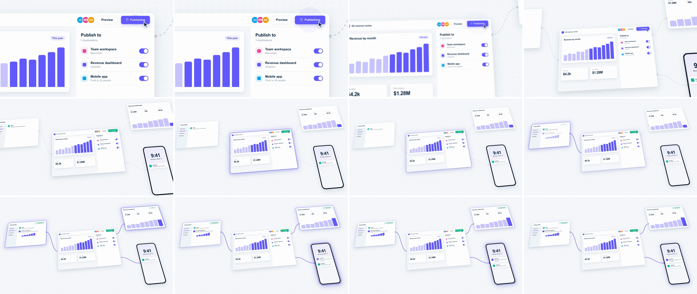

# Contextual Pullback (zoom-out reveal)

It opens tight on a single control, such as a Publish, Deploy or Send button. After the press, the camera pulls back in log space and tilts the world into a 2.5D plane. The click turns out to be one screen in a network: wires light up from it, and each connected surface flips to its new state as the camera settles. It says "this one action reaches all of this." It is the reverse of [ui-deep-zoom](../ui-deep-zoom/SKILL.md).



## Use it when

- One action fans out: publish → workspace, dashboard and phone; deploy → regions; send → every inbox.
- You need the return trip after a [ui-deep-zoom](../ui-deep-zoom/SKILL.md) dive, to put the detail back in context.
- Closing a feature segment by showing where it sits in the product's ecosystem.

Avoid it when there's nothing connected to reveal. A pullback onto empty canvas reads as a lost camera. To travel *between* surfaces, use [infinite-canvas-pan](../infinite-canvas-pan/SKILL.md). To show stacked layers of one system, use [isometric-stack-explosion](../isometric-stack-explosion/SKILL.md).

## Anatomy (30fps)

| Beat | Frames | What happens |
| --- | --- | --- |
| Telegraph | −7 → 0 | The cursor is already on the button. It dips (scale 0.95, 2×0.08s yoyo), a ripple expands, and at −5 the label swaps to "Publishing" with a spinner. |
| Snap back | 0 → 8 | `.cam` scales 2 → 0.54 in **log space** with `power4.out` on the exponent, so 80% of the zoom (in log terms) is done by frame 8. x/y use the same ease, so the button travels in a straight line. Screen-space blur ramps to 3px by frame 2 and clears by frame 11. |
| Tilt | 0 → 24 | `rotationX` 0 → 22° on `.cam` and a −5° roll on the inner `.world`, both on `power3.out`. That ease is a little slower than the scale, so the 2.5D angle keeps arriving after the zoom has mostly settled. |
| Origin lights | 8 | The button turns green with "Published", and a ring flashes around the editor. |
| Wires carry it | 10 → 22 | Each wire draws on from the editor (`power2.in`, 7f), staggered by 3f. When a wire arrives (frames 16, 19, 22), its surface's ring flashes, a "Published" pill pops (`back.out(2)`) and its content updates: a new message, the Q3 bar, a push notification. |
| Settle | 24 → 45 | The camera is at rest. Pills finish by frame 35 and the rings fade out by frame 45. |

## Build it

Structure: one world. `#s1` (`perspective: 1500px`, carries `filter`) › `.cam` (x/y/scale/rotationX) › `.world` (roll) › a dot-grid floor, the wire SVG and the surfaces. All of it uses 3840×2160 world px, and `transform-origin` is the button center on both layers.

```js
const T = 1.15, D = 0.8;
const B = { x: 2402, y: 768 };                 // #publish center in world px; also .cam/.world transform-origin
const S0 = 2, S1 = 0.54;                       // macro on the button -> wide shot (3.7x)
const START = { x: 1500 - B.x, y: 220 - B.y }; // pins the button at screen (1500, 220)
const END = { x: -1182, y: -396 };             // centers the layout under the tilt; tune by eye
const TILT = 22, ROLL = -5;

const E = gsap.parseEase("power4.out");
const logPull = (p) => (S0 * Math.pow(S1 / S0, E(p)) - S0) / (S1 - S0); // scale = S0 * (S1/S0)^E(p)

tl.set(".cam", { x: START.x, y: START.y, scale: S0 }, 0);
tl.to("#publish", { scale: 0.95, duration: 0.08, ease: "power2.out", yoyo: true, repeat: 1 }, 0.93);

tl.to(".cam", { scale: S1, duration: D, ease: logPull }, T);
tl.to(".cam", { x: END.x, y: END.y, duration: D, ease: "power4.out" }, T);
tl.to(".cam", { rotationX: TILT, duration: D, ease: "power3.out" }, T);  // trails the scale slightly
tl.to(".world", { rotation: ROLL, duration: D, ease: "power3.out" }, T); // inner layer: turns the table, not the camera
tl.fromTo("#s1", { filter: "blur(0px)" }, { filter: "blur(3px)", duration: 0.08, ease: "power1.out" }, T);
tl.to("#s1", { filter: "blur(0px)", duration: 0.3, ease: "power2.out" }, T + 0.08);
tl.set("#s1", { filter: "none" }, T + 0.4);

// Wires are <path pathLength="1"> with stroke-dasharray: 1, so drawing on needs no getTotalLength().
const sats = [
  { wire: "#w0", node: "#n0", ring: "#lit-ws", pub: "#ws .pub" },
  { wire: "#w1", node: "#n1", ring: "#lit-dash", pub: "#dash .pub" },
  { wire: "#w2", node: "#n2", ring: "#lit-ph", pub: null },
];
sats.forEach((s, i) => {
  const tw = T + 0.32 + i * 0.09, tp = tw + 0.22; // wire starts / wire arrives
  tl.fromTo(s.wire, { strokeDashoffset: 1 }, { strokeDashoffset: 0, duration: 0.24, ease: "power2.in" }, tw);
  tl.fromTo(s.node, { opacity: 0 }, { opacity: 1, duration: 0.06 }, tp);
  tl.fromTo(s.ring, { opacity: 0 }, { opacity: 1, duration: 0.08 }, tp);
  tl.to(s.ring, { opacity: 0, duration: 0.7, ease: "power2.out" }, tp + 0.08);
  if (s.pub) tl.fromTo(s.pub, { scale: 0.5, opacity: 0 }, { scale: 1, opacity: 1, duration: 0.45, ease: "back.out(2)" }, tp);
});
```

The full working composition is in [demo.html](demo.html).

## Tuning

- **Duration.** 0.7–1.0s. Below 0.6s the tilt doesn't register and it reads as a plain zoom-out.
- **Zoom ratio (`S0 / S1`).** 3–4×. This demo authors the world at about 1.85× the wide shot, so the macro frame renders at 2× and the wide shot at 0.54×.
- **Curve.** `power4.out` on the exponent is a confident snap. `expo.out` is harder: its first frame covers a quarter of the zoom. `power3.out` is calmer.
- **Tilt and roll.** `rotationX` 18–24° with `perspective` 1200–1800px. Roll −3° to −7°. Steeper tilts foreshorten the far surfaces, so check that their text still reads in the wide shot.
- **Stagger.** 0.08–0.12s between surfaces. The last one should light within about 0.1s of the camera coming to rest.

## Pitfalls

- **Tilt on an in-out ease.** The first build used `power3.inOut` for the tilt. It barely moved while the zoom snapped back, so the move read as a zoom-out followed by a separate tilt. Give the tilt the same decelerating shape as the scale, just a little softer.
- **Perspective is in screen px.** The scale lives on `.cam`, so at 0.54× a 20° tilt under `perspective: 2000px` barely converges. 1500px with 22° gives the plane a visible vanishing direction.
- **Roll on the same element as the tilt.** GSAP writes `rotate()` before `rotateX()`, so a roll on `.cam` tilts the horizon (a dutch angle). Put the roll on an inner layer, and the tilted plane itself turns.
- **Satellites in the macro frame.** At `S0 = 2` the opening frame only shows a 960×540 world rect around the button (here x 1652–2612, y 658–1198). Keep the other surfaces outside it, and keep every text run either fully inside or fully outside, because a word cut by the frame edge looks like a layout bug. One stub of dashed wire showing at the edge works well as a hint.
- **Cursor tip offset.** The kit cursor's tip sits at (8, 4) in its 40px box. The first draft placed the box at the button and the tip landed 76px below it.
- **Linear scale.** The same Δscale is a much bigger visual change at 0.6× than at 2×, so tweening `scale: 2 → 0.54` directly makes the settle drift instead of land. Tween the exponent instead.

## Variants

- **Round trip.** Use [ui-deep-zoom](../ui-deep-zoom/SKILL.md) into a detail, then contextual pullback back out to the network. Reuse the same pivot so the button comes home.
- **Device fan-out.** Make the satellites a laptop, a tablet and a phone, then continue with [device-to-canvas-wrap](../device-to-canvas-wrap/SKILL.md).
- **Iso board.** Tilt to 50–55° with a 45° roll for a full isometric map. This bridges into [isometric-stack-explosion](../isometric-stack-explosion/SKILL.md).

## Sound

A click on the press at −7, a reverse air whoosh peaking around frames 3–5, and three rising soft ticks on the surface lights at frames 16, 19 and 22.
