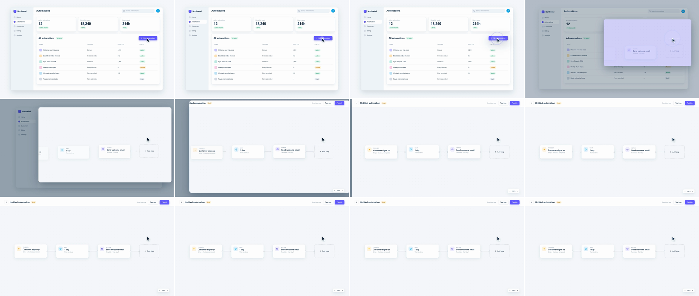

# Cursor-Triggered Expansion (click-to-expand, container transform)

A cursor arcs across scene A, presses a button, and on release the button's shape grows out of its own box like an opening modal. It keeps growing past the frame edges, and its surface becomes scene B. Scene A dims and drops back behind it. The viewer learns the UX ("click here") and why the scene changed ("this is what that button opens") at the same moment.



## Use it when

- One click starts a flow: "New automation", "Create project" or "Connect integration" opens a builder, wizard or editor.
- You're teaching the product. The cursor shows where to click, so the cut doubles as a tutorial beat.
- The button and scene B are cause and effect. If scene B isn't what the button opens, the click reads as a fake.
- Pair with [shared-element](../shared-element/SKILL.md) when one object has to persist through the next cut, or with [dropdown-accordion-wipe](../dropdown-accordion-wipe/SKILL.md) for a second UI-led cut.

Avoid it for chapter breaks, and don't use it at every cut: a click on every scene change starts to feel like a tic. If there's no cursor in the story, use [container-mask-expand](../container-mask-expand/SKILL.md) to open a card, or [ui-deep-zoom](../ui-deep-zoom/SKILL.md) to dive into a button.

## Anatomy (60fps)

| Beat | Frames | What happens |
| --- | --- | --- |
| Pre-roll | −54 → −18 | The cursor arcs from the table up to the button on one quadratic Bézier, with `power3.inOut` along the curve. It accelerates out of rest and decelerates onto the label. |
| Press | −12 → −6 | After a 6f dwell, the button scales to 0.96 and the cursor to 0.9 about its tip (`power2.out`). |
| Release | −6 → 0 | Both return to 1. A ripple (white fill, indigo ring) fires from the tip and runs 18f, scale 0.3 → 3.2, fading out. |
| Grow | 0 → 30 | The `clip-path` box grows from the button's exact rect to 40px past every frame edge (`power2.out`, about 19% of the travel by f2: 212×48 → 547×255). Its corner radius opens from 10 to 28, and a drop shadow lifts it. Builder content scales 0.94 → 1 about the click column at y = 0, so the top bar stays put while the card's top edge passes it. |
| Fill fade | 2 → 8 | On f1–f2 the card is solid button indigo with the label still on it. The indigo fades out over f2 → f8, with the builder already showing through. |
| Backdrop | 0 → 30 | Scene A scales to 0.95 over the grow, and a scrim rises to 0.45 over the first 18f. |
| Cover | ~22 | The card's left edge, the one with the farthest to travel, clears the frame (measured in the render). At f30, scene A is hidden and the shadow is removed. |
| Land | 0 → 36 | The flow builds outward from the cursor, so the growing card reads as the builder, not a blank modal. "Add step" (under the cursor) fades up from 0.3 opacity at f0, the nodes rise in right to left from f2 (`back.out(1.2)`, 0.06s stagger, from 0.3 opacity), and the links draw from f6. By f4 the email node and "Add step" are legible inside the card. |
| Follow-through | 60 → 96 | The cursor arcs on to "Add step", which takes its hover state at f90. The lesson carries on past the cut. |

## Build it

Structure: `#s1` (`.cam` + `.scrim`) · `#s2` (`filter: drop-shadow`) › `.sheet` (`clip-path` starts at the button rect) › `.content.cam` (scene B) + `.fill` (button indigo + ghost label) · `#ripple` and `#cursor` at root level, above both scenes.

```js
const T = 1.8, D = 0.5;                          // T = release: the card grows on mouse-up
const BTN = { x: 1530, y: 398, w: 212, h: 48 };  // button rect in scene px; hard-code it, don't measure
const CLICK = { x: 1625, y: 424 }, REST = { x: 880, y: 720 }, C1 = { x: 1060, y: 360 };
const OVER = 40;                                 // end past the frame so edges don't crawl on the ease tail
const EXPAND = "power2.out";                     // GSAP power2 = cubic: ~19% of the travel by f2
const inset = (t, r, b, l, rad) => `inset(${t}px ${r}px ${b}px ${l}px round ${rad}px)`;

// One Bézier parameter drives both axes, so x and y trace a single curve.
const glide = gsap.parseEase("power3.inOut");
const arc = (a, c, b) => (p) => { const s = glide(p); return (2 * s * (1 - s) * (c - a) + s * s * (b - a)) / (b - a); };

tl.fromTo("#cursor", { x: REST.x }, { x: CLICK.x, duration: 0.6, ease: arc(REST.x, C1.x, CLICK.x), immediateRender: false }, T - 0.9);
tl.fromTo("#cursor", { y: REST.y }, { y: CLICK.y, duration: 0.6, ease: arc(REST.y, C1.y, CLICK.y), immediateRender: false }, T - 0.9);
tl.to("#btn", { scale: 0.96, duration: 0.1, ease: "power2.out" }, T - 0.2);
tl.to("#cursor", { scale: 0.9, duration: 0.1, ease: "power2.out" }, T - 0.2); // CSS transform-origin = the tip
tl.to(["#btn", "#cursor"], { scale: 1, duration: 0.1, ease: "power2.out" }, T - 0.1);
tl.fromTo("#ripple", { scale: 0.3, opacity: 1 }, { scale: 3.2, opacity: 0, duration: 0.3, ease: "power2.out", immediateRender: false }, T - 0.1);

tl.set("#s2", { opacity: 1 }, T);
tl.fromTo("#s2 .sheet",
  { clipPath: inset(BTN.y, 1920 - BTN.x - BTN.w, 1080 - BTN.y - BTN.h, BTN.x, 10) },
  { clipPath: inset(-OVER, -OVER, -OVER, -OVER, 28), duration: D, ease: EXPAND }, T);
tl.fromTo("#s2 .ghost", { opacity: 1 }, { opacity: 0, duration: 0.1, ease: "power1.in" }, T);
tl.fromTo("#s2 .fill", { opacity: 1 }, { opacity: 0, duration: 0.1, ease: "power1.out", immediateRender: false }, T + 2 / 60);
tl.fromTo("#s2 .content", { scale: 0.94, transformOrigin: `${CLICK.x}px 0px` }, { scale: 1, duration: D, ease: EXPAND }, T); // y=0 pins the top bar

tl.fromTo("#s1 .cam", { scale: 1, transformOrigin: `${CLICK.x}px ${CLICK.y}px` }, { scale: 0.95, duration: D, ease: EXPAND }, T);
tl.fromTo("#s1 .scrim", { opacity: 0 }, { opacity: 0.45, duration: D * 0.6, ease: "power2.out" }, T);
tl.set("#s1", { visibility: "hidden" }, T + D);
tl.set("#s2", { filter: "none" }, T + D);        // the shadow is off-screen now; stop paying for the filter

// Build outward from the click (right to left), so content is inside the card while it is still small.
tl.fromTo("#add", { opacity: 0.3, scale: 0.96 }, { opacity: 1, scale: 1, duration: 0.45, ease: "power3.out" }, T);
tl.fromTo("#s2 .node", { y: 30, scale: 0.96, opacity: 0.3 }, { y: 0, scale: 1, opacity: 1, duration: 0.45, stagger: { each: 0.06, from: "end" }, ease: "back.out(1.2)" }, T + 0.03);
tl.fromTo("#s2 .link", { scaleX: 0, transformOrigin: "0% 50%" }, { scaleX: 1, duration: 0.3, stagger: { each: 0.06, from: "end" }, ease: "power3.out" }, T + 0.1);
```

The full working composition is in [demo.html](demo.html).

## Tuning

- **Expansion.** 0.4–0.6s. `power2.out` (GSAP's cubic) reads as a modal opening. `power3.out` (quartic) puts about 24% of the travel by f2, so the card jumps from button size to 643×316 and reads as a pop. `expo.out` is snappier still and creeps at the end, so raise `OVER` with it.
- **`OVER`.** 24–60px, and at least the end corner radius. Too small and the rounded corners and edges hang in frame for the last third of the move.
- **Fill fade.** 4–8f, starting on f2. With no fill at all, the shape reads as a white rectangle wiping in and loses the button. A longer fade leaves a large lavender card on screen.
- **Backdrop.** Scrim 0.3–0.5, scene A scale 0.94–0.97. Past that, scene A reads as a second camera move competing with the card.
- **Pre-roll.** 0.5–0.8s, then a 4–8f dwell before the press. Move the Bézier control point off the straight line by about a third of the distance. Mouse paths are never straight.

## Pitfalls

- **Button near the frame edge.** In the top bar (95px from the top, 213px from the right), the card could only grow left and down. Its top and right edges were gone by about f14, and the growth read as a wipe from the corner. Put the button where all four edges stay visible for most of the growth (here, the list header).
- **Ripple that disappears or lingers.** An indigo ripple on an indigo button is invisible. Use a white fill for the button and an indigo ring for the card around it. At 0.4s it left a grey ring on the white card at f8. Keep it to 18f.
- **Box shadow inside a clip.** `clip-path` cuts off the card's own `box-shadow`. Put `filter: drop-shadow` on the unclipped parent (`#s2`), and remove it once the card fills the frame.
- **Cursor hotspot.** The kit arrow's tip is at (8, 4) in a 40-unit viewBox, not at (0, 0). Offset `left`/`top` by the tip × scale and put `transform-origin` there. Otherwise the click lands about 12px off and the press scales away from the button.
- **Stacked `fromTo` on one property.** A `fromTo` renders its from-values as soon as it's created, so the cursor's later tweens would park it on the button before playback, and the ripple's `opacity: 1` would leave a dot on the label from f0. Pass `immediateRender: false` on every later `fromTo` whose from-state must not show early.
- **Blank card mid-growth.** If scene B builds left to right after the card is already large, the first third of the growth is an empty pale rectangle and the content reads as a separate build. Start the elements nearest the click at f0, from opacity 0.3, so the card is visibly the builder while it is still small.
- **Separate eases per axis.** Different eases on `x` and `y` draw a hook, not an arc. Share one Bézier parameter, and don't use `arc()` when start equals end on an axis (it divides by `b − a`).

## Variants

- **Circular ripple takeover.** Use `clip-path: circle()` from the click point, radius 0 → the frame diagonal. It suits round buttons and FABs, and reads as Material ink.
- **Popover first.** Grow to an anchored 640×420 popover, hold for 16–20f, then continue to full frame. Use it when the menu itself is part of the lesson.
- **Return trip.** Run it in reverse from a close button: scene B shrinks back into the button that opened it. Follow it with [contextual-pullback](../contextual-pullback/SKILL.md) if the story widens out again.

## Sound

A crisp mouse click on the press (f−12), then a short soft swell that peaks around f10 as the card grows. Keep it under the click.
