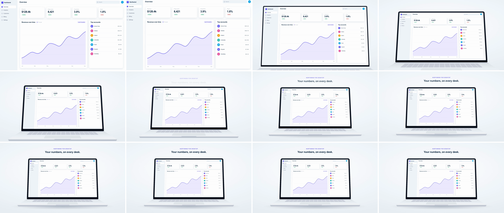

# Device-to-Canvas Wrap (screen-to-hardware pullback)

The full-bleed product UI recedes, and a laptop builds itself around it. The bezel grows outward from the UI's edges, the keyboard deck comes up from below the frame, and the lid leans back past its rest angle and settles. The UI ends up exactly in the screen. It tells the viewer that what they were just using is a real product on real hardware, and it leaves room for a line of copy.



## Use it when

- A launch or availability beat follows a UI sequence: "now on desktop", "works on every device", the end-card product shot.
- You are moving from feature detail to a brand or tagline moment. The device gives the UI context, and the space it frees up holds the headline.
- In reverse (the camera dives through the bezel), to open a demo. See Variants.
- [contextual-pullback](../contextual-pullback/SKILL.md) is the same pull-back without hardware: the camera reveals surrounding UI. [perspective-tilt](../perspective-tilt/SKILL.md) tilts a flat UI in 3D without a device.

Avoid it mid-demo when the next beat needs the UI legible. At 55% scale the small text becomes texture. Use [contextual-pullback](../contextual-pullback/SKILL.md) or [component-reflow](../component-reflow/SKILL.md) instead.

## Anatomy (30fps)

| Beat | Frames | What happens |
| --- | --- | --- |
| Wind-up | −9 → 0 | The rig dollies toward camera to an apparent 1.025× (`power2.inOut`) and comes to rest. It is still frameless and full-bleed. |
| Pull-back | 0 → 24 | The rig dollies away in z to an apparent 0.55× (`power2.out`). Measured on the render: frame 1 is already 0.92× (22% of the move), 87% is done by frame 8 and 96% by frame 12, and it settles by frame 20. |
| Wrap | 0 → 14 | The lid's `clip-path` opens from exactly the screen rect to the full lid, so the bezel, chin and camera dot grow outward from the UI's edges. The screen corners round off from 0 to 14px. |
| Deck rises | 1 → 8 | The keyboard deck sits flat, hinged at the lid's bottom edge (`rotateX(90deg)`), so it enters from below the frame as the rig recedes. Up close the perspective is wide, and it flattens as the rig settles. |
| Lean | 0 → 10 → 24 | The lid tips back 0 → 13° (`power2.out`), then settles to 8° (`sine.inOut`). This secondary motion lags the dolly and makes it read as an object with weight. |
| Land | 4 → 32 | The floor shadow fades in and widens (scaleX 0.6 → 1). The eyebrow and headline rise in from frame 9, staggered by 2f. |

## Build it

Structure: `#s1` (scene, `perspective: 2400px`, origin at the landing point) › `.rig` (`preserve-3d`, moves only in z) › `.lid` (clipped, leans) › `.screen` › the UI, authored at 1920×1080. Siblings of `.lid` inside the rig: `.deck` (`rotateX(90deg)`, hinged at the lid's bottom edge) and `.lip` (`translateZ(<deck depth>)`). The UI never moves during the transition. The device moves around it, so it stays registered to the screen on every frame.

```css
#s1   { perspective: 2400px; perspective-origin: 960px 540px; }           /* the dolly shrinks toward this point */
.rig  { position: absolute; left: 0; top: 0; width: 1920px; height: 1080px; transform-style: preserve-3d; }
.lid  { position: absolute; left: -36px; top: -36px; width: 1992px; height: 1172px; transform-origin: 50% 100%;
        clip-path: inset(36px 36px 56px 36px round 0px 0px 0px 0px); }    /* starts as exactly the screen rect */
.screen { position: absolute; left: 36px; top: 36px; width: 1920px; height: 1080px; overflow: hidden; }
.deck { position: absolute; left: -36px; top: 1136px; width: 1992px; height: 900px; transform-origin: 50% 0; transform: rotateX(90deg); }
.lip  { position: absolute; left: -36px; top: 1136px; width: 1992px; height: 34px; transform: translateZ(900px); }
```

```js
const T = 1.5, D = 0.8;
const K = 0.55;                       // landed screen scale: the 1920×1080 UI becomes a 1056×594 screen
const P = 2400;                       // #s1 perspective
const zFor = (s) => P * (1 - 1 / s);  // dolly depth at which the z=0 plane appears at scale s
const TILT = 8, TILT_PEAK = 13;       // lid lean (deg)

tl.fromTo(".rig", { z: 0 }, { z: zFor(1.025), duration: 0.3, ease: "power2.inOut" }, T - 0.3); // wind-up
tl.to(".rig", { z: zFor(K), duration: D, ease: "power2.out" }, T); // dolly, don't scale (see Pitfalls)
tl.fromTo(".lid", { clipPath: "inset(36px 36px 56px 36px round 0px 0px 0px 0px)" },
  { clipPath: "inset(0px 0px 0px 0px round 44px 44px 18px 18px)", duration: D * 0.6, ease: "power3.out" }, T);
tl.fromTo(".screen", { borderRadius: 0 }, { borderRadius: 14, duration: D * 0.6, ease: "power3.out" }, T);
tl.fromTo(".lid", { rotationX: 0 }, { rotationX: TILT_PEAK, duration: D * 0.4, ease: "power2.out" }, T);
tl.to(".lid", { rotationX: TILT, duration: D * 0.6, ease: "sine.inOut" }, T + D * 0.4); // .to, not a second fromTo

tl.fromTo(".shadow", { opacity: 0, scaleX: 0.6 }, { opacity: 1, scaleX: 1, duration: 0.7, ease: "expo.out" }, T + 0.12);
tl.fromTo(".headline > *", { y: 30, opacity: 0 }, { y: 0, opacity: 1, duration: 0.7, stagger: 0.06, ease: "expo.out" }, T + 0.3);
```

The full working composition is in [demo.html](demo.html).

## Tuning

- **Landed scale `K`.** 0.45–0.65. Lower frees room for copy. Below about 0.4 the UI stops reading as UI.
- **Perspective `P`.** 1800–3200px. Lower acts like a wider lens: more keystone, and a deck that balloons mid-move. Above about 3200px the deck flattens to a sliver and the laptop looks like a monitor.
- **Lean.** Rest 5–10° with a peak 4–6° past it. Past about 15° at rest, the screen keystones enough that the UI looks distorted.
- **Ease.** Apparent scale is `P / (P − z)`, so a z tween front-loads the shrink by itself, close to log space. `power2.out` on z already lands like `power3`/`power4` on screen: 22% of the shrink happens in frame 1. `power3.out` measured 33%, and `expo.out` is harsher still, reading as a cut.
- **Duration.** 0.7–1.0s (21–30f). The visible travel is mostly over by frame 10, and the lean settle fills the rest.

## Pitfalls

- **Scaling the rig instead of dollying it.** GSAP writes `scale(x, y)` and silently drops `scaleZ`, so depth stays full-size while width shrinks. The first render had the deck 1.43× the lid's width, reaching the bottom of the frame. Move the rig in z with `zFor(s)` and the perspective stays physically consistent.
- **Chaining `fromTo` on one property.** `fromTo` renders its start state immediately. The second lean leg's 13° start was applied from frame 0, so scene A rendered keystoned and cropped. Use `.to` for any later leg, or pass `immediateRender: false`.
- **Flying the UI into a separately placed laptop.** Two independently eased layers drift a pixel or two mid-move, and a sliver of background shows between the UI and the bezel. Parent the UI inside `.screen` and animate only the device.
- **Bezel visible at frame 0.** The lid's starting clip must equal the screen rect exactly (36/36/56/36 here), with the screen's radius at 0. Otherwise dark corners show on the full-bleed frame.
- **Grouping properties on the rig.** `opacity`, `filter`, `overflow` or `clip-path` on `.rig` flattens `preserve-3d`, and the deck collapses into the lid's plane. Clip the lid, which is flat anyway, and fade children, not the rig.

## Variants

- **Dive in (reverse).** Swap the values: z `zFor(K)` → 0, lean 8° → 0, clip back to `inset(36px 36px 56px 36px round 0px…)`, and radius 14 → 0. Use `power3.in` so it accelerates into full-bleed. All four must land on the same frame, or a bezel sliver or keystone survives into the full-bleed frame. Pair it with [ui-deep-zoom](../ui-deep-zoom/SKILL.md) to keep going into one element.
- **Phone.** Author the UI at 2× phone size (780×1688) in a `.phone`-style body, with no deck. Lean with `rotationY` (−12° → −8°) instead of `rotationX`. `K` is around 0.4.
- **Floating window to device.** Start from a rounded, shadowed window (the kit's `.app`) instead of full-bleed. The lid's starting clip then matches the window's box and radius.
- **Tablet.** Use a uniform bezel with no chin, no deck and only the floor shadow. A 4:3 UI.

## Sound

A soft air whoosh starting on frame 0 and peaking by frame 2 (fastest shrink), then a low, muted thud as the lean settles near frames 20–24.
