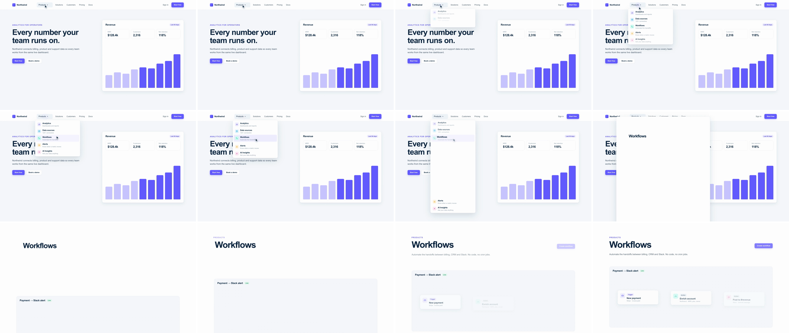

# Dropdown & Accordion Wipe (menu-to-page)

A click opens an ordinary dropdown. Then it doesn't stop: the panel's bottom edge cascades past the frame like an accordion opening under the hovered item, and its side and top edges spread until the menu surface is the whole frame. The hovered item's label grows into scene B's headline. It shows *where* a feature lives in the product and then goes there, so the viewer learns the navigation while the scene changes.



## Use it when

- A product tour moves between top-level sections: Products → Workflows, Settings → Billing, Docs → API reference.
- You want to show the breadth of a menu for a beat, then commit to one item. The menu itself is the "here's everything" shot.
- The item you pick is exactly what scene B is about. Its label has to carry over as the headline, or the wipe is just a white flash.
- Sits in the same "teach the UX" family as [cursor-click-expand](../cursor-click-expand/SKILL.md) and [toggle-theme-shift](../toggle-theme-shift/SKILL.md). Use it once per video at most.

Avoid it when scene A has no nav or menu to click, or when the next scene starts from a card already on screen. Use [container-mask-expand](../container-mask-expand/SKILL.md) for a card, or [ui-deep-zoom](../ui-deep-zoom/SKILL.md) to dive into a small control.

## Anatomy (60fps)

| Beat | Frames | What happens |
| --- | --- | --- |
| Telegraph | −54 → 0 | The cursor travels to "Products" (f−54 → −15), the trigger takes a hover fill (f−18), then an 8f press (scale 0.96 yoyo) straddles the click. |
| Open | 0 → 12 | Click ripple, chevron flips. The panel goes opaque in 1f while its bottom inset drops 996 → 640px (`power3.out`), opening a 356px menu. The five rows stagger in 0.02s apart (f0–14). The cursor slides onto Workflows (f4–18), which highlights at f12. |
| Hold | 12 → 16 | The panel's height holds at 356px for 4f while the last rows settle. This brief rest is what makes the next move read as "it kept going" rather than one long tween. |
| Cascade | 16 → 34 | The bottom inset keeps going, 640 → −168px (`power3.inOut`), past the frame edge. The rows below Workflows ride that edge down 808px on the same ease, so a gap opens under the hovered item like an accordion. The rows above lift 24px and fade (f18–30). |
| Lift | 20 → 50 | Workflows' icon, description, highlight and the cursor fade (f20–30). Its label scales 0.216 → 1 and moves to the headline position (`power2.inOut`, 30f). |
| Spread | 24 → 42 | The left, top and right insets open to −24px together and the 14px corners flatten (`power3.inOut`). The frame is covered from f38–40; scene A is hidden at f42. |
| Land | 32 → 90 | Scene B content arrives inside the surface: the workflow canvas rises on `expo.out` (f32), then the eyebrow (f40), body and nodes (f44), CTA (f48). The wires draw at f60. |

## Build it

Structure: `#s2` holds `#panel`, a clipped box whose four edges are CSS variables. Inside it, `#world` is a full-frame layer counter-positioned by the same variables, so its content stays in scene coordinates while the window grows. The menu rows and all of scene B are siblings in `#world`. Nothing is re-parented at the handoff.

```css
#panel { --l: 344px; --t: 84px; --r: 1136px; --b: 996px; /* closed: height 0 */
  position: absolute; left: var(--l); top: var(--t); right: var(--r); bottom: var(--b);
  overflow: hidden; border-radius: 14px; background: var(--surface);
  box-shadow: 0 0 0 1px var(--border), var(--shadow-lg); } /* not .dropdown: its border and padding would offset #world; border as shadow */
#world { position: absolute; left: calc(-1 * var(--l)); top: calc(-1 * var(--t)); width: 1920px; height: 1080px; }
#wf-title { font-size: 88px; font-weight: 700; letter-spacing: -0.04em; transform-origin: 0 0; } /* styled as the headline, scaled down to start */
```

```js
const T = 1.6, D = 0.7, F = 1 / 60;   // F = one frame at 60fps
const OPEN_B = 640;               // bottom inset when open: 1080 - 84 - 356
const OVER = -24;                 // final inset on the side and top edges, so the corners leave the frame
const DROP_B = OVER - 144;        // the 144px of rows riding below the bottom edge must clear the frame too
const TITLE = { x: 416, y: 242, s0: 19 / 88 }; // label in the menu (scene px)
const HEAD = { x: 160, y: 168 };               // label as scene B's headline

tl.set("#s2", { opacity: 1 }, T);
tl.fromTo("#panel", { "--b": "996px" }, { "--b": `${OPEN_B}px`, duration: 0.2, ease: "power3.out" }, T);
tl.fromTo("#panel", { opacity: 0 }, { opacity: 1, duration: F, ease: "none" }, T);
tl.fromTo(".mi", { y: -10, opacity: 0 }, { y: 0, opacity: 1, duration: 0.15, stagger: 0.02, ease: "power2.out" }, T);
tl.fromTo("#mi-wf", { backgroundColor: "rgba(238,237,255,0)" }, { backgroundColor: "rgba(238,237,255,1)", duration: 0.1, ease: "power1.out" }, T + 12 * F);

// Cascade: rows below the hinge share the bottom edge's ease, duration and distance, so they look attached to it.
tl.to("#panel", { "--b": `${DROP_B}px`, duration: 0.3, ease: "power3.inOut" }, T + 16 * F);
tl.to(".mi-low", { y: OPEN_B - DROP_B, duration: 0.3, ease: "power3.inOut" }, T + 16 * F);
tl.to(".mi-up", { y: -24, opacity: 0, duration: 0.2, ease: "power2.in" }, T + 18 * F);
// Spread starts 8f into the cascade: height leads, width follows.
tl.to("#panel", { "--l": `${OVER}px`, "--r": `${OVER}px`, "--t": `${OVER}px`, borderRadius: 0, duration: 0.3, ease: "power3.inOut" }, T + 24 * F);

tl.set("#wf-title", { scale: TITLE.s0 }, 0);
tl.to("#mi-wf", { backgroundColor: "rgba(238,237,255,0)", duration: 0.15, ease: "power1.in" }, T + 20 * F);
tl.to("#mi-wf .ic, #mi-wf .d", { opacity: 0, duration: 0.15, ease: "power1.in" }, T + 20 * F);
// Soft start: #panel clips the label, which sits only 72px inside the menu's left edge until the spread moves it.
tl.to("#wf-title", { x: HEAD.x - TITLE.x, y: HEAD.y - TITLE.y, scale: 1, duration: 0.5, ease: "power2.inOut" }, T + 20 * F);
tl.set("#s1", { visibility: "hidden" }, T + D);
tl.fromTo("#b-canvas", { y: 680 }, { y: 0, duration: 0.9, ease: "expo.out" }, T + 32 * F);
```

The full working composition is in [demo.html](demo.html).

## Tuning

- **Stage lengths.** Open 0.15–0.25s, hold 2–6f, cascade 0.25–0.35s, spread 0.25–0.35s. Keep the click-to-cover total at 0.6–0.8s. With no hold the open and the cascade merge into one slow tween and the dropdown beat disappears.
- **Overlap.** Start the spread 6–10f into the cascade. Start it at the same time and you get a growing rectangle, not a dropdown. Start it after the cascade ends and the move stalls.
- **Overshoot (`OVER`).** −16 to −32px, enough for the corner radius and the shadow to leave the frame. `DROP_B` must also cover the height of the rows riding below the edge.
- **Anchor.** A left-aligned menu spreads mostly to the right (here the right edge travels 1160px against the left's 368px). That asymmetry reads as the menu "unfolding" from its trigger. A centered mega-menu spreads evenly.
- **Ease.** `power3.inOut` on the cascade and spread. `power4.inOut` feels snappier and suits a high-energy cut.

## Pitfalls

- **Scaling the panel.** Scaling a dropdown up to full frame stretches its text and corner radius and drags the rows with it. Grow the clip window instead and keep the content in scene coordinates.
- **`clip-path: inset()` instead of a window.** It also grows a rectangle, but clip-path clips the box's own shadow, so the open menu loses its elevation and looks pasted on.
- **The headline lags the sheet.** In the first render the label grew on a slow-starting `power3.inOut` (0.55s). It was still under 40% of its final size halfway through the spread, so the growing sheet read as blank white with a tiny word on it. A `power2.inOut` starting with the row fade (f20) keeps it legible throughout.
- **The label outruns the window.** A fast-start ease (`expo.out`) on the label pushes it left past the menu's edge before the spread arrives, and `overflow: hidden` slices it. Use a soft start, or start the move with the spread.
- **Ghosting.** A 4f opacity fade on the panel left half-opaque frames with the hero text showing through. Fade it in 1f and let the rows carry the entrance. Start the row stagger at the click too, or the first open frame is an empty white box.
- **Overlapping `y` tweens.** The rows' entrance animates `y`, and so does the accordion ride. If the entrance is still running when the cascade starts, the `to` tween records a mid-entrance start value. Finish the entrance by f14.

## Variants

- **Mega-menu.** A full-width menu already touches both sides, so the wipe is only the bottom edge dropping past the frame. This is the simplest version.
- **Sidebar accordion.** A settings group in the sidebar expands downward, then sideways across the content area. Use the same window rig, anchored on the sidebar.
- **Select to screen.** A form `<select>` or command palette opens, and the chosen option becomes the next screen's title.
- **Collapse back.** Run it in reverse to return to the nav: scene B shrinks back into the menu, and the menu closes.

## Sound

A crisp UI click on f0, then a short, soft paper-slide whoosh whose peak lands on the cover frame (f40).
