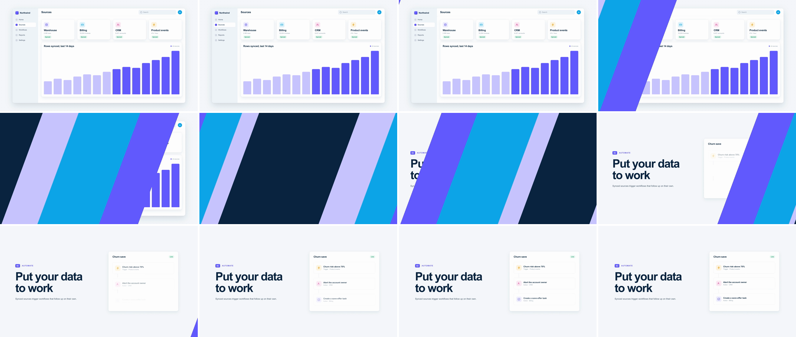

# Geometric & Brand Ribbon Wipe (brand stripe wipe)

Diagonal bands in the brand palette sweep left to right. Their leading edges cross on a stagger, so the old scene is covered band by band. The swap happens on the one frame the outermost ribbon spans the screen. Then the trailing edges cross in reverse order and uncover the new scene. Nothing from either scene carries over, so the viewer reads it as a deliberate pause: a palate cleanser that says "new chapter" in the brand's colours.



## Use it when

- A product tour changes chapter ("Connect your data" → "Automate"), and scene B is a section opener or a title card with one piece of UI.
- Two scenes share nothing that a camera move, a morph or a [shared-element](../shared-element/SKILL.md) could carry: marketing site → product, feature A → feature B.
- You want a brand beat: before the logo end card, or between a testimonial and the product.
- When the chapter title itself should carry the cut, use [kinetic-type-mask](../kinetic-type-mask/SKILL.md) or [text-split](../text-split/SKILL.md). When the app shell should stay on screen, use [border-rail-wipe](../border-rail-wipe/SKILL.md).

Avoid it between two views of the same flow (dashboard → report). The ribbons say "new section" and break the continuity, so use [ui-deep-zoom](../ui-deep-zoom/SKILL.md) instead. Use it once or twice per video at most.

## Anatomy (60fps)

Frame 0 = T = 1.5s. Every edge takes 18f to cross, on `sine.inOut`.

| Beat | Frames | What happens |
| --- | --- | --- |
| Telegraph | 0 → 4 | Indigo's leading edge eases in. The top of the edge leads by 400px, so a triangle opens in the top-left corner first and the eye goes there. |
| Cover | 0 → 18 | Leading edges start at f0 (indigo), f2 (sky), f5 (soft) and f7 (ink). Reading in from scene A, the bands are indigo, sky, soft, ink. They move fastest at f8–10, about 202px per frame. |
| Swap | 18 | Indigo's leading edge lands on the frame its trailing edge starts, so for this one instant it spans the screen. The frame shows sky, soft, a ~980px ink band, soft, sky, with ~70px indigo slivers in the top-left and bottom-right corners. `#s2` switches on and `#s1` is hidden. f16 and f20 show only a 70px corner triangle (A at bottom right, then B at top left), f17 and f19 a 17px one. |
| Uncover | 12 → 36 | Trailing edges start at f12 (ink), f13 (soft), f16 (sky) and f18 (indigo): first in, last out. Scene B opens from the top-left at f19, and reading out from it the bands are indigo, sky, soft, ink. Ink is gone by f30. The last indigo sliver eases out of the bottom-right corner at f36. |
| Land | 18 → 72 | The copy (x −90 → 0) and the flow card (−140 → 0, from f21.6) slide in the ribbons' direction on `expo.out` over 54f, as if carried by them. The nodes rise in from f25.2, 4.2f apart. |

## Build it

Structure: `#s1` and `#s2` (scenes) · `.ribbons` (on top) › four full-frame `.ribbon` solids, in DOM order bottom to top. Each ribbon is clipped to a parallelogram between two CSS variables. `--a` is the trailing edge and `--b` the leading edge, both measured at the bottom of the frame.

```css
.ribbons { position: absolute; inset: 0; z-index: 10; pointer-events: none; }
.ribbon { position: absolute; inset: 0; --a: -400px; --b: -400px;   /* both edges parked: zero area */
  clip-path: polygon(calc(var(--a) + 400px) 0, calc(var(--b) + 400px) 0, var(--b) 100%, var(--a) 100%); }
#rb-indigo { background: var(--accent); } #rb-sky { background: var(--sky); }
#rb-soft { background: #c9c6ff; } /* not --accent-soft: too pale at speed */  #rb-ink { background: var(--ink); }
```

```js
const T = 1.5, D = 0.6, F = 1 / 60;
const E = 18 * F;     // one edge crossing; the outer ribbon crosses twice, so E = D / 2
const LEAN = 400;     // the top of each edge leads its bottom by 400px (~20°); matches the CSS
// Bottom → top. in / out = frame after T where the leading / trailing edge starts. First in is last out.
const RIBBONS = [
  { el: "#rb-indigo", in: 0, out: 18 },
  { el: "#rb-sky", in: 2, out: 16 },
  { el: "#rb-soft", in: 5, out: 13 },
  { el: "#rb-ink", in: 7, out: 12 },
];
RIBBONS.forEach((r) => {
  tl.fromTo(r.el, { "--b": `${-LEAN}px` }, { "--b": "1920px", duration: E, ease: "sine.inOut" }, T + r.in * F);
  tl.fromTo(r.el, { "--a": `${-LEAN}px` }, { "--a": "1920px", duration: E, ease: "sine.inOut" }, T + r.out * F);
});

const SWAP = T + 18 * F; // indigo's in-edge lands as its out-edge starts: the only full-coverage instant
tl.set("#s2", { opacity: 1 }, SWAP);
tl.set("#s1", { visibility: "hidden" }, SWAP);
tl.fromTo("#s2 .copy", { x: -90 }, { x: 0, duration: 0.9, ease: "expo.out" }, SWAP);
tl.fromTo("#s2 .flow", { x: -140 }, { x: 0, duration: 0.9, ease: "expo.out" }, SWAP + 0.06);
tl.fromTo("#s2 .node", { y: 18, opacity: 0 }, { y: 0, opacity: 1, duration: 0.5, stagger: 0.07, ease: "power3.out" }, SWAP + 0.12);
```

The full working composition is in [demo.html](demo.html).

## Tuning

- **Duration.** 0.55–0.75s, with `E = D / 2`. Peak edge speed is `(1920 + LEAN) / E × π/2`: 202px per frame at 0.6s, 174px at 0.7s. Below 0.5s the edges pass 240px per frame and strobe.
- **Lean.** 300–500px (16–25°). The lean adds to every edge's travel, so it costs speed. Under about 250px the ribbons read as vertical bars, which looks like a blinds wipe.
- **Offsets.** Keep them uneven and 1–3f apart. The gap between a ribbon's `in` and `out` sets its width: ink's 5f makes the ~980px band at the swap. Every inner ribbon needs `out ≥ in`, and the outer one needs exactly `out = in + 18`.
- **Ribbon count.** 3–5. Every ribbon has to fit inside the outer ribbon's 18f, so a fifth ribbon squeezes the offsets toward 1f and the bands get thin.
- **Ease.** `sine.inOut` peaks at 1.57× the average speed. `power1.inOut` is 2× and `power2.inOut` is 3×. Use those only on a longer duration.

## Pitfalls

- **Moving rigid bands.** The first build translated parallelograms with `x`. To cover the frame, the ink band had to be at least 1920 + LEAN wide, and it travelled its own width plus the frame (5320px). That peaked near 885px per frame: ink was on screen for 6 frames and covered for 2. With two clipped edges, each edge crosses the frame only once (2320px).
- **GSAP `power2` is cubic.** `power2.inOut` peaks at 3× the average speed. On an 18f crossing that is about 385px per frame, against 202px on `sine.inOut`.
- **Bands of equal width.** In the first build the leading bands came out at nearly the same width, and they read as a striped flag, not as ribbons. A band's width is its offset times the edge speed, so uneven offsets (2, 3, 2f in and 1, 3, 2f out) give each band its own width.
- **Overlapping the outer ribbon's edges.** If indigo's trailing edge starts before its leading edge lands, the frame is never fully covered. Before the swap, scene A shows behind the trailing edge. After it, scene B pops into the bottom-right corner ahead of the leading edge. Keep `out = in + E` and swap at that time. Then any frame rate is safe: before `SWAP` no trailing edge has moved, and after it the leading edge has landed.
- **Scene B entering late.** The first build started the node fades 0.22s after the swap, so the trailing ribbons uncovered an empty card. Start scene B's entrance at the swap, so its content is already moving when it is uncovered.

## Variants

- **Return wipe.** Set `scaleX: -1` on `.ribbons` (and flip the sign of scene B's drift) to run it right to left when going back a chapter.
- **Vertical sweep.** Near-horizontal ribbons that rise from bottom to top. Each edge travels only 1080 + LEAN, about 35% less distance, so the wipe can drop to 0.45s without strobing.
- **Circles.** Concentric brand discs grow from a corner on the same in/out offsets (`clip-path: circle(var(--r) at 0 100%)`). Then scene B opens with its own growing circle. Good for a softer, more playful brand.
- **Brand swap.** Swap in the brand's palette, but keep one dark and one light band next to each other so the edges stay readable. Two mid-tones side by side blur together at 200px per frame.

## Sound

A layered air swish with one short transient per leading edge (f0–7), peaking on the swap at f18, and a softer tail as the trailing edges clear.
