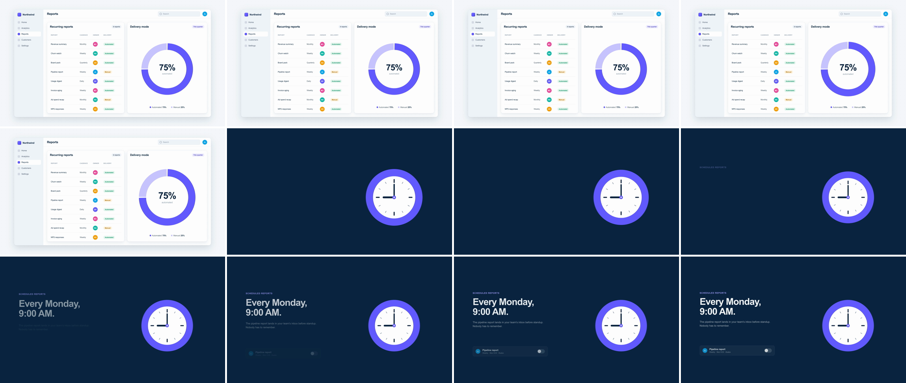

# Geometric Match Cut (graphic match cut)

Two different objects with the same silhouette sit at the same screen position and scale, and the edit swaps one for the other in a single frame. Here a donut chart pulses up and, on the peak frame, the world cuts from a light dashboard to a navy feature slide while the ring stays put and becomes a clock. The eye holds still on the shape, so the cut feels like a continuation, not a jump. It says "this idea leads straight to that one."



## Use it when

- The story jumps context but the thought carries on: "75% of reports are automated" → "schedule the rest", a revenue donut → the account owner's avatar, a progress ring → a record button.
- Cutting a montage between surfaces that don't share layout. One shared shape is enough to stitch them.
- When the match should be on movement rather than shape, use [speed-match-cut](../speed-match-cut/SKILL.md). When it is the *same* object travelling, use [shared-element](../shared-element/SKILL.md).

Avoid it when the two shapes differ in aspect or size (a wide card into a circle). Forcing it reads as a glitch. Use [ui-component-morph](../ui-component-morph/SKILL.md) or [liquid-blob-morph](../liquid-blob-morph/SKILL.md) to deform one into the other instead.

## Anatomy (60fps)

| Beat | Frames | What happens |
| --- | --- | --- |
| Establish | −96 → 0 | Dashboard cards rise in, the donut's indigo arc draws from 12 o'clock and the lavender wedge closes the ring. The eye ends on the donut, the largest shape on screen. |
| Pulse up | 0 → 12 | The donut scales 1 → 1.1 on `power2.out` around its own center. Measured outer radius: 229px at f2, 239px at f6, 242px at f10 (from 220). The pulse is the telegraph. |
| Cut | 12 | One frame. `#s1` is hidden and `#s2` is shown on the same frame (absolute frame 108, 1.8s). The clock appears at scale 1.1 with the same center (1426, 590). The ring's outer radius measures 242px on both frame 11 and frame 12. |
| Settle | 12 → 24 | The clock finishes the pulse: 1.1 → 1 on `power2.inOut`. Velocity is near zero on both sides of the cut, so the cut changes content, not geometry. |
| Build | 18 → 66 | On navy, the copy rises (`expo.out`, about 4f stagger) from f18, the schedule card from f29, and its toggle flips on at f66. The cut frame itself shows only the clock. |

## Build it

Both matched objects are direct children of their `.scene` and share one set of CSS variables, so there is no parent offset to account for. Give them identical outer geometry: here a ring with outer r 220 and inner r 164 in a 440px box. The donut's segment gaps sit at 12 and 9 o'clock, and the clock's hands point there (9:00).

```css
#root { --mx: 1426px; --my: 590px; --md: 440px; }   /* one center, one diameter, for both scenes */
.match { position: absolute; left: calc(var(--mx) - var(--md) / 2); top: calc(var(--my) - var(--md) / 2);
         width: var(--md); height: var(--md); }      /* #donut in #s1, #clock in #s2 */
#s2 { background: #0a2540; z-index: 2; }            /* the world changes; the ring color doesn't */
```

```js
const T = 1.6;          // pulse starts (frame 96 @ 60fps)
const D = 0.4;          // pulse window, 24f: 12f up in scene A, 12f settle in scene B
const CUT = T + D / 2;  // 1.8s = frame 108, the first frame of scene B
const PEAK = 1.1;       // both objects hit this scale on the cut

tl.to("#donut", { scale: PEAK, duration: D / 2, ease: "power2.out" }, T);
tl.set("#s2", { opacity: 1 }, CUT);                 // hard cut: two sets, same frame, no fade
tl.set("#s1", { visibility: "hidden" }, CUT);
// inOut, not out: zero velocity on both sides of the cut, so frames 107 and 108 are the same size.
tl.fromTo("#clock", { scale: PEAK }, { scale: 1, duration: D / 2, ease: "power2.inOut" }, CUT);

tl.fromTo("#s2 .copy > *", { y: 40, opacity: 0 }, { y: 0, opacity: 1, duration: 0.7, stagger: 0.06, ease: "expo.out" }, CUT + 0.1);
tl.fromTo("#s2 .rule", { y: 40, opacity: 0 }, { y: 0, opacity: 1, duration: 0.7, ease: "expo.out" }, CUT + 0.28);
```

The full working composition is in [demo.html](demo.html).

## Tuning

- **Peak scale.** 1.06–1.12. Below about 1.05 the pulse doesn't register at 1080p. Above 1.15 it reads as a zoom, and the cut looks like a zoom cut.
- **Pulse window.** 20–30f with the cut at the midpoint. A 10f up-stroke punches harder; keep the settle at least 12f.
- **Cut position.** On the peak gives identical geometry across the cut. Cutting 2–4f before the peak (cut on action) hides the edit more, but scene B must then start at the scale and velocity scene A had on that frame.
- **World contrast.** Change the background value (light → navy) so the edit reads as a cut, and keep the matched shape's color the same so the eye locks on it. Changing both makes it read as two unrelated shots.
- **Shared detail.** The outer silhouette must match within about 2px. Inner lines that also line up (segment gaps ↔ clock hands) turn a good match into a satisfying one.

## Pitfalls

- **Nested coordinates.** The donut card lives in `.app` (offset 120, 80 plus a 1px border), and an absolutely positioned child inside it lands 1px off from the same numbers in scene B. Put both matched objects at scene level and drive them from one set of variables.
- **Out-ease after the cut.** With `power3.out` on the settle, the ring shrinks about 5px on the first frame after the cut, against under 1px on the last frame before it, so the pulse visibly restarts. Keep velocity continuous across the cut frame.
- **The contact sheet can skip the cut frame.** Twelve tiles across 54 frames sample about every 4–5f. Confirm the last A frame and the first B frame with `ffmpeg -vf "select='between(n\,104\,112)'"`, and measure the ring edge on both.
- **White over navy.** The first build faded a white schedule card in over the navy slide, and it passed through flat grey for most of its 12-frame fade. Scene B's card is dark glass (`rgba(255,255,255,0.06)`), so its fade stays clean.
- **Too many wedges.** A donut with four or five segments has edges that point nowhere in scene B. Use two segments and put their gaps where scene B has lines.

## Variants

- **Donut → avatar.** The ring becomes a profile ring around a round avatar: "Maya owns 38% of revenue" → Maya's profile.
- **Pill match.** A pill button cuts to a toggle track or a search field of the same width and radius.
- **Tile match.** An app-icon tile cuts to a square widget on a phone, or a KPI card to a slide of the same aspect.
- **Chain.** Donut → clock → globe on successive pulses for a montage, one cut per beat. Mix it with [speed-match-cut](../speed-match-cut/SKILL.md) so it doesn't get repetitive.

## Sound

A single crisp tick (a clock tick suits this demo) landing exactly on the cut frame, f12. No whoosh: nothing moves fast enough to earn one.
