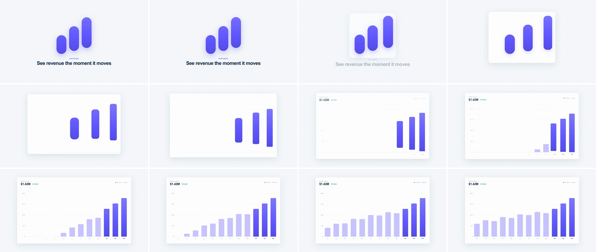

# Icon-to-Scene Morph (concept-to-UI morph)

Each part of an abstract icon becomes one concrete part of the product. In the demo, a 3-bar brand glyph's floating pills travel into a chart, slim from 132px to 72px wide, lose their pill radius and drop onto a shared baseline as the Q4 bars. The card frame unfolds from the glyph's footprint, and the nine earlier months grow in beside them. It tells the viewer that the logo is not decoration: it is the product's data.



## Use it when

- Opening on a brand mark or value-prop card and cutting straight into the product.
- The icon's parts map one-to-one onto UI parts: bars to chart bars, dots to avatars or graph nodes, a folder's tab and body to a page header and content blocks.
- The parts can stay large in scene B, at least ~60px wide, so the eye can follow them in.
- For UI that becomes other UI, use [ui-component-morph](../ui-component-morph/SKILL.md). For an organic shape, use [liquid-blob-morph](../liquid-blob-morph/SKILL.md). For AI-generated UI, use [prompt-to-ui-render](../prompt-to-ui-render/SKILL.md).

Avoid it when the parts don't map one-to-one. A forced morph reads as a gimmick. Align the silhouettes and cut with [graphic-match-cut](../graphic-match-cut/SKILL.md) instead.

## Anatomy (60fps)

| Beat | Frames | What happens |
| --- | --- | --- |
| Telegraph | −14 → 0 | The glyph squashes to 0.97 and back (yoyo) around its base, a breath before it moves. |
| Lift-off | 0 → 9 | The Dec bar leads, Nov follows at 4f and Oct at 8f. The card fades in behind the glyph as a 48px-radius tile (the glyph's box + 36px), and the value prop fades out over 9f. |
| Morph | 0 → 48 | Each bar morphs for 40f. `x` and `clip-path` share the `glide` ease, so speed peaks about 11f after each bar starts. `y` runs on the later `drop` ease, so the bars arc across and then drop onto the baseline. The pill radius goes 66px → 8/8/3/3 and the lift shadow fades out. The tile's clip opens to the full card (radius 16) over 0 → 40f and is 82% open by 20f. |
| Scaffold | 12 → 52 | Gridlines draw in from the right, baseline first (2.4f apart), inside the opening card's clip. The bars are still in flight, so they drop onto a floor that is already there. |
| Assemble | 23 → 80 | Y labels from 22.8f, header and legend from 24f, month labels from Dec back to Jan from 27f. The soft bars grow from Sep back to Jan, two frames apart, from 33f. |

## Build it

The morphing parts live in their own layer above both scenes: `#morph` (drop-shadow filter) › `#glyph` (telegraph scale) › `.gbar` × 3. Each `.gbar` is a fixed 132×500 box placed with `left`/`bottom` in CSS. Only `x`, `y` and its `clip-path` are tweened. `#s2` is transparent, and the card is `#frame-wrap` (shadow filter) › `#frame`: a full-scene white layer whose clip-path *is* the card, with the whole chart (grid, labels, soft bars) as its children so the opening clip trims them too.

```js
const T = 1.6, D = 0.8, STAG = 4 / 60, DB = D - 2 * STAG; // 48f total, 40f per bar
const FROM = [{ left: 726, bottom: 380, w: 132, h: 250 }, { left: 894, bottom: 420, w: 132, h: 330 }, { left: 1062, bottom: 460, w: 132, h: 410 }];
const TO   = [{ left: 1348, bottom: 200, w: 72, h: 360 }, { left: 1460, bottom: 200, w: 72, h: 430 }, { left: 1572, bottom: 200, w: 72, h: 500 }];
const BOX = { w: 132, h: 500 };
const shape = (w, h, r) => `inset(${BOX.h - h}px ${BOX.w - w}px 0px 0px round ${r})`; // bottom-left anchored
const PILL = "66px 66px 66px 66px", BAR = "8px 8px 3px 3px";  // same value count, or GSAP mis-pairs corners
const CARD = { left: 220, top: 110, w: 1480, h: 860 }, GLYPH = { left: 690, top: 174, w: 540, h: 562 }; // glyph bbox + 36px
const frameClip = (b, r) => `inset(${b.top}px ${1920 - b.left - b.w}px ${1080 - b.top - b.h}px ${b.left}px round ${r}px)`; // #frame is inset:0

const expoOut = gsap.parseEase("expo.out");
const glide = (p) => expoOut(p * p);     // starts from rest, peaks at ~27%, long expo settle
const drop = (p) => expoOut(p * p * p);  // y lags x, so the path arcs

tl.set("#glyph", { transformOrigin: "960px 700px" }, 0);
tl.to("#glyph", { scale: 0.97, duration: 0.12, ease: "power2.out", yoyo: true, repeat: 1 }, T - 0.24);

FROM.forEach((f, i) => {
  const to = TO[i], at = T + (2 - i) * STAG, el = `#g${i}`; // front bar (Dec) leads
  tl.fromTo(el, { x: 0, clipPath: shape(f.w, f.h, PILL) },
    { x: to.left - f.left, clipPath: shape(to.w, to.h, BAR), duration: DB, ease: glide }, at);
  tl.fromTo(el, { y: 0 }, { y: f.bottom - to.bottom, duration: DB, ease: drop }, at);
});
tl.to("#morph", { filter: "drop-shadow(0px 0px 0px rgba(99, 91, 255, 0))", duration: DB, ease: glide }, T);
tl.to("#s1 .copy", { y: 20, opacity: 0, duration: 0.15, ease: "power1.out" }, T);

tl.set("#s2", { opacity: 1 }, T);
tl.fromTo("#frame", { clipPath: frameClip(GLYPH, 48) }, { clipPath: frameClip(CARD, 16), duration: DB, ease: glide }, T);
tl.fromTo("#frame-wrap", { opacity: 0 }, { opacity: 1, duration: 0.15, ease: "power1.out" }, T);
// Inside the clipped #frame, so it can draw mid-morph without poking out of the card. Baseline first.
tl.fromTo("#s2 .grid", { scaleX: 0, transformOrigin: "100% 50%" }, { scaleX: 1, duration: 0.5, stagger: { each: 0.04, from: "end" }, ease: "expo.out" }, T + 0.2);
tl.fromTo("#s2 .bar", { scaleY: 0, transformOrigin: "50% 100%" }, { scaleY: 1, duration: 0.5, stagger: { each: 0.035, from: "end" }, ease: "power3.out" }, T + 0.55); // Sep waits for Oct to clear
tl.fromTo("#s2 .ylab", { opacity: 0, x: 8 }, { opacity: 1, x: 0, duration: 0.4, stagger: { each: 0.03, from: "end" }, ease: "power2.out" }, T + 0.38);
tl.fromTo(".months span", { opacity: 0, y: 8 }, { opacity: 1, y: 0, duration: 0.4, stagger: { each: 0.025, from: "end" }, ease: "power2.out" }, T + 0.45);
tl.fromTo("#s2 .head, #s2 .legend", { opacity: 0, y: 12 }, { opacity: 1, y: 0, duration: 0.6, stagger: 0.06, ease: "expo.out" }, T + 0.4); // clip edge has passed x 268
```

The full working composition is in [demo.html](demo.html).

## Tuning

- **Duration.** 0.7–0.9s. The parts travel about 600px and change shape at the same time. Under 0.6s the reshape blurs into a slide.
- **Arc.** `drop` uses `p³` against `glide`'s `p²`. Use `p⁴` for a more pronounced fall onto the baseline. Equal exponents give a straight diagonal.
- **Stagger.** 2–6f per part. At 0f the parts read as a single image being moved. Above 6f they read as three separate moves.
- **Frame start radius.** 40–56px makes the first frame read as an app icon, which sells the "icon" half. The card lands at the kit's 16px.
- **Contrast.** Keep the morphed parts in a different fill from the parts that materialise around them (accent vs `.bar.soft`), or the viewer loses which bars came from the icon.

## Pitfalls

- **Copy under the glyph.** Scene A's value-prop line must be gone before the card edge reaches it (about 9f at this clip speed), or it shows through as a ghost under the white card. This is the one exit fade, and it runs in the same window as the morph.
- **Tweening `left`/`bottom`/`width`/`height`.** Strict lint rejects layout motion (`gsap_non_transform_motion`), and size tweens snap to whole pixels during the expo tail. Move the part with `x`/`y` and reshape it with a `clip-path: inset(... round ...)` on a fixed box.
- **Resizing with `scaleX`/`scaleY`.** Non-uniform scale squashes a pill's round ends into ellipses. The clip-path `round` keeps the corners true at every frame.
- **Shadows vanish.** `clip-path` clips `box-shadow`. Put shadows on an unclipped parent as `filter: drop-shadow()`, which follows the clipped shape. Fade that wrapper, not the clipped child: a half-transparent white frame lets its own shadow show through as a grey tile.
- **Wrong lead.** Start the part at the front of the direction of travel first (Dec), so the gaps open in flight. If Oct led, its head start would eat the 36px gap to Nov, and the bars would overlap by about 88px at 12f.
- **Neighbours arriving into the settle tail.** With a long expo settle, Oct is still about 77px short of its slot at 30f. Soft bars that started then grew underneath it, so they wait until T+0.55. Time them against the bar positions, not by feel.
- **Scaffold outside the card.** As siblings of the card, gridlines that started before the frame's edge passed x 1644 poked outside it, which forced them to wait until the bars had landed (a blank white card for 20f). Make the chart children of the clipped frame and they can draw from T+0.2. The catch: anything inside shows up cropped if it fades in before the edge reaches it. The header at T+0.3 read "nly revenue"; at T+0.4 the edge is at x 259, left of the header's 268.

## Variants

- **Folder to wireframe.** The folder's tab clips into a page header and its body into the content block. Skeleton rows materialise inside.
- **Lock to security card.** The lock body becomes the card's status chip and the shackle stroke unbends into a toggle track. The settings rows assemble around it.
- **Dots to team.** A 3-dot logo's dots become avatar circles in a member list. Rows slide in under each one.
- **Outro lockup.** Run it in reverse to collapse the chart back into the logo for the end card.

## Sound

A soft synth swell rising from frame 0 that peaks around frame 11 (peak speed), then three quiet ticks as the bars land at 40, 44 and 48f.
