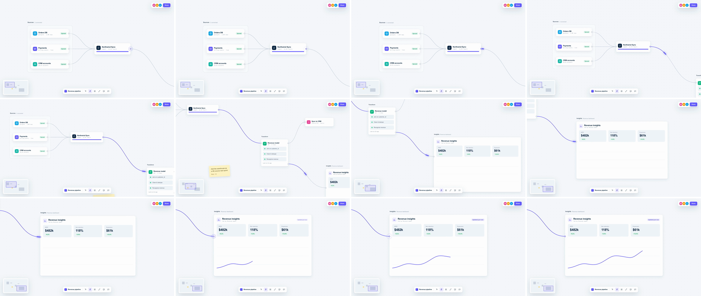

# Infinite Canvas Pan (Figma / Miro canvas glide)

Scene A and scene B are two camera positions on one oversized world, like a Figma file, a Miro board or a flow builder. The camera dollies diagonally between them on `power3.inOut` and pulls back about 12% mid-move (the "breath"), so whatever sits in between flashes past. The message is "all of this is one connected system, and it's bigger than the screen."



## Use it when

- Walking a pipeline or integration map stage by stage: sources → transform → dashboard, trigger → actions → result.
- Moving between two features that really do live on the same canvas: whiteboard, flow builder, design file, roadmap.
- Showing ecosystem scale: the in-between clusters seen mid-pan do the selling.
- For a longer hop or a harder cut use [whip-pan](../whip-pan/SKILL.md). To show the whole canvas at once, use [contextual-pullback](../contextual-pullback/SKILL.md). When the connector itself is the subject, use [path-stroke-leading](../path-stroke-leading/SKILL.md).

Avoid it when the two scenes aren't spatially related. A pan claims they sit side by side, so a pan from billing settings to a marketing headline reads as a mistake. Use [shared-element](../shared-element/SKILL.md) or [cross-dissolve](../cross-dissolve/SKILL.md) instead.

## Anatomy (60fps)

| Beat | Frames | What happens |
| --- | --- | --- |
| Telegraph | −18 → 0 | At −18 the ingest node's out port turns indigo and pings a ring, and its sync bar finishes filling at −15. At −6 a glowing packet leaves along the connector, so the eye is already moving down and to the right. |
| Pan | 0 → 60 | `#world` translates (2360, 1100) world px on `power3.inOut`. Peak speed is about 115 screen px/frame at frame 30 (3 × 2,604 / 60 × 0.88). The minimap viewport moves with the same tween. |
| Breath | 0 → 60 | `#cam` scales 1 → 0.88 → 1 around the frame center with `sin²(πp)`. The scale is lowest at frame 30, where the speed peaks. Mid-pan, the frame shows the ingest node, the Transform node, a branch node, a sticky note and the dashboard's edge all at once. |
| Lead | −6 → 51 | The packet leads the frame center until about frame 32 and dips under the Transform card. Then the camera overtakes it, and it enters the dashboard port from the left third, lighting the connector behind it. |
| Land | 51 → 114 | The packet reaches the dashboard port at 51, as the camera finishes settling (≈98% of the way at 50). The port pings, an "Updated just now" pill pops on `back.out(1.7)` at 54, the chart line draws 51 → 105 and the area fills 84 → 114. |

## Build it

Structure: `#s1` › `#cam.cam` (zoom rig, `transform-origin: 960px 540px`) › `#world` (4800×2700 `.dots`, every node placed in world px) › wires SVG + cards. The HUD (toolbar, minimap, avatars) sits in `#s1` beside `#cam`, so it stays fixed in screen space.

```js
const T = 1.5, D = 1.0;
const CAM_A = { x: 1200, y: 780 };  // world point at frame center in scene A
const CAM_C = { x: 3560, y: 1880 }; // ... and in scene B
const BREATH = 0.88;
const breath = (p) => Math.sin(Math.PI * p) ** 2; // 0 → 1 → 0 with flat ends; as a GSAP ease, scale returns to 1

// Telegraph + lead: the packet leaves 0.1s before the camera and arrives 0.15s before it settles.
tl.set("#ingest-ring", { opacity: 0.9 }, T - 0.3);
tl.to("#ingest-ring", { scale: 3, opacity: 0, duration: 0.5, ease: "power2.out" }, T - 0.3);
tl.set("#head", { opacity: 1 }, T - 0.1);
tl.to("#trail", { strokeDashoffset: 0, autoRound: false, duration: 0.95, ease: "power3.inOut" }, T - 0.1);   // pathLength="100"
tl.to("#head", { strokeDashoffset: -98, autoRound: false, duration: 0.95, ease: "power3.inOut" }, T - 0.1);  // dasharray "2 300"

// Dolly translates, zoom rig breathes around the frame center: two layers, so the breath can't bend the path.
tl.fromTo("#world", { x: 960 - CAM_A.x, y: 540 - CAM_A.y }, { x: 960 - CAM_C.x, y: 540 - CAM_C.y, duration: D, ease: "power3.inOut" }, T);
tl.fromTo("#cam", { scale: 1 }, { scale: BREATH, duration: D, ease: breath }, T);
tl.fromTo("#mm-view", { x: 0, y: 0 }, { x: CAM_C.x - CAM_A.x, y: CAM_C.y - CAM_A.y, duration: D, ease: "power3.inOut" }, T);
tl.fromTo("#mm-view", { scale: 1 }, { scale: 1 / BREATH, duration: D, ease: breath }, T);

// Landing: scene B comes alive when the data arrives.
const ARRIVE = T + 0.85;
tl.set("#dash-ring", { opacity: 0.9 }, ARRIVE);
tl.to("#dash-ring", { scale: 3.2, opacity: 0, duration: 0.55, ease: "power2.out" }, ARRIVE);
tl.fromTo("#live", { scale: 0.6, opacity: 0 }, { scale: 1, opacity: 1, duration: 0.4, ease: "back.out(1.7)" }, ARRIVE + 0.05);
tl.set("#chart-line", { opacity: 1 }, ARRIVE);
tl.to("#chart-line", { strokeDashoffset: 0, autoRound: false, duration: 0.9, ease: "power2.out" }, ARRIVE);
```

The full working composition is in [demo.html](demo.html).

## Tuning

- **Duration vs distance.** 0.9–1.1s for about 2,600 world px. With `power3.inOut` the peak speed is 3× the average, so keep the peak under about 125 screen px/frame. Past roughly 1.5 screen-diagonals, use [whip-pan](../whip-pan/SKILL.md) and its blur.
- **Breath (`BREATH`).** 0.85–0.92. Below 0.8 it reads as a pullback, not a pan. Above 0.95 it disappears and the move reads as a slide.
- **Direction.** A diagonal reads as "canvas". A purely horizontal pan reads as a carousel or [parallax-push](../parallax-push/SKILL.md). Keep at least 20° of vertical travel.
- **Ease.** `power3.inOut` by default. `power2.inOut` is calmer for long, slow tours. `expo.inOut` drifts toward a whip and needs blur.
- **Packet lead.** Start it 0.1–0.2s before the camera and land it 0.1–0.2s before the camera settles. Land it after the camera settles and the dashboard reacts late.

## Pitfalls

- **One layer for pan and zoom.** Scaling the translated world around its own origin moves the framed point, so the camera drifts off the path mid-pan. Split it: `#cam` scales around (960, 540) and `#world` only translates.
- **GSAP rounds px.** CSSPlugin's `autoRound` rounds `strokeDashoffset` to whole pixels. With `pathLength="1"` the chart line and wires popped in a single frame instead of drawing, and at `pathLength="100"` the packet moved in 1% (≈18px) steps. Pass `autoRound: false` on every dash tween.
- **`fromTo` ring pings.** A `fromTo` from `opacity: 0.9` renders its from-state from frame 0, which left a static halo on both ports until their pings. Use `tl.set` + `tl.to` at the ping time.
- **Round cap dots.** A dasharray of `1` is `1 1`, so at offset 1 the next dash starts exactly on the path end and its round cap paints a dot there. Use `1 2`, and keep the path hidden until it draws.
- **Leaky framing.** Plan world coordinates so the in-between content sits in the gap between the A and C frames (here x 2160–2600, where the Transform node sits). That way it only appears mid-pan. A branch wire first routed through scene B's top-left corner and had to move.
- **HUD inside the camera.** If the toolbar and minimap move with the world, the shot reads as a slide. The fixed screen-space HUD is what tells the viewer this is a camera.

## Variants

- **Hand-tool drag.** A hand cursor grabs the canvas at frame −12 and drags against the direction of travel. Same timing, and it teaches the gesture.
- **Pan to fit.** End at a different scale (1 → 0.75) to frame a bigger cluster. The breath becomes a one-way zoom-out on the second half.
- **Canvas tour.** Chain 2–3 pans with 0.6–0.8s holds on the same ease. Use [whip-pan](../whip-pan/SKILL.md) for the one long hop.
- **Horizontal flow.** For a strictly left-to-right pipeline, pan along the flow with a 10–15% vertical drift, so it still reads as canvas.

## Sound

Soft low-mid air whoosh, without high hiss, peaking at frame 30 with the breath trough. Add a light tick on the packet landing at frame 51.
