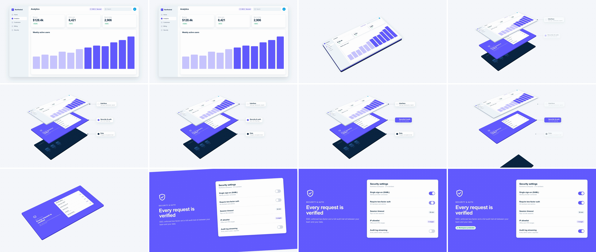

# Isometric Stack Explosion (exploded architecture view)

The front-facing screen tips back to a 55° / −45° isometric angle and turns out to be a stack of plates, which spring apart along the stack axis. The plates are the interface, the security layer and the data layer. The camera then sends the other plates off and flattens the chosen one face-on, and that plate is scene B. It says "here is what's underneath, and here is the part we're going to talk about."



## Use it when

- Explaining architecture or "under the hood": UI over auth over data, app over API over infra.
- A feature has no UI surface of its own (security, compliance, sync, infrastructure). Explode the stack, isolate that layer, and land on its settings or status page.
- Moving from the product surface to a backend story. For a lighter single-plane tilt, use [perspective-tilt](../perspective-tilt/SKILL.md). To travel through layers face-on, use [z-space-push](../z-space-push/SKILL.md).

Avoid it when the layered model adds nothing. A plain drill into one feature is [ui-deep-zoom](../ui-deep-zoom/SKILL.md), and front versus back of one thing is [card-flip-3d](../card-flip-3d/SKILL.md).

## Anatomy (30fps)

| Beat | Frames | What happens |
| --- | --- | --- |
| Telegraph | −15 → 0 | A ring pulses off the "SOC 2 · Secured" badge (growing mostly vertically, clear of the Search field), so the eye is on security before anything moves. |
| Tip | 0 → 12 | `.tilt` rotationX 0 → 55, `.spin` rotation 0 → −45, `.cam` scale 1 → 0.4 and x −170 (to make room for labels), all `power3.inOut`. The lower plates sit flush behind the top one, so mid-tilt the screen reads as one thick slab. |
| Explode | 7 → 23 | The plates spring apart along the stack axis with `back.out(1.5)` over 13.5f, staggered 0.9f: Interface z → +600 (f7–20), Security −26 → 0, Data → −600 (f9–23). About 197px apart on screen. |
| Label | 10 → 20 | Flat screen-space tags slide in 16px from each plate's right corner, staggered 1.2f. |
| Hold | 20 → 29 | All three tags are fully on screen for about 9f, and the plates are still from f23. |
| Pick | 23 → 26 | The Security tag fills indigo, showing which layer the camera is about to take. Interface and Data tags fade over f29–34. The picked tag holds at full strength until f32 and is gone by f37. |
| Part | 28 → 39 | Data drops out the bottom (z −4600, f28–35, `power2.in`) while the stack is still tilted, and is hidden once off-frame at f35. Interface flies up the axis (z +3200, f28–39, `power2.in`) and out the top, and its faces fade over f35–38. |
| Flatten | 31 → 48 | Tilt and spin return to 0 while `.cam` scales 0.4 → 1.25 and recentres (`power3.inOut`). The security plane covers the frame from f44. |
| Land | 45 → 62 | Scene B's toggles switch on, staggered 2.4f, and a "Workspace protected" pill pops in at f50. |

The whole move is 48f, which is past the house 10–20f. Each sub-move stays inside it (12f, 14f, 17f), and the stack only works with a short exploded hold where the labels can be read: about 0.3s fully labelled and 0.2s on the picked tag. The 0.4s tip is what buys that hold inside 1.6s.

## Build it

Structure: `#s1` (`perspective: 5000px`) › `.cam` (scale, x, y) › `.tilt` (rotationX) › `.spin` (rotation) › three `.layer` plates (z) › `.face` + `.edge` (`translateZ(-24px)`, a darker slab). Every wrapper and `.layer` needs `transform-style: preserve-3d`. The labels sit outside `.cam`.

```js
const T = 1.5, D = 1.6;
const ISO = { rx: 55, rz: -45, scale: 0.4, x: -170, y: -20 }; // exploded camera
const GAP = 600;   // stack spacing in local px; on screen = GAP * sin(rx) * scale = 197px
const LAND = 1.25; // 1680x920 plane covering 1920x1080 with its rounded corners off-frame

tl.set("#L-sec", { z: -26 }, 0);  // flush stack, hidden behind the face-on top plate
tl.set("#L-data", { z: -52 }, 0);

// 1. Tip. Two wrappers, because GSAP writes rotation before rotateX (see Pitfalls).
tl.to(".tilt", { rotationX: ISO.rx, duration: 0.4, ease: "power3.inOut" }, T);
tl.to(".spin", { rotation: ISO.rz, duration: 0.4, ease: "power3.inOut" }, T);
tl.to(".cam", { scale: ISO.scale, x: ISO.x, y: ISO.y, duration: 0.4, ease: "power3.inOut" }, T);

// 2. Explode. Once tilted, +z is "up the stack".
tl.to("#L-ui", { z: GAP, duration: 0.45, ease: "back.out(1.5)" }, T + 0.24);
tl.to("#L-sec", { z: 0, duration: 0.45, ease: "back.out(1.5)" }, T + 0.27);
tl.to("#L-data", { z: -GAP, duration: 0.45, ease: "back.out(1.5)" }, T + 0.3);
tl.fromTo(".tag", { opacity: 0, x: -16 }, { opacity: 1, x: 0, duration: 0.25, stagger: 0.04, ease: "power3.out" }, T + 0.34);

// 3. Hold ~0.3s, then pick, part, flatten.
tl.to("#tag-sec", { backgroundColor: "#635bff", borderColor: "#635bff", color: "#ffffff", duration: 0.1, ease: "power1.out" }, T + 0.78);
tl.to("#tag-sec .tag-sub", { color: "rgba(255,255,255,0.8)", duration: 0.1, ease: "power1.out" }, T + 0.78);
tl.to("#tag-ui, #tag-data", { opacity: 0, duration: 0.15, ease: "power1.in" }, T + 0.98);
tl.to("#tag-sec", { opacity: 0, duration: 0.15, ease: "power1.in" }, T + 1.08); // picked tag leaves last
tl.to("#L-ui", { z: GAP + 2600, duration: 0.34, ease: "power2.in" }, T + 0.95);
tl.to("#L-data", { z: -GAP - 4000, duration: 0.24, ease: "power2.in" }, T + 0.92); // out the bottom while still tilted
tl.set("#L-data", { visibility: "hidden" }, T + 1.16); // off-frame; never fade it (see Ghost plates)
tl.to("#L-ui > *", { opacity: 0, duration: 0.12, ease: "power1.in" }, T + 1.16); // fade the leaves, never the layer
tl.to(".tilt", { rotationX: 0, duration: 0.55, ease: "power3.inOut" }, T + 1.05);
tl.to(".spin", { rotation: 0, duration: 0.55, ease: "power3.inOut" }, T + 1.05);
tl.to(".cam", { scale: LAND, x: 0, y: 0, duration: 0.55, ease: "power3.inOut" }, T + 1.05);
tl.set("#L-ui, #L-data", { visibility: "hidden" }, T + D);
```

Scene B is the middle plate itself, so nothing gets swapped. Build its content for the area that is on screen at 1.25×: plane x 72–1608, y 28–892. The full working composition is in [demo.html](demo.html).

## Tuning

- **Angle.** rotationX 50–60° with rotation −45°. Use +45° to mirror the stack, and put the labels on the left. Below about 45° the plates overlap too much to read as separate. Above about 65° they collapse into slivers.
- **Spacing.** Aim for an on-screen gap (`GAP × sin(rx) × scale`) of 35–45% of one plate's projected height (197px against about 450px here). Tighter, and the lower plates disappear. Wider, and the stack outgrows the frame.
- **Perspective.** 4000–6000px keeps the look close to orthographic, which is what reads as isometric. Under about 2500px the top plate visibly outgrows the bottom one, and the stack reads as a tower in perspective.
- **Spring.** `back.out(1.3–1.8)` with a 0.03–0.06s stagger. More overshoot reads as wobble rather than plates locking into place.
- **Timing.** 1.4–1.8s total. Keep at least 0.3s of still, fully labelled stack and 0.2s on the picked tag. If the labels need longer, add hold before the Pick beat (and lengthen D) rather than slowing the moves.

## Pitfalls

- **One element can't do isometric in GSAP.** `{ rotationX: 55, rotation: -45 }` renders as `rotate(-45deg) rotateX(55deg)`: the plate tilts first and is then spun in the screen plane, so you get a tilted card turned sideways. Isometric needs Z first, then X. Nest `.tilt` (X) around `.spin` (Z).
- **Flattening the stack.** `opacity < 1`, `filter` or `overflow: hidden` on `.cam`, `.tilt`, `.spin` or `.layer` flattens everything below it into one plane, and the explosion vanishes. Fade `.face` and `.edge`, and keep effects on `#s1` or the leaves.
- **Ghost plates.** A half-faded navy plate over the light stage reads as a double exposure. Fading late doesn't save the bottom plate: once rotationX heads back to 0, −z points away from the camera, so the plate recedes toward the centre of the frame instead of leaving it, and it is not behind the security plane yet. Send Data out the bottom fast (z −4600 in 0.24s) while the stack is still tilted, hide it with `visibility` once it is off-frame, and never fade it.
- **+z changes meaning while flattening.** Once rotationX heads back to 0, "up the stack" becomes "toward the camera", so a surviving top plate swings in front of the target and fills the frame. It must reach opacity 0 before the tilt drops below about 40°.
- **Coplanar plates.** With all three plates at z 0, Chrome has to depth-sort identical planes. Start them one slab apart (−26, −52). They stay hidden behind the face-on top plate, then show as slab thickness mid-tilt.
- **Telegraph ring from frame 0.** A `fromTo` placed late in the timeline still applies its from-state (opacity 0.9) at build time, so the ring sits on the badge from the first frame. Give it `immediateRender: false`.
- **Labels on the planes.** Text on a plate shrinks to 0.4× and slopes at 30°. Keep the tags in screen space. Their positions are the plates' right corners in the exploded state, read off a still and hard-coded.

## Variants

- **Assemble (reverse).** A flat feature screen tips back, the other layers fly in and close up, and the stack flattens to the full product. Use it for "all of this ships as one app."
- **Walk the stack.** Isolate each layer in turn, with one beat per layer, before landing on the last one.
- **Deeper stacks.** Use 4–5 thinner plates (app, API, queue, storage, infra) with `GAP` about 400 and no subtitles on the tags.
- **Land on the bottom.** Isolate the Data layer instead. Both upper plates lift out together.

## Sound

A low air whoosh on the tip, three soft staggered plate clicks on each overshoot (f15–17), and a rising whoosh that peaks where the security plane covers the frame (f44). Then crisp toggle clicks on landing.
