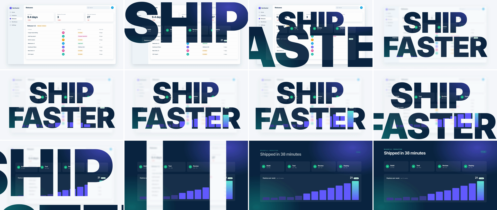

# Kinetic Typography Mask (type-window push-through)

A short claim slams onto scene A, and its letters are windows: scene B is already playing inside the type. The camera then pushes into the stem of one letter until the stem is wider than the frame, so scene B becomes the whole picture. The headline states the promise, and the push delivers the screen that proves it. The camera push alone is 21f; the first 21f are the slam and the hold.



## Use it when

- Opening a chapter with a 1–3 word claim ("SHIP FASTER", "ZERO SETUP") and cutting straight to the screen that proves it.
- Launch or hero moments, where the copy is the beat and the product is the payoff.
- Scene B has live, colourful content (charts, status checks) that lines up with the letter areas, so the letters read as windows.
- For a calmer copy-led cut, use [text-split](../text-split/SKILL.md). For the same log-space push into a UI element instead of a letter, use [ui-deep-zoom](../ui-deep-zoom/SKILL.md).

Avoid it for copy longer than about 3 words, or when it would be the third type moment in a short video. Use [container-mask-expand](../container-mask-expand/SKILL.md) to reveal through a UI panel instead.

## Anatomy (30fps)

| Beat | Frames | What happens |
| --- | --- | --- |
| Slam | 0 → 5, 4 → 9 | "SHIP", then "FASTER" 4f later, appear fully opaque at 2× and drop to 1× (`power1.in`), each with a 0.985 give (2f + 2f). Scene B switches on at frame 0, but only inside the letters. |
| Knock-back | 5 → 19 | On the first impact, scene A scales to 0.94, blurs 10px and gets a 55% `--bg` veil (`power3.out`). It becomes a quiet backdrop. |
| Hold | 9 → 21 | Scene B moves inside the type: bars grow (frames 6 → 31) and the UI slides up 60px. The type creeps 1 → 1.04× around the I stem (`sine.in`), aiming the push. |
| Push | 21 → 42 | The mask scales 1.04 → 28.7× around the I stem in **log space** (`power2.in` on the exponent, which is cubic) and pans the stem to frame center (`power2.inOut`). H and P stems fly past. Scene B only drifts 0.88 → 1 (far plane). Edge blur ramps 0 → 8px over frames 32 → 42. |
| Cover | ~41.4, 42 | The stem's width passes 1920px at frame 41.4 (frame 41 is the last with slivers of scene A). At frame 42 the mask goes solid and scene A is hidden. |
| Land | 40 → 58 | Scene B's headline rises 40px and fades in (`expo.out`), and the Live pill pops (`back.out(1.6)`). Scene B keeps settling to 1× until frame 55. |

## Build it

Structure: `#s2` (scene B, above scene A) carries `mask: url(#type-mask)`. In the SVG `<mask>`, `#push-pan` (translate only, carries the blur filter) wraps `#push-zoom` (scale only), which holds one `<g>` per word with white `<text>`. A full-frame `#mask-fill` rect sits at opacity 0.

```html
<mask id="type-mask" maskUnits="userSpaceOnUse" maskContentUnits="userSpaceOnUse" x="0" y="0" width="1920" height="1080">
  <g id="push-pan" filter="url(#edge-blur)"><g id="push-zoom">
    <g id="w1" opacity="0"><text x="456.6 738.6 1057.6 1174.7" y="510">SHIP</text></g>  <!-- Inter 900, 440px, fill #fff -->
    <g id="w2" opacity="0"><text x="133.2 339.2 665.5 943.2 1234.3 1492.9" y="890">FASTER</text></g>
  </g></g>
  <rect id="mask-fill" width="1920" height="1080" fill="#fff" opacity="0" />
</mask>
```

```js
const T = 1.4, SLAM = 0.17, W2 = 0.13, TP = T + 0.7, DP = 0.7, D = TP + DP - T;
const STEM = { cx: 1121.6, cy: 350, w: 87, h: 320 };        // I stem, measured from a render; hard-coded
const COVER = Math.max(1920 / STEM.w, 1080 / STEM.h);       // 22×
const S = COVER * 1.3, CREEP = 1.04;
const accel = gsap.parseEase("power2.in");                  // GSAP power2 is cubic: p³
const logZoom = (r) => (p) => (Math.pow(r, accel(p)) - 1) / (r - 1); // scale = from × r^accel(p)

gsap.set("#w1", { svgOrigin: "960 350" });
gsap.set("#w2", { svgOrigin: "960 730" });
gsap.set("#push-zoom", { svgOrigin: `${STEM.cx} ${STEM.cy}` });
gsap.set("#s2 .cam", { transformOrigin: "960px 540px" });

tl.set("#s2", { opacity: 1 }, T);
[["#w1", T], ["#w2", T + W2]].forEach(([w, t]) => {
  tl.set(w, { opacity: 1 }, t);                             // solid from frame one: no ghost frame
  tl.fromTo(w, { scale: 2 }, { scale: 1, duration: SLAM, ease: "power1.in", immediateRender: false }, t);
  tl.to(w, { scale: 0.985, duration: 0.07, ease: "power2.out", yoyo: true, repeat: 1 }, t + SLAM);
});
tl.to("#s1 .cam", { scale: 0.94, duration: 0.45, ease: "power3.out" }, T + SLAM);
tl.to("#s1", { filter: "blur(10px)", duration: 0.45, ease: "power3.out" }, T + SLAM);
tl.to("#veil", { opacity: 0.55, duration: 0.45, ease: "power3.out" }, T + SLAM);
tl.fromTo("#s2 .cam", { scale: 0.86, y: 60 }, { scale: 0.88, y: 0, duration: TP - T, ease: "power2.out" }, T);

tl.to("#push-zoom", { scale: CREEP, duration: TP - (T + W2 + SLAM), ease: "sine.in" }, T + W2 + SLAM);
tl.to("#push-zoom", { scale: S, duration: DP, ease: logZoom(S / CREEP) }, TP);
tl.to("#push-pan", { x: 960 - STEM.cx, y: 540 - STEM.cy, duration: DP, ease: "power2.inOut" }, TP);
tl.to("#s1 .cam", { scale: 1.06, duration: DP, ease: "power2.in" }, TP);
tl.to("#s2 .cam", { scale: 1, duration: DP + 0.45, ease: "power3.inOut" }, TP); // far plane: lands at 1:1
tl.fromTo("#edge-blur-fx", { attr: { stdDeviation: 0 } }, { attr: { stdDeviation: 8 }, duration: DP * 0.45, ease: "power2.in" }, TP + DP * 0.55);

tl.set("#mask-fill", { opacity: 1 }, T + D);
tl.set("#s1", { visibility: "hidden" }, T + D);
tl.fromTo("#s2 .copy", { y: 40, opacity: 0 }, { y: 0, opacity: 1, duration: 0.6, ease: "expo.out" }, T + D - 0.05);
```

The full working composition is in [demo.html](demo.html).

## Tuning

- **Push (`DP`).** 0.6–0.8s. Below 0.6s the passing letters become a blur, and above 0.8s the cubic start feels like a stall.
- **Hold (`TP − T`).** 10–15f after the last word lands. The first ~8f of the push barely move the type, so it stays readable into the push.
- **Overshoot (`S = COVER × 1.2–1.4`).** Raise it if you raise the edge blur, so the soft stem edges clear the frame before the mask goes solid.
- **Slam.** Start at 1.6–2.2× and land in 4–6f. Stagger words by 3–5f so the second lands while the first is still giving.
- **Target letter.** Pick a straight stem near center (I, H, L, T, E). The stem's width sets `COVER`, and a round letter (O, S) leaves curved slivers in the cover frame.

## Pitfalls

- **GSAP `power2` is cubic, not quadratic.** Inverting `power2.in` with `Math.sqrt` predicts a cover several frames early. Measured here, the stem passed 1920px at frame 41.4, which matches `Math.cbrt`. Use `Math.cbrt`, or hand off at the end of the push.
- **Opacity ramp on the slam.** Even a 2f fade leaves one frame of grey, semi-transparent letters over scene A, which reads as a double exposure. Show the words solid and let the scale do the impact.
- **Letters filled with flat `--ink`.** They read as ordinary dark text, not windows. Give scene B a background with variation (two radial glows here) and live content that crosses letter edges.
- **Scaling scene B with the mask.** If scene B rides the same 28× camera, you land on a blurred crop. Scale only the mask. Scene B is the far plane (0.88 → 1), so at cover it is already at 1:1.
- **Blur on the scaled group.** `stdDeviation` on `#push-zoom` is multiplied by the zoom (8px × 28). Put the filter on the translate-only `#push-pan`.
- **`power2.in` on the slam.** It's cubic too, so the word hangs at about 2× for 3 frames and then pops. `power1.in` spreads the shrink over all 5 frames.

## Variants

- **Counter dive.** Reverse the roles. Solid letters cover scene A, scene B shows only through the counter of an O, P or A, and the push goes through the hole.
- **Wordmark portal.** Push through a stem of the product's wordmark at the end of a brand open.
- **Single word.** One slam ("LIVE"), no second word. Hold 10f, then push through its first stem.
- **Light landing.** Scene B on `--surface` with a dark veil over scene A, so white UI glows inside the letters.

## Sound

A low sub hit on each slam landing (frames 5 and 9), then a rising air whoosh that peaks at the cover (frame 42).
