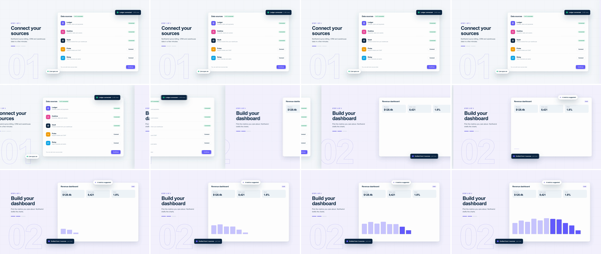

# Layered Parallax Push (multiplane push)

A horizontal push where every scene is three planes: a background grid with big landmarks, the main UI, and foreground toasts and chips. All three slide with one ease, but over different distances, so the background lags, the UI travels with the seam and the foreground races ahead. Scene A comes apart in depth on the way out. Scene B's chips land a few frames after its card. It says "next step" and keeps the product feeling tactile instead of flat.



## Use it when

- Moving between sequential steps: an onboarding wizard, setup or checkout steps, or "1 of 3 → 2 of 3". The sideways direction already means "forward".
- Moving between sibling screens or tabs of one product, where the order matters but neither screen sits inside the other.
- The screens have floating elements anyway (toasts, presence chips, AI suggestions). The push gives them a reason to exist on a separate plane.

Avoid it when scene B is a detail of scene A. Use [ui-deep-zoom](../ui-deep-zoom/SKILL.md) for that. For a jump between unrelated modules at high energy, use [whip-pan](../whip-pan/SKILL.md). If both screens live on one canvas and you want the trip itself shown, use [infinite-canvas-pan](../infinite-canvas-pan/SKILL.md).

## Anatomy (60fps)

| Beat | Frames | What happens |
| --- | --- | --- |
| Telegraph | −30 → −2 | A ring pulses off scene A's Continue button, on the side B will come from. The button presses (scale 0.95, yoyo) over −14 → −2. |
| Launch | 0 → 10 | All layers start together on `power3.inOut`, which is a quartic in GSAP, so the first frames barely move: the UI has travelled 37px by f8 and 91px by f10. B's panel, with a lavender tint, slides in at the right edge from about f6; its edge shadow ramps in over f0 → f12 (`power2.in`) so it never runs ahead of the panel. |
| Push | 10 → 26 | Peak speed at f18: the UI moves 196px per frame, the foreground 275 and the background 98. At f18 the seam is at mid-frame. A's dark toast has slid 384px along the card from its corner. The edge of B's "02" numeral peeks out just right of the seam, revealed as the seam passes. Horizontal blur also peaks at f18: 4px on the UI, 5.6px on A's foreground, none on the background. |
| Land | 26 → 36 | B's UI brakes from 91px out to rest. At every frame B's background is half as far from home as its UI, so it reads as arriving first. A is hidden at f36, by which point it is entirely off-frame. |
| Trail | 26 → 44 | B's chips start their extra 0.4W (768px) overshoot 8f late, so they sit about 475px from home at f26, 78px at f32 and 15px at f36, and lock onto the card's corners by f42–44. |

## Build it

Structure: each scene is a `.scene` panel (it moves at 1x and has `overflow: hidden`) › `.bg` (grid plus landmarks, which counter-move), `.ui` (rides with the panel) and `.fg` (floats, which over-move). The grid overhangs its panel by 960px on each side. Each `.ui`/`.fg` carries an SVG `feGaussianBlur stdDeviation="X 0"` filter. Scene B's panel has a tint and a `-32px 0 64px` shadow so the seam reads.

```js
const T = 1.6;           // push start (frame 96 @ 60fps)
const D = 0.6;           // 36f
const W = 1920;          // the main layer travels one frame width
const BG = 0.5, FG = 1.4; // layer speeds relative to the UI
const LAG = 8 / 60;      // B's foreground lands 8f after its UI
const BLUR = 4;          // peak horizontal blur on the 1x layer, px: 8 was tuned at 30fps; each 60fps frame covers half the travel
const ease = "power3.inOut";

tl.fromTo("#next-ring", { opacity: 0.9, scale: 1 }, { opacity: 0, scale: 1.3, duration: 0.5, ease: "power2.out" }, T - 0.5);
tl.to("#next", { scale: 0.95, duration: 0.1, ease: "power2.out", yoyo: true, repeat: 1 }, T - 0.24);

// The panel carries the 1x move and the children add their offsets. With one ease and one duration
// the nested tweens add linearly, so the net speeds are exactly 0.5x / 1x / 1.4x on every frame,
// except B's lagged foreground, which trails by up to ~0.25W (about 490px, f22) mid-push.
tl.to("#s1", { x: -W, duration: D, ease }, T);
tl.to("#s1 .bg", { x: W * (1 - BG), duration: D, ease }, T);  // net −0.5W, disappears behind the seam
tl.to("#s1 .fg", { x: -W * (FG - 1), duration: D, ease }, T); // net −1.4W, leaves first

tl.set("#s2", { opacity: 1 }, T);
// Ramp the edge shadow with the panel; at full strength from f0 it smudges the edge while B is off-frame.
tl.fromTo("#s2", { boxShadow: "-32px 0 64px rgba(10, 37, 64, 0)" }, { boxShadow: "-32px 0 64px rgba(10, 37, 64, 0.1)", duration: 0.2, ease: "power2.in" }, T);
tl.fromTo("#s2", { x: W }, { x: 0, duration: D, ease }, T);
tl.fromTo("#s2 .bg", { x: -W * (1 - BG) }, { x: 0, duration: D, ease }, T);
tl.fromTo("#s2 .fg", { x: W * (FG - 1) }, { x: 0, duration: D, ease }, T + LAG); // off-frame until ~f20 anyway
tl.set("#s1", { visibility: "hidden" }, T + D);

// Blur tracks speed. Each half of a quartic inOut has speed ∝ u³: power2.in (cubic) up, power2.out down.
const blur = (id, px, at) => {
  tl.fromTo(id, { attr: { stdDeviation: "0 0" } }, { attr: { stdDeviation: `${px} 0` }, duration: D / 2, ease: "power2.in" }, at);
  tl.to(id, { attr: { stdDeviation: "0 0" }, duration: D / 2, ease: "power2.out" }, at + D / 2);
};
blur("#blur-ui", BLUR, T);           // both .ui layers move at the same speed, so they share one filter
blur("#blur-fga", BLUR * FG, T);
blur("#blur-fgb", BLUR * FG, T + LAG);
```

The full working composition is in [demo.html](demo.html).

## Tuning

- **Speed ratios.** Use `BG` 0.3–0.6 and `FG` 1.2–1.6. Below 1.2 the foreground looks glued to the card. Above 1.6 the chips drift so far from their card that they read as flying off rather than sitting nearer the camera.
- **Duration.** 0.5–0.7s. A quartic inOut spends roughly 8f at each end nearly still, so the readable move is about 20f. Under 0.5s it turns into a whip pan.
- **`LAG`.** 0–12f. At 0 everything lands on f36 and the stagger is gone. Past 12f the chips arrive as a separate beat, after the UI has settled. The lag delays only the 0.4W overshoot, not the panel the chips ride on, so even 12f adds at most a few hundred px of trail (about 720px from rest at f26, against 475px at 8f).
- **Blur.** 3–6px on the UI, multiplied by each layer's speed ratio. Keep the background at 0: a sharp, slow background is half of the depth cue.
- **Seam.** A light tint difference plus an edge shadow gives a clear push. With an identical background on B, the seam shows only as a break in the grid. That's fine for a calmer cut.

## Pitfalls

- **GSAP's `powerN` is exponent N+1.** `power3` is a quartic. The first blur envelope assumed a cubic. A quartic puts the seam at 1730px on f12 (the 60fps render measures the tint edge at 1730px), where a cubic predicts 1636px. Anything derived from the ease (blur envelopes, speed matching, inverse timing) has to use the real exponent.
- **One filter on the panel.** A blur on the moving `.scene` blurs all three planes by the same amount and flattens the depth. Give each plane its own filter. Two planes can share one only if their timing is identical, which is why B's lagged foreground has its own.
- **Pale floats vanish at peak blur.** A white chip on A's white card all but vanished from f16 to f20, so the midpoint frames showed no foreground at all. Put the dark toast on the corner that is still on screen at mid-push (the right side for a leftward push).
- **Background layer.** It slides ±960px inside its clipped panel, so extend it 960px past both edges or a bare strip slides in behind the UI. A uniform grid repeats every cell, so its 0.5x motion is invisible in any single frame: add one large landmark per scene (here a 440px outlined step numeral) so the lag shows.
- **Edge shadow switched on with opacity.** A static `-32px 0 64px` shadow on B appears at f0, when B is still at x = 1920, and bleeds about 90px into frame as a grey smudge. Tween its alpha from 0 over the first 12f.
- **Delaying A's foreground.** Starting A's chips late makes them sit still while the card leaves. That reads as drag, the opposite of depth. Only the incoming foreground should lag.

## Variants

- **Vertical push.** Use `y` with `H = 1080` for stacked content: a feed, a changelog or a long form.
- **Back step.** Negate `W` so B enters from the left. Pair it with the forward version for back/next in a wizard.
- **Inertial chips.** Land B's `.fg` with `back.out(1.3)` instead of the shared ease, for a playful brand. Keep the other layers on `power3.inOut`.
- **Seamless world.** Drop the tint and the shadow, and give both scenes one background plane at 0.5x. The push becomes a camera truck across a layered canvas.

## Sound

A soft click on the Continue press (f−8), an air whoosh panned right to left peaking at f18, and a light tick as B's chips lock (about f38).
