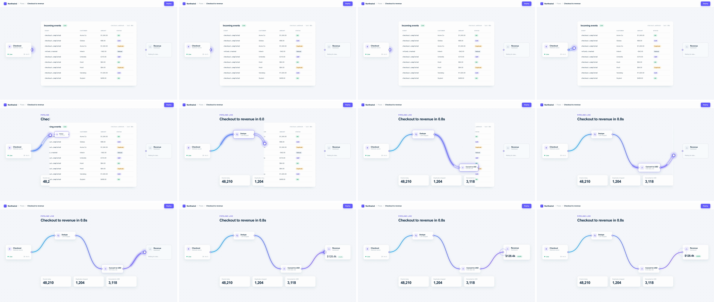

# Path & Stroke Leading (data-flow lead, line wipe)

A bright head travels along a curved path and draws a stroke behind it. Scene B exists only behind the head: a mask edge rides the head's x, so scene A is erased as the line crosses it. Scene B's elements appear at the moment the head reaches them. The eye follows the head, so the viewer is carried into the new scene and never sees a cut. The message is "this flows into that."



## Use it when

- Data moves through a product: webhook → transforms → dashboard, form → CRM → email, raw events → pipeline. The wire left on screen is scene B's own diagram.
- Scene A shows the input and scene B shows where it goes. Keep the source and destination as persistent cards, as in [shared-element](../shared-element/SKILL.md), and let the line build everything in between.

Avoid it when nothing in the story actually flows, such as a settings change or a pricing page. A line crossing the frame for no reason reads as a generic wipe. Use [border-rail-wipe](../border-rail-wipe/SKILL.md) or [light-sweep](../light-sweep/SKILL.md) instead.

## Anatomy (60fps)

| Beat | Frames | What happens |
| --- | --- | --- |
| Telegraph | −30 → 0 | A ring pings off the source port (scale 1 → 2.6, 30f). At −18 the head charges at the port (scale 0 → 1, `back.out(2.2)`). The wire SVG turns visible at f0, under the head. |
| Launch | 0 → 20 | The head leaves the port from rest (`power2.inOut` on arc length). It covers only 7% of the path (110px) in the first 14f. The mask edge reaches scene A's panel at f15. |
| Node 1 | 19 → 24 | Dedupe pops at f19, one frame before the head reaches its left port (f20): opacity is set to 1 and it scales 0.6 → 1 (`back.out(1.7)`) from its left edge, so its port stays on the wire tip. The head runs under the card from f20 to f24 (hidden on f21–23), and the card's glow ring fades from f24. |
| Dive | 24 → 34 | This is the fastest stretch: ~86px/frame of arc at f27.5. Convert to USD pops at f29 and the head passes through it from f30 to f34 (hidden on f31–33; the trail and mask edge lead). The white trail core stretches to ~290px because its length follows speed. |
| Settle | 34 → 52 | The head climbs into the destination port, decelerating. Scene A is fully wiped at f41. The last 14f cover 7% of the path. Trails fade from f48. |
| Land | 50 → 90 | The head is absorbed into the port (scale → 0, 11f from f50). At f54 the destination hard-swaps from dashed to live with its value already rising (it started at f52, hidden), a ring pings, and the card bumps to 1.05 for 6f then settles on `expo.out`. |

## Build it

Structure: `#s1` (scene A) · `#s2` (scene B, same background, `mask-image` driven by the head) · `#flow` overlay above both, holding `svg.wires` (glow, wire and two trail paths, all `pathLength="1"`), `#head-pos > #head` (HTML), the nodes, and the shared source and destination cards. CSS starts `svg.wires`, `.node` and `#dst .live` at opacity 0, and gives `.node` `transform-origin: 0 50%`. Content that changes between scenes must sit inside the head's sweep (x 340–1580).

```js
const T = 1.5, D = 0.9, EASE = gsap.parseEase("power2.inOut");
const SRC = [340, 540], DST = [1580, 540];                    // ports, hard-coded from CSS
const NODES = [{ el: "#n1", x: 590, y: 360, w: 230 }, { el: "#n2", x: 1100, y: 720, w: 230 }]; // left x, center y, width
const pts = [SRC, ...NODES.flatMap((n) => [[n.x, n.y], [n.x + n.w, n.y]]), DST];
// Node-editor wiring: horizontal tangents at every port, straight under each node.
const segs = pts.slice(1).map((b, i) => { const a = pts[i], k = (b[0] - a[0]) * 0.55; return [a, [a[0] + k, a[1]], [b[0] - k, b[1]], b]; });
const d = `M${SRC} ` + segs.map((s) => `C${s[1]} ${s[2]} ${s[3]}`).join(" ");
document.querySelectorAll(".wires path").forEach((p) => p.setAttribute("d", d)); // scope it: icons have paths too

// Arc-length table, so the head moves at the speed EASE says, not at the bezier's t.
const bez = (s, t) => [0, 1].map((j) => (1 - t) ** 3 * s[0][j] + 3 * (1 - t) ** 2 * t * s[1][j] + 3 * (1 - t) * t * t * s[2][j] + t ** 3 * s[3][j]);
const LUT = [[...SRC, 0]], ends = [];
segs.forEach((s) => { for (let i = 1; i <= 64; i++) { const [x, y] = bez(s, i / 64), [px, py, pl] = LUT[LUT.length - 1]; LUT.push([x, y, pl + Math.hypot(x - px, y - py)]); } ends.push(LUT[LUT.length - 1][2]); });
const LEN = LUT[LUT.length - 1][2];
const at = (p) => { const L = p * LEN, i = Math.max(1, LUT.findIndex((r) => r[2] >= L)), a = LUT[i - 1], b = LUT[i], f = (L - a[2]) / (b[2] - a[2] || 1); return [a[0] + (b[0] - a[0]) * f, a[1] + (b[1] - a[1]) * f]; };
const timeAt = (f) => { let lo = 0, hi = 1; for (let i = 0; i < 30; i++) { const m = (lo + hi) / 2; EASE(m) < f ? (lo = m) : (hi = m); } return T + D * lo; };

// One driver: wire, trails, head and scene B's mask edge read the same progress, so they can't drift apart.
const headPos = document.getElementById("head-pos"), s2 = document.getElementById("s2"), wires = document.querySelectorAll(".wire"), flow = { u: 0 };
const trails = [[document.getElementById("trail-tail"), 0.2], [document.getElementById("trail-core"), 0.07]]; // [el, lag in u]
const draw = () => {
  const u = flow.u, p = EASE(u), [x, y] = at(p);
  headPos.style.transform = `translate(${x}px, ${y}px)`;
  wires.forEach((w) => (w.style.strokeDashoffset = 1 - p));      // dasharray "1 2": drawn on [0, p]
  trails.forEach(([el, lag]) => {
    const t0 = EASE(Math.max(0, u - lag));                       // where the head was `lag` ago: a speed streak
    el.style.strokeDasharray = `${p - t0} 2`;
    el.style.strokeDashoffset = -t0;
  });
  s2.style.webkitMaskImage = s2.style.maskImage = `linear-gradient(90deg, #000 ${x - 16}px, transparent ${x}px)`; // B only behind the head
};
draw(); // tl.seek() suppresses callbacks by default: set the start state yourself

tl.set("#src-ring", { scale: 1, opacity: 0.9 }, T - 0.5).to("#src-ring", { scale: 2.6, opacity: 0, duration: 0.5, ease: "power2.out" }, T - 0.5);
tl.fromTo("#head", { scale: 0 }, { scale: 1, duration: 0.3, ease: "back.out(2.2)" }, T - 0.3);
tl.set(["#s2", "svg.wires"], { opacity: 1 }, T);
tl.to(flow, { u: 1, duration: D, ease: "none", onUpdate: draw }, T); // the ease is applied inside draw()

NODES.forEach((n, i) => {
  const tIn = timeAt(ends[i * 2] / LEN), tOut = timeAt(ends[i * 2 + 1] / LEN);
  tl.set(n.el, { opacity: 1 }, tIn - 0.033); // set, not faded: the node lands over unwiped scene A
  tl.fromTo(n.el, { scale: 0.6 }, { scale: 1, duration: 0.4, ease: "back.out(1.7)" }, tIn - 0.033);
  tl.fromTo(`${n.el} .flash`, { opacity: 1 }, { opacity: 0, duration: 0.5, ease: "power2.out" }, tOut);
});
const tLand = T + D;
tl.to("#head", { scale: 0, duration: 0.18, ease: "power2.in" }, tLand - 0.06);
tl.to(".trail", { opacity: 0, duration: 0.3, ease: "power1.out" }, tLand - 0.1);
tl.set("#dst .empty", { opacity: 0 }, tLand).set("#dst .live", { opacity: 1 }, tLand);
// Starts ~2 frames (0.04s) early under the hidden .live card, so the swap frame never shows an empty body.
tl.fromTo("#dst .value", { y: 14, opacity: 0.35 }, { y: 0, opacity: 1, duration: 0.45, ease: "expo.out" }, tLand - 0.04);
tl.to("#dst", { scale: 1.05, duration: 0.1, ease: "power2.out" }, tLand).to("#dst", { scale: 1, duration: 0.5, ease: "expo.out" }, tLand + 0.1);
```

The full working composition is in [demo.html](demo.html). It also has the destination ring and the glow settle.

## Tuning

- **Duration.** 0.8–1.0s for a ~1600px path. Peak arc speed is 3 × LEN / frames for `power2.inOut` (a cubic): 89px/frame here, carried by the trail streak. Faster and the head jumps between frames instead of streaking. Shorter paths can go down to 0.6s.
- **Ease.** `power2.inOut`. The head has to leave from rest and arrive at rest, because it starts and ends on a port. `power3.inOut` covers under 60px in the first 14f, which feels stuck after the telegraph. Out-only eases make the head jump straight out of the source.
- **Trail lags (0.2 / 0.07 of the move).** The trail is the head's own recent path, so it stretches in the dive and shrinks to nothing on arrival. Raise the lag for a longer streak. Above 0.3 it reads as a second line.
- **Mask edge.** Transparent exactly at the head's x, opaque 16px behind it. Never let it get ahead of the head. A hard `clip-path` slices glyphs mid-letter; a feather wider than ~24px double-exposes both scenes' text in the band.
- **Curve amplitude.** The middle segment drops 360px over 280px. Steeper curves make the mask edge stall while the head dives. Flatter curves turn it into a plain left-to-right wipe.

## Pitfalls

- **Broad selectors catch icons.** `#flow svg { width: 1920px }` resized every inline icon to 1920×1080, and `#flow path` wrote the wire's `d` into the icon paths. Give the wire SVG a class and select only that.
- **GSAP scale on an SVG `<g>` head.** With `svgOrigin` and with `transformOrigin`, GSAP wrote `matrix(1,0,0,1,-46,-46)`, so the head rode 46px up and left of the wire tip. Make the head an HTML div translated in scene px.
- **Callbacks on seek.** A plain `tl.seek(t)` suppresses `onUpdate`, so the driver never runs when you scrub in a normal page. The HyperFrames renderer fires `onUpdate` on seek (verified in preview.mp4); if a scrubber shows a frozen head, it is seeking with `suppressEvents`. Call `draw()` once at setup, and scrub with `tl.seek(t, false)`.
- **Zero-length dashes still draw a dot.** At p=0 every wire and trail dash has zero length, but `stroke-linecap: round` paints the caps: a glowing dot sat alone at the source port on the poster frame. Hide `svg.wires` until T.
- **Fades and from-states.** `fromTo` on the port rings applied `opacity: 0.9` at frame 0, so use `set` + `to` for pings. A node lands right of the edge, over unwiped scene A, so even a 0.1s fade ghosted the table through it; a destination crossfade double-exposed "Waiting for data…". Hard-set both.
- **Content outside the sweep.** The mask only moves between the two ports, so keep both scenes identical outside x 340–1580. Count shadows too: the kit's 32px card shadow on scene A's panel showed as a gray sliver past x=1480 after the head passed, so the panel gets a tight one.

## Variants

- **Line-graph lead.** The path is a chart line. Each data point of scene B's chart pops as the head reaches it, and the head stops on the latest value.
- **Exit right.** No destination card: the wire runs off the right edge and the mask edge reaches x = 1920 as the head leaves. Use this when scene B has no single endpoint.
- **Branch.** At a node, start a second driver on a second path with the same ease, offset by 4–6f. The flow fans out to two destinations.

## Sound

A rising electric zip that follows the head, soft ticks as it passes through each node (f20, f30), and a low thump plus a chime when it lands at f54.
