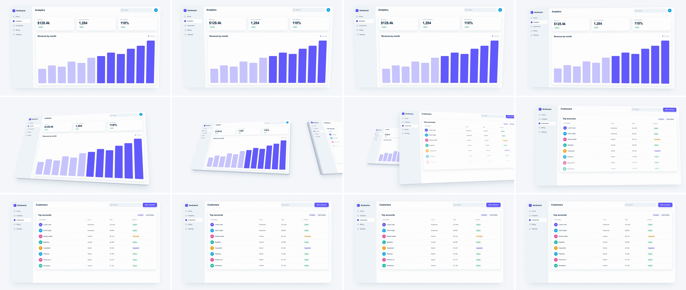

# Perspective Tilt & Extrusion (screen-as-object)

Scene A's app window tips back in 3D (top away from camera, face turned aside), and a stack of edge layers behind it shows up as real slab thickness along its bottom and side. A recedes, and scene B's window sweeps in from the other side with mirrored yaw and flattens into the frame. For about 20 frames the UI looks like a physical object you could pick up, which reads as "this is a real, solid product", not just a page change.



## Use it when

- Moving between two top-level surfaces of the same product: Analytics → Customers, editor → live preview, inbox → thread.
- A launch or feature video wants a premium "here's the product as an object" beat without leaving the UI.
- For depth layers or an architecture stack, use [z-space-push](../z-space-push/SKILL.md) or [isometric-stack-explosion](../isometric-stack-explosion/SKILL.md). For the front and back of one card, use [card-flip-3d](../card-flip-3d/SKILL.md).

Avoid it when the viewer has to read UI during the move: text is foreshortened and tiny for most of the 48f. Avoid it for drilling into a detail, which is [ui-deep-zoom](../ui-deep-zoom/SKILL.md)'s job.

## Anatomy (60fps)

| Beat | Frames | What happens |
| --- | --- | --- |
| Telegraph | −12 → 0 | A leans toward camera, `rotationX` 0 → −5° (`power2.out`). The top edge widens slightly, a wind-up before it falls back. |
| Tilt | 0 → 26 | A rotates to `rotationX 25°, rotationY −15°` (`power3.inOut`). The bottom and right edges of the slab show from about f12. |
| Recede | 0 → 48 | A travels to `x −700, z −2200` (`power3.inOut`). Tilt leads translation, so A is fully tilted while it is still large. |
| Enter | 0 → 48 | B travels from `x 3000, z −1600` to rest (`power3.inOut`). Its corner enters the right edge at about f18. Rows rise in from f14, staggered 2.4f apart. |
| Crossover | ~24 | The money frame: A tilted on the left with its bottom and right edges showing, B on the right with its left edge facing the centre. |
| Flatten | 14 → 48 | B's tilt `(25°, 15°)` → 0 (`power3.inOut`). B passes over A from f26 and fully covers it by f35. |
| Land | 48 | B is flat at its kit position. A gets `visibility: hidden` (already covered). |

## Build it

Structure: `.scene` (carries `perspective`) › `.slab` (transformed, `preserve-3d`) › `.edge` × N + `.app` (front face). `.app` keeps `overflow: hidden`, so the 3D context has to live on the slab, not on the app. Scene B is `background: transparent` over scene A, so the dot grid stays put.

```css
.scene { perspective: 1800px; perspective-origin: 960px 540px; }
.slab { position: absolute; left: 120px; top: 80px; width: 1680px; height: 920px; transform-style: preserve-3d; }
.slab .app { left: 0; top: 0; box-shadow: none; }
.slab .edge { position: absolute; inset: 0; border-radius: 20px; }
.slab .edge:first-child { box-shadow: var(--shadow-lg); } /* the back of the slab casts the shadow */
```

```js
// Extrusion: thin layers behind the face. Hidden when flat; any tilt shows them as a solid side.
const DEPTH = 72, LAYERS = 24;
const FRONT = [226, 232, 240], BACK = [168, 181, 199];
document.querySelectorAll(".slab").forEach((slab) => {
  for (let i = 1; i <= LAYERS; i++) {
    const k = i / LAYERS, edge = document.createElement("div");
    edge.className = "edge";
    edge.style.transform = `translateZ(${-k * DEPTH}px)`;
    edge.style.background = `rgb(${FRONT.map((c, j) => Math.round(c + (BACK[j] - c) * k)).join(",")})`;
    slab.prepend(edge);
  }
});

const T = 1.5, D = 0.8;
const TILT_A = { rotationX: 25, rotationY: -15 };
const TILT_B = { rotationX: 25, rotationY: 15 };   // mirrored yaw: B's extruded side faces the centre
const AWAY = { x: -700, z: -2200 };                 // deep enough to end fully behind B
const ENTRY = { x: 3000, z: -1600 };                // off-frame even with the yawed near corner

tl.fromTo("#slab-a", { rotationX: 0 }, { rotationX: -5, duration: 0.2, ease: "power2.out" }, T - 0.2);
tl.to("#slab-a", { ...TILT_A, duration: D * 0.55, ease: "power3.inOut" }, T); // tilt leads
tl.fromTo("#slab-a", { x: 0, z: 0 }, { ...AWAY, duration: D, ease: "power3.inOut" }, T);

tl.set("#s2", { opacity: 1 }, T);
tl.fromTo("#slab-b", { ...ENTRY }, { x: 0, z: 0, duration: D, ease: "power3.inOut" }, T);
tl.fromTo("#slab-b", { ...TILT_B }, { rotationX: 0, rotationY: 0, duration: D * 0.7, ease: "power3.inOut" }, T + D * 0.3);
tl.set("#slab-a", { visibility: "hidden" }, T + D);
tl.fromTo("#s2 .row", { y: 18, opacity: 0 }, { y: 0, opacity: 1, duration: 0.45, stagger: 0.04, ease: "power3.out" }, T + D * 0.3);
```

The full working composition is in [demo.html](demo.html).

## Tuning

- **Duration.** 0.7–0.9s. Below 0.6s the edges never read; they need about 16 frames on screen.
- **Tilt.** `rotationX` 18–30°, `rotationY` 10–20°. Past ~35° the UI turns into a sliver and the face stops reading as an app.
- **Depth (`DEPTH`).** 48–96px for a 1680px window, about 3–5% of its width. Keep the layer step ≤ 3px (`LAYERS = DEPTH / 3`) or the side turns into stripes near the frame edge.
- **Lens.** `perspective` 1400–2200px. Lower values exaggerate the near corner and make the slab look toy-like; higher values flatten the edges.
- **Lead.** The tilt runs over `D × 0.5–0.6` for A, and B holds its tilt until `D × 0.3`. If every property runs over the full `D`, both windows are only half-tilted at the crossover and the extrusion barely shows.

## Pitfalls

- **A peeking out after the land.** With `AWAY = { x: −900, z: −1600 }`, A's tilted corner stayed visible in the 120px margin left of B for the last ~8 frames, then popped off when A was hidden. A tilted slab projects larger than its flat box, because the near corner comes toward camera. Push A deeper (z −2200) and check the margins in the frames just before `T + D`.
- **B popping in at the edge.** With `ENTRY.x = 2700`, B's +15° yaw swung its near corner into frame on the exact frame `#s2` was revealed, a sliver that popped in at the right edge. Clear the frame using the rotated near edge, not the flat width.
- **Empty window in flight.** The first build started B's rows at `T + D × 0.6`, so B flew through the crossover with a blank table and looked like a wireframe. Content should already be on the slab while it flies.
- **`preserve-3d` on `.app`.** `overflow: hidden` forces flattening, so edge layers inside `.app` collapse onto the face. Make them siblings of `.app` inside the slab.
- **Shadow on the face.** The kit's `.app` shadow sits at z = 0, so it floats in front of the edges and dirties them. Put the shadow on the back-most edge layer.
- **Invisible telegraph.** A −3° lean doesn't show at 1080p. −5° is the smallest that reads as a wind-up.

## Variants

- **Hero hold.** Tilt A to the 3D pose and hold it with a slow drift (`rotationY` −15 → −12 over 2s) as a product beauty shot, then flatten B.
- **Conveyor.** Give B the same yaw as A instead of a mirrored one. It reads as the camera sliding along a row of parallel slabs rather than a carousel.
- **Device slab.** Same build on a phone-sized face (`border-radius: 64px`, depth ~40px). Pair with [device-to-canvas-wrap](../device-to-canvas-wrap/SKILL.md).

## Sound

A low, airy whoosh that peaks at the crossover (f24), plus a soft muted thud as B flattens on f48.
