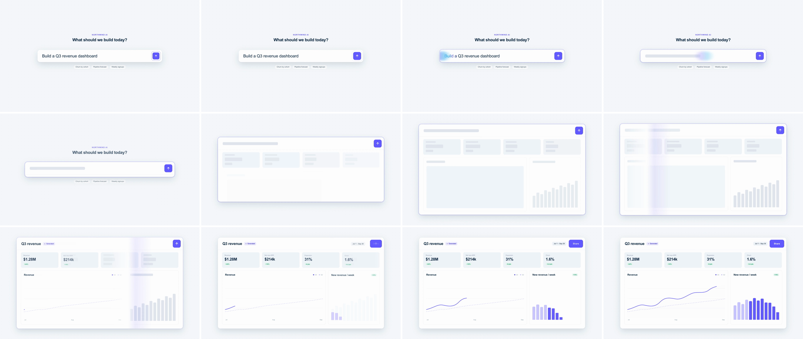

# Prompt-to-UI Render (prompt compile)

A glint crosses a typed prompt. Each letter lights indigo→sky just ahead of it and turns into a skeleton line just behind it. The prompt bar then opens into the result card, with its row becoming the card header. Skeleton tiles fill the body, and a second, wider shimmer crosses the card, resolving each tile into real UI as it passes. The viewer watches the words become the product, with no cut between asking and getting.



## Use it when

- An AI feature launch where the pitch is "describe it, get it": dashboards, reports, forms, landing pages.
- A dev tool turns code, config or a query into running UI. Swap the prompt for a `.code` block (see Variants).
- The result belongs in the same container as the prompt. If the output lands somewhere else in the app, carry the prompt there with [shared-element](../shared-element/SKILL.md).
- For one component becoming another with no generation step, use [ui-component-morph](../ui-component-morph/SKILL.md).

Avoid it for features that don't generate anything. A prompt that compiles into UI promises AI, so on a plain settings or list screen it reads as a gimmick. Use [cursor-click-expand](../cursor-click-expand/SKILL.md) instead.

## Anatomy (60fps)

| Beat | Frames | What happens |
| --- | --- | --- |
| Telegraph | −16 → 0 | Send presses (scale 0.88, yoyo) and a ring pulses off it. The caret goes at −10. |
| Compile | 0 → 20 | `--p` runs −32 → 115 (`power2.inOut`). That one custom property moves four things: the glint, a sheen on the text (p → p+30), a mask that erases the text (p → p+12) and a mask that reveals a skeleton line behind it. The first letter lights at 5 and starts erasing at 8, and the last one is gone by 14. The glint fades in over 4 → 8 and out over 11 → 17. An indigo focus ring fades in on the bar. |
| Unfold | 6 → 48 | Width leads (`expo.inOut`, 6 → 39) and height follows (`expo.inOut`, 12 → 48), so the bar widens, then drops open like a drawer around its own center. The headline and chips fall away over 12 → 30. |
| Skeleton | 20 → 53 | Six tiles pop in (opacity, scale 0.96 → 1, 0.04s stagger) while the frame is still opening. About 24f pass between the first tile popping in and its resolve. |
| Render pass | 37 → 67 | A 420px sweep (white over grey, faint indigo over white) crosses the card on `sine.inOut`. Each tile cross-fades from skeleton to content when the sweep's center is 60px into it: the title and first KPI at 45, the last KPI at 57, send → Share at 60. |
| Settle | 50 → 108 | The line draws over 50 → 98, the area fills behind it over 78 → 108, and the bars grow over 58 → 108. The focus ring fades out over 48 → 72. |

## Build it

Structure: `#shell` is the morphing object (background, border, shadow, `overflow: hidden`). It holds the prompt row, the result tiles and `#sweep`, all positioned in the *card's* coordinates from its top-left. That makes the prompt row the header row, and the body stays clipped until the shell grows. `.skel-line` sits absolutely inside the inline-block `.word`, so CSS sizes it to the text without any measuring.

```css
:root { --sk: #e2e7ef; } /* skeleton grey: one shade darker than --surface-2 */
.word { position: relative; display: inline-block; --p: -32; }   /* --p: % of the text width */
.txt { color: transparent; background-clip: text;                 /* plus -webkit- prefixes on clip and mask */
  background-image: linear-gradient(90deg, #635bff calc(var(--p) * 1%), #0ea5e9 calc(var(--p) * 1% + 12%), #635bff calc(var(--p) * 1% + 21%), var(--ink) calc(var(--p) * 1% + 30%));
  mask-image: linear-gradient(90deg, transparent calc(var(--p) * 1%), #000 calc(var(--p) * 1% + 12%)); }
.skel-line { position: absolute; left: 0; right: 0; top: 8px; bottom: 8px; border-radius: 10px; background: var(--sk);
  mask-image: linear-gradient(90deg, #000 calc(var(--p) * 1% - 12%), transparent calc(var(--p) * 1%)); }
.band { position: absolute; top: -20px; bottom: -20px; width: 200px; left: calc(var(--p) * 1% - 100px); opacity: 0; border-radius: 50%; filter: blur(10px);
  background: linear-gradient(90deg, rgba(122, 115, 255, 0), rgba(122, 115, 255, 0.55) 35%, rgba(14, 165, 233, 0.5) 65%, rgba(14, 165, 233, 0)); }
#sweep { position: absolute; top: 0; bottom: 0; left: 0; width: 420px; z-index: 1;
  background: linear-gradient(90deg, rgba(255, 255, 255, 0), rgba(255, 255, 255, 0.9) 45%, rgba(99, 91, 255, 0.1) 62%, rgba(99, 91, 255, 0)); }
```

```js
const T = 2.0, D = 1.1; // compile + unfold + render pass
const PROMPT = { x: 360, y: 480, w: 1200, h: 120, r: 26 }; // #shell in scene A (matches CSS)
const CARD = { x: 160, y: 100, w: 1600, h: 880, r: 24 };   // #shell in scene B

tl.to("#send", { scale: 0.88, duration: 0.1, ease: "power2.out", yoyo: true, repeat: 1 }, T - 0.26);
tl.fromTo("#send-ring", { opacity: 0.9, scale: 1 }, { opacity: 0, scale: 1.3, duration: 0.4, ease: "power2.out", immediateRender: false }, T - 0.2);

// Compile: one custom property drives the sheen, both masks and the glint.
tl.fromTo(".word", { "--p": -32 }, { "--p": 115, duration: 0.33, ease: "power2.inOut" }, T);
tl.fromTo(".band", { opacity: 0 }, { opacity: 1, duration: 0.08, ease: "power1.out" }, T + 0.06);
tl.to(".band", { opacity: 0, duration: 0.1, ease: "power1.in" }, T + 0.18);
tl.to("#shell", { outlineColor: "rgba(99, 91, 255, 0.3)", duration: 0.2, ease: "power2.out" }, T);

// Unfold: x/y for position (sub-pixel), width/height for size (scale would stretch the radius, border and text).
tl.fromTo("#shell", { x: 0, width: PROMPT.w }, { x: CARD.x - PROMPT.x, width: CARD.w, duration: 0.55, ease: "expo.inOut" }, T + 0.1);
tl.fromTo("#shell", { y: 0, height: PROMPT.h, borderRadius: PROMPT.r }, { y: CARD.y - PROMPT.y, height: CARD.h, borderRadius: CARD.r, duration: 0.6, ease: "expo.inOut" }, T + 0.2);
tl.fromTo(".tile", { opacity: 0, scale: 0.96 }, { opacity: 1, scale: 1, duration: 0.35, stagger: 0.04, ease: "power3.out" }, T + 0.34);

// Render pass: at() inverts sine.inOut, so each tile resolves exactly as the band crosses it.
const R0 = T + 0.62, SW = 0.5, SPAN = CARD.w + 420;
tl.fromTo("#sweep", { x: -420 }, { x: CARD.w, duration: SW, ease: "sine.inOut" }, R0);
const at = (x) => R0 + (SW * Math.acos(1 - (2 * (x + 270)) / SPAN)) / Math.PI; // sweep center 60px into card-x
tl.to(".word", { opacity: 0, duration: 0.2, ease: "power1.out" }, at(44));
tl.fromTo("#title", { opacity: 0, y: 10 }, { opacity: 1, y: 0, duration: 0.45, ease: "expo.out" }, at(44) + 0.04);
[["#k1", 40], ["#k2", 425], ["#k3", 810], ["#k4", 1195], ["#chart", 40], ["#plan", 1062]].forEach(([id, x]) => {
  tl.to(`${id} .sk`, { opacity: 0, duration: 0.2, ease: "power1.out" }, at(x));
  tl.fromTo(`${id} .real`, { opacity: 0, y: 10 }, { opacity: 1, y: 0, duration: 0.45, ease: "expo.out" }, at(x) + 0.04);
});
```

Typing uses one `<span>` per character, revealed with `tl.set(span, { display: "inline" }, t)`. The cadence comes from a seeded `sin` hash, with an extra beat after each space. The full working composition is in [demo.html](demo.html).

## Tuning

- **Compile length (0.25–0.4s).** Under 15f the text-to-skeleton swap reads as a flicker. Over 24f the viewer waits on a bar. The `--p` range must clear the lit stretch on the left (≤ −30) and the skeleton feather on the right (≥ 112).
- **Width/height lag (0.05–0.15s).** At 0 it reads as a plain box scaling up. Past 0.15s it splits into two separate moves.
- **Ease.** `expo.inOut` packs the unfold into about 20 frames, which suits a snappy launch. `power3.inOut` spreads it out for a calmer explainer.
- **Skeleton dwell (tiles at T+0.34 → first resolve at about T+0.75).** Under 16f the skeleton state doesn't register. Over 40f the card looks stuck loading.
- **Sweep (`SW` 0.4–0.7s).** `SW` *is* the resolve stagger, because `at()` derives every tile's time from it. Change `SW` or `R0`, never individual tile times.

## Pitfalls

- **Lit stretch showing at rest.** The sheen runs 30% ahead of `p`, so with a rest value of −15 the first 15% of the text ("Bu") stays tinted indigo through the whole typing beat. Start `p` at −32, so the ink stop sits at −2%.
- **Glint drifting on an empty bar.** The last letter erases at frame 14, but `--p` keeps travelling to 115. While the glint faded out late (from T+0.26), it slid alone over the skeleton for six frames. Fade it from T+0.18.
- **Tweening `left`/`top`.** Strict lint rejects it (`gsap_non_transform_motion`), and layout properties snap to whole pixels and stutter in the expo tail. Move the shell with `x`/`y` and size it with `width`/`height`.
- **`fromTo` renders its from-state at build time.** The press ring showed at 0.9 opacity from frame 0. Add `immediateRender: false` to any telegraph whose from-state is visible.
- **Typing with `opacity`.** Hidden characters keep their width, so the caret sits at the end of the full string. Toggle `display` with `tl.set`.
- **White in the glint.** A white core over a white bar disappears and splits the shimmer into two coloured blobs. Use one purple→sky ellipse. (White does work in `#sweep`, because there it only has to show over the grey skeletons.)

## Variants

- **Code-to-UI.** Replace the prompt with a `.code` block, and give each line its own `--p` tween, staggered 4–6f. The code card then unfolds into the component it describes.
- **Terminal-to-UI.** Start from a dark terminal shell and tween its `backgroundColor` to `--surface` during the unfold. Pair it with [xray-scanline](../xray-scanline/SKILL.md) for a "what's underneath" follow-up.
- **In-app slot.** Set `CARD` to an empty slot inside an `.app` window, so the generated card lands in the product instead of floating on the canvas.

## Sound

Soft key ticks under the typing and a crisp click on send (frame −16). A rising synth shimmer peaks as the card opens (about frame 30), then a quick run of soft ticks rides the render sweep (frames 45–60).
