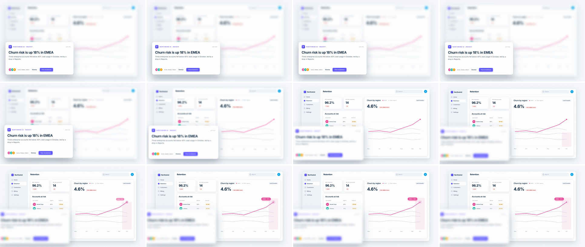

# Rack Focus (focus pull)

Two depth planes share the frame the whole time: a sharp foreground element and a blurred UI behind it. The focal plane travels from one to the other. The front softens, the back sharpens, and for a few frames neither is sharp. Nothing cuts and almost nothing moves, so it reads as "look past this, at what it's about."



## Use it when

- A floating element points at data behind it: an AI insight, notification, toast or tooltip, then the chart or table it refers to.
- A settings sheet or modal sits over the page, and scene B is the page reacting to the change.
- You want a premium depth beat between two layers without moving the camera. To travel *through* the front layer instead, use [z-space-push](../z-space-push/SKILL.md).

Avoid it when the two scenes aren't stacked in depth, or when the front element would cover what scene B needs to show. It stays on screen, soft. Use [soft-blur](../soft-blur/SKILL.md) or [cross-dissolve](../cross-dissolve/SKILL.md) instead.

## Anatomy (60fps)

| Beat | Frames | What happens |
| --- | --- | --- |
| Telegraph | −16 → 0 | The card's "View breakdown" button presses (scale 0.95 yoyo, about 7f each way). The press gives the eye a reason to look past the card. |
| Release | 0 → 16 | The focal plane leaves the card on `power2.inOut`. Card blur goes 0 → 2px (visible from f10) and the card starts drifting toward the lens. The back plane is still above 8px. |
| Both soft | 16 → 26 | Card 2 → 8px, dashboard 8 → 2px, crossing at about 5px on f21. Nothing in frame is sharp for about 10f. This dip is what makes it a rack and not a dissolve. |
| Land | 26 → 42 | The dashboard is at about 2px on f26 and under 1px from f30, settling from scale 1.035 → 1 around the chart. The card ends at 14px blur, 1.06×, offset (−80, +36). Its right edge has cleared the chart panel. |
| Answer | 29 → 75 | The chart's October band grows (`expo.out`), the "EMEA +18%" callout pops at f33 (`back.out(1.6)`) and the endpoint ring pulses. |

## Build it

Structure, once per plane, back plane first: `#s1` › `.focus` (unscaled, inset 0, carries `filter`) › `.cam` (inset 0, carries `transform`) › content. Both planes live in one scene. There is no scene swap.

```js
const T = 1.6, D = 0.7, BLUR = 14;
const CARD = { x: 72, y: 556, w: 900, h: 432 };  // front card box in frame px; hard-code it, don't measure at load

// One variable drives the pull: the focal plane travels front (0) -> back (1) on power2.inOut.
// Each plane's blur = BLUR x (distance from the focal plane)^K. K > 1 keeps a plane near-sharp
// longer, because the eye reads 0 -> 2px of blur as most of the change.
const K = 1.5;
const pull = gsap.parseEase("power2.inOut");
const defocus = (p) => Math.pow(pull(p), K);
const refocus = (p) => 1 - Math.pow(1 - pull(p), K);

tl.set("#bg-focus", { filter: `blur(${BLUR}px)` }, 0);
tl.set("#bg-cam", { scale: 1.035, transformOrigin: "1356px 578px" }, 0); // centre of the chart panel
tl.set("#fg-cam", { transformOrigin: `${CARD.x + CARD.w / 2}px ${CARD.y + CARD.h / 2}px` }, 0);

tl.to("#cta", { scale: 0.95, duration: 0.12, ease: "power2.out", yoyo: true, repeat: 1 }, T - 0.26);

// Front: defocus and drift toward the lens, away from the target.
tl.fromTo("#fg-focus", { filter: "blur(0px)" }, { filter: `blur(${BLUR}px)`, duration: D, ease: defocus }, T);
tl.fromTo("#fg-cam", { x: 0, y: 0, scale: 1 }, { x: -80, y: 36, scale: 1.06, duration: D, ease: "power2.inOut" }, T);
// Back: refocus with a small scale settle (lens breathing).
tl.fromTo("#bg-focus", { filter: `blur(${BLUR}px)` }, { filter: "blur(0px)", duration: D, ease: refocus }, T);
tl.to("#bg-cam", { scale: 1, duration: D, ease: "power2.inOut" }, T);

const tLand = T + D * 0.7; // back plane under ~1px from here (f29.4)
tl.to("#band", { scaleY: 1, duration: 0.5, ease: "expo.out" }, tLand);
tl.to("#callout", { opacity: 1, scale: 1, duration: 0.45, ease: "back.out(1.6)" }, tLand + 0.06);
```

The full working composition is in [demo.html](demo.html).

## Tuning

- **Duration.** 0.6–0.8s. The readable transfer is only the middle third, so under 0.5s it looks like a blur glitch.
- **`BLUR`.** 10–18px at 1080p. Under 8px the back plane stays legible in scene A and there's no depth. Over 20px the soft card turns into white fog.
- **`K` (perceptual exponent).** At 0.7s, `K = 1` gives about 20f where nothing is sharp (mushy). `1.5` gives about 10f (the demo). `2` gives about 6f, and the pull starts to read as a snap.
- **Front drift.** Keep x/y under about 100px and scale 1.04–1.08. Any more and it reads as a camera push.
- **Back breathing.** Start at 1.02–1.05× and settle to 1. Scale around the target's centre so the target doesn't slide.

## Pitfalls

- **Easing the blur radius directly.** The first build ran `power2.inOut` on both radii with an 8f lag. Measured edge energy showed the card effectively soft by f16 and the chart not sharp until f36: 20f where nothing reads. Shape the radius with the `K` exponent instead.
- **Fading the front plane out.** That turns the move into a [soft-blur](../soft-blur/SKILL.md) dissolve. The defocused card stays at full opacity, so plan the layout: it should cover only back-plane content that scene B doesn't need, and drift away from the target.
- **px `transformOrigin` on SVG children.** GSAP resolves px origins on SVG elements against the element's own bbox, not the viewBox, so `"698px 98px"` on the endpoint ring pivots about 700px away. Use `"50% 50%"` or `svgOrigin`.
- **Filter and transform on one node.** Keep blur on the unscaled `.focus` wrapper so it stays in screen pixels and the transform tweens never touch `filter`.
- **Frame-edge halo.** A blurred full-frame plane pulls transparent pixels in at the frame border. Leave the `.cam` background transparent (only `.dots`) so the scene's `--bg` shows through. An opaque plane in another colour shows a 14px halo.

## Variants

- **Pull forward.** A toast or AI card arrives over a sharp dashboard, and focus racks forward to it. Swap `defocus` and `refocus` between the planes.
- **Three planes.** Modal → page → sidebar: two 0.6s pulls with a 0.4s hold between them, one plane in focus at a time.
- **Dark UI.** Add `brightness(0.85)` to the defocused plane's filter so it recedes. On light UI, blur alone is enough.

## Sound

A soft airy swell (lens-ring whir) peaking on the crossover at f21, then a light tick when the callout lands at f33.
