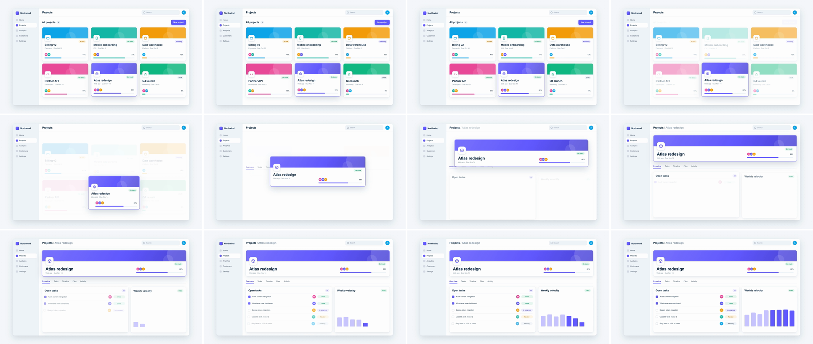

# Shared-Element Transition (hero animation)

One recognizable element, here a project card, never leaves the screen. It lifts out of its slot, travels and resizes into its place on the next screen (the detail page header), while everything around it swaps out. The viewer's eye rides the object, so the cut doesn't feel like a cut. It says "same thing, closer look."



## Use it when

- List → detail, where the item *is* the subject of scene B: project card → project page, table row → record, ticket → ticket view, avatar → profile.
- Following one object through a flow: the same deal card becomes the pipeline row, then the invoice header. Chain hops with the same node.
- The camera should stay still and the UI should do the work. To push the camera *into* the element instead, use [ui-deep-zoom](../ui-deep-zoom/SKILL.md).

Avoid it when scene B has no natural home for the element (it lands nowhere and just floats), or when the element must turn into a different object. Use [ui-component-morph](../ui-component-morph/SKILL.md) for a shape change, or [container-mask-expand](../container-mask-expand/SKILL.md) when the card should open into the whole page.

## Anatomy (30fps)

| Beat | Frames | What happens |
| --- | --- | --- |
| Telegraph | −15 → 0 | The card gets selected: a 3px accent ring, a 6px lift and a bigger shadow over 8f. At −6 it does a 5f press (scale 0.98 yoyo). |
| Clear | 0 → 11 | The grid header lifts out (6f). Neighbours fall 56px (`power2.in`) and fade (`power2.out`), nearest first, 1f apart. Opacity leads, so the grid is visibly leaving on frame 1 while the card is still in its slot. |
| Flight | 0 → 18 | One `expo.inOut` drives everything the card owns: x/y −464/−416, width 440 → 1368, height 320 → 248. Real travel happens over f6 → f12 (5% → 95%), with peak speed at f9. The left group (icon, title, meta) rides the left edge and the right group (pill, progress) rides the right. The title scales 26 → 40px. |
| Build | 7 → 39 | Scene B arrives under and around the card: tabs rise at f7, the task and velocity cards at f9 and f11, the breadcrumb at f9, task rows from f13.5 and bars from f15. The ring and lift shadow settle over f11 → f20. |
| Land | 18 | The card sits exactly on its header rect. Position, size and children are final at f18; only the shadow keeps settling until f20. |

## Build it

Structure: `#s1` (scene A plus the app chrome, which stays as the shell) · `#s2` (scene B's body on a transparent background) · `#hero` (a sibling of both, stacked above them, CSS `left/top` = FIRST). Inside the card, every child is `position:absolute` against one edge (`left`, `right`, or `left:0; right:0`), so changing the card's width re-lays them out with no scaling.

```js
const T = 1.5, D = 0.6;
const FIRST = { x: 864, y: 604, w: 440, h: 320 };   // grid slot; hard-code both rects, don't measure at load
const LAST = { x: 400, y: 188, w: 1368, h: 248 };   // detail header
const MOVE = { duration: D, ease: "expo.inOut" };   // shared by every hero tween, so the card moves as one object

tl.to("#hero", { boxShadow: RING_ON, y: -6, duration: 0.25, ease: "power2.out" }, T - 0.5);
tl.to("#hero", { scale: 0.98, duration: 0.09, ease: "power2.out", yoyo: true, repeat: 1 }, T - 0.2);

tl.to(".grid-head", { y: -12, duration: 0.2, ease: "power2.in" }, T);
tl.to(".grid-head", { opacity: 0, duration: 0.15, ease: "power2.out" }, T);
[["#p2", 0], ["#p4", 0.03], ["#p6", 0.03], ["#p1", 0.06], ["#p3", 0.06]].forEach(([el, d]) => {
  tl.to(el, { y: 56, scale: 0.97, duration: 0.3, ease: "power2.in" }, T + d); // falls...
  tl.to(el, { opacity: 0, duration: 0.3, ease: "power2.out" }, T + d);        // ...but is visibly going from frame 1
});

// Position on transforms, size on width/height: no scale on the card, so text and radius never distort.
tl.to("#hero", { x: LAST.x - FIRST.x, y: LAST.y - FIRST.y, width: LAST.w, height: LAST.h, ...MOVE }, T);
tl.to("#hero .icon", { x: 8, y: -8, width: 76, height: 76, borderRadius: 20, ...MOVE }, T);
tl.to("#hero .title", { x: 8, y: 4, scale: 40 / 26, transformOrigin: "0 0", ...MOVE }, T);
tl.to("#hero .meta", { x: 8, y: 18, ...MOVE }, T);
tl.to("#hero .pill", { x: -8, y: -4, ...MOVE }, T);
tl.to("#hero .progress", { x: -8, y: -8, width: 440, ...MOVE }, T);
tl.to("#hero", { boxShadow: RING_OFF, duration: 0.3, ease: "power2.out" }, T + D * 0.6); // set it down

tl.set("#s2", { opacity: 1 }, T);
tl.fromTo(".tabs", { y: 24, opacity: 0 }, { y: 0, opacity: 1, duration: 0.5, ease: "expo.out" }, T + 0.24);
tl.fromTo([".tasks", ".velocity"], { y: 40, opacity: 0 }, { y: 0, opacity: 1, duration: 0.6, stagger: 0.06, ease: "expo.out" }, T + 0.3);
```

`RING_ON`/`RING_OFF` are three-part `box-shadow` strings (ring + two shadow layers) with matching structure, so GSAP can interpolate them. The full working composition is in [demo.html](demo.html).

## Tuning

- **Duration.** 0.5–0.7s. `expo.inOut` puts nearly all the travel in the middle 8 frames. Under 0.5s it reads as a jump cut; over 0.75s the slow start reads as hesitation.
- **Curve.** Use `expo.inOut` for a card leaving its slot from rest, or `power3.inOut` for a calmer glide. Never a pure `.out` curve: starting at full speed rips the card out of the grid. This is a deliberate exception to the house fast-in rule: the card starts from rest in its slot, so it needs an ease-in.
- **Neighbour exit.** 8–10f, with a nearest-first stagger of about 1f and a 40–64px drop. Fade them over at least 8f, or the card flies over an empty page.
- **Scene B start.** f7–f9, while the card passes 10–50% of its travel. Earlier competes with the telegraph; later leaves a blank frame.
- **Aspect change.** Here the card gets 3.1× wider and 0.78× as tall. The more extreme the change, the more you need one constant feature (the cover colour, the icon) for the eye to hold.

## Pitfalls

- **Scale-based FLIP.** Inverting 1368×248 to 440×320 with `scaleX/scaleY` squashes the text about 4:1 and warps the corner radius. Counter-scaling the children needs a per-frame `1/s(t)`. Tween the box (`width/height`) instead: in a rendered video, layout cost doesn't matter.
- **Strict lint rejects layout motion.** Tweening `left/top/right/bottom` or `fontSize` fails `gsap_non_transform_motion`: those properties snap to whole pixels and stutter under frame seeking. Move with `x/y`, grow type with `scale`. Only box sizes (the card, the icon tile, the progress track) stay on `width/height`.
- **Dead frames at the start.** `expo.inOut` covers under 5% of its travel by f5. With `power2.in` exits on top, the first draft sat frozen for about 5 frames after the press. Split each neighbour's opacity (ease-out) from its drop (ease-in).
- **Empty stage mid-flight.** When the neighbours were gone by f8 and scene B didn't start until f9, the card crossed a blank page. Overlap the two: the old grid should still be fading when the new body starts.
- **Card inside a scene.** If the card lives in `#s1` (or in `.app`, which has `overflow:hidden`), it gets clipped, or hidden along with the scene. It has to be a sibling above both scenes from frame 0. Don't swap in a clone at T either: one node means there is nothing to mismatch and nothing to crossfade.

## Variants

- **Avatar → profile.** A 40px avatar in a table row grows into the 120px profile avatar. The row's other cells fall away.
- **Back navigation.** Run the same tweens from LAST back to FIRST, with the neighbours rising back into their slots on `expo.out`.
- **Arc path.** Split the hero's `y` and `x` into two 15f tweens on the same ease, with `y` starting 3f earlier. One axis then always leads, so the card rises first and slides over on a curve instead of a straight diagonal. Keep `width/height` on the full 18f. (Different eases on x and y with the same start make an S-curve, not an arc.)
- **Relay.** The landed header becomes the shared element for the next hop (header → share modal), so one object carries a whole sequence.

## Sound

A soft tick on the press (f−6), a short airy swish peaking at f9 (top speed), and a muted click when the card seats at f18.
