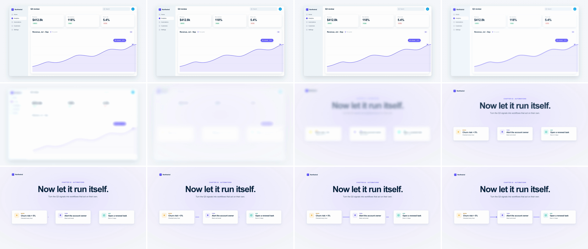

# Soft Blur (defocus dissolve)

Scene A defocuses to a heavy Gaussian blur with a slight brightness lift, holds there for 4 frames, and scene B resolves out of the same blur. The swap happens while both scenes are equally out of focus. Only colour masses are left at that point, so the frame reads as one haze changing tint, not as two images overlapping. Almost nothing moves, which reads as "a new chapter starts" rather than "we went somewhere."



## Use it when

- Changing chapters or moods: results to next steps, problem to solution, a customer story into the product.
- Scene B looks nothing like scene A, so no element can carry a match cut or a [shared-element](../shared-element/SKILL.md) move.
- You need something softer than a cut but more deliberate than a [cross-dissolve](../cross-dissolve/SKILL.md). For a bright, branded chapter break use [light-sweep](../light-sweep/SKILL.md).

Avoid it when the two scenes sit in depth and one should stay in frame. Use [rack-focus](../rack-focus/SKILL.md) for that. Also avoid it in fast montage, where 0.7s of haze stalls the cut. Use [whip-pan](../whip-pan/SKILL.md) instead. Once or twice per video is enough.

## Anatomy (30fps)

| Beat | Frames | What happens |
| --- | --- | --- |
| Telegraph | −14 → 0 | The chart's endpoint dot pops (`back.out(2.2)`) and the indigo "Q3 closed +24%" tag rises in. Scene A's story finishes, so the defocus reads as the chapter closing. |
| Defocus | 0 → 8 | Scene A's blur goes 0 → 24px on `power2.in`: 1.5px at f2, 3.4px at f3, 13.5px at f6. Brightness goes 1 → 1.1 at the same time. The camera breathes 1 → 1.025 around the endpoint (through f12). Mean luma peaks at f8. |
| Hold / swap | 8 → 12 | Both scenes sit at 24px. Scene B crossfades 0 → 1 (`sine.inOut`) inside the hold only, and A is hidden at f12. The frame is mostly haze: a white slab melting into a lavender field with white blocks, though A's indigo pill and panel edge still overlap B's cards until f11. |
| Resolve | 12 → 21 | Scene B's blur goes 24 → 0px on `power3.out`: ~11px at f14, ~4px at f16, under 1px from f18. Brightness goes 1.1 → 1. The camera settles 1.04 → 1 from f9 (27f, `power3.out`). The headline fades in from f11, so it condenses out of the haze. |
| Answer | 16 → 42 | Once B is sharp, the workflow wires draw in, the end dots pop, and the "Workflow live" pill rises at f28. |

## Build it

Structure for each scene: `.scene` (holds the background) › `.focus` (unscaled, inset 0, holds the `filter`) › `.cam` (inset 0, holds the `transform`) › content. Keep the background outside `.focus`, so the blur never pulls transparent pixels in at the frame edge.

```js
const T = 1.6, D = 0.7, BLUR = 24, LIFT = 1.1;
const PEAK = { at: T + 0.267, hold: 0.133 };  // f8 -> f12
const END = { x: 1744, y: 584 };               // frame px of the chart endpoint; hard-code it, don't measure at load
const sharp = "blur(0px) brightness(1)";        // same function list in both strings, so GSAP can interpolate it
const soft = `blur(${BLUR}px) brightness(${LIFT})`;

tl.fromTo("#f1", { filter: sharp }, { filter: soft, duration: PEAK.at - T, ease: "power2.in" }, T);
tl.fromTo("#c1", { scale: 1 }, { scale: 1.025, duration: PEAK.at + PEAK.hold - T, ease: "power2.in", transformOrigin: `${END.x}px ${END.y}px` }, T);

// Swap only while both are at peak blur: same low frequencies, so the crossfade reads as one image.
tl.fromTo("#s2", { opacity: 0 }, { opacity: 1, duration: PEAK.hold, ease: "sine.inOut" }, PEAK.at);
tl.set("#s1", { visibility: "hidden" }, PEAK.at + PEAK.hold);
// A 112px headline still reads as word shapes at 24px. Let it condense in as B sharpens instead.
tl.fromTo("#s2 .copy", { opacity: 0 }, { opacity: 1, duration: 0.3, ease: "power2.out" }, PEAK.at + PEAK.hold - 0.033);

// Fast first, then a long settle in the 0-3px range, where the eye judges sharpness.
tl.fromTo("#f2", { filter: soft }, { filter: sharp, duration: T + D - (PEAK.at + PEAK.hold), ease: "power3.out" }, PEAK.at + PEAK.hold);
tl.fromTo("#c2", { scale: 1.04 }, { scale: 1, duration: 0.9, ease: "power3.out", transformOrigin: "960px 540px" }, T + 0.3);
```

The full working composition is in [demo.html](demo.html).

## Tuning

- **Duration.** 0.6–0.9s. Under 0.5s it reads as a render glitch. A hold over 0.3s becomes a deliberate pause, which works for a title card (see Variants).
- **`BLUR`.** 18–32px at 1080p. It has to make the largest type in both scenes illegible: 24px hides 40–64px text, but not a 112px display line.
- **`LIFT`.** 1.05–1.15 on light UI. Without it the blurred ink text spreads into grey fog. On dark UI, use 0.85 so the haze sinks instead.
- **Defocus curve.** On `power2.in`, f0–f2 come out identical (blur under 1.5px), so the move seems to start late. Use `power1.in` to start sooner, or `power3.in` for a slower slide into the haze.
- **Breathing.** Scale A by 1.02–1.03 toward its focal point and B from 1.03–1.05 back to 1. Above about 1.06 it reads as a [z-space-push](../z-space-push/SKILL.md).

## Pitfalls

- **Crossfading before A peaks.** The first build crossfaded over f6–f12. For 4f, B's ghost headline sat over A's dashboard, which was still half legible. Keeping the crossfade inside the 4f hold fixed it.
- **Display type survives the blur.** A 112px bold headline is an 80px-tall dark bar, and a 24px blur can't break that up. In the first build the headline was visible from the start of the crossfade, and "Now let it run itself." read through the whole swap. Fade big type in during the resolve, or raise `BLUR`.
- **The darkest mass survives longest.** The telegraph tag was first ink (`#0a2540`), and it stayed a dark smudge through the swap. In indigo it melts into the haze. Check where each scene's darkest element sits at the swap.
- **Brightness can't brighten white.** At the peak, mean luma rose only 226.8 → 232.6. On white UI the lift works only on mid-tones (the indigo chart, grey labels). That's enough, so don't push `LIFT` past 1.15 to get more: indigo goes pastel and the haze starts to flash.
- **Filter on the scaled layer.** CSS filters apply before the transform, so 24px blur on a layer at 1.04 becomes about 25px and drifts while the scale settles. Keep the filter on `.focus`.

## Variants

- **Blur to title.** Hold at the peak for 0.3–0.5s and set a chapter title sharp over the haze (no blur on the title layer), then resolve B under it.
- **Same layout, new state.** Defocus a dashboard, swap the data (month → quarter, before → after), and resolve. The layout matches at the swap, so only colour shifts.
- **Human to UI.** A blurred customer clip resolves into the product. Match the haze tint by giving scene B a background close to the footage's average colour.
- **Sink to dark.** Use `brightness(0.85)` instead of a lift and a dark scene B. Pair it with [toggle-theme-shift](../toggle-theme-shift/SKILL.md) later in the same video.

## Sound

A soft airy swell (reversed cymbal or breath pad) that peaks on the haze at f8–10 and decays as B sharpens. No click.
