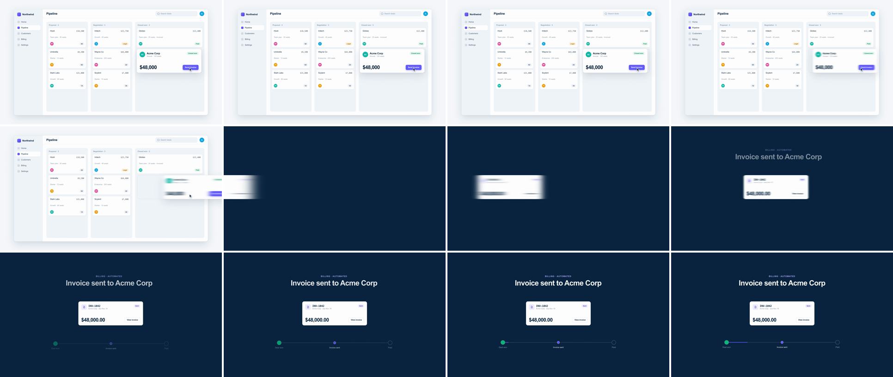

# Speed Match Cut (directional momentum)

One element accelerates out of frame right. On a hard cut, a different element in a different scene enters from the left at exactly that speed and brakes to rest. The camera never moves; only the object does, and because its velocity, height and size carry across the cut, the eye reads one continuous throw. It says "this thing just went over there and became that": a deal becomes an invoice, a form becomes a confirmation.



## Use it when

- A hand-off between systems or teams, where the object changes identity on the way: deal → invoice, upload → processed file, ticket → deploy.
- Montage beats that need pace but have a real object to follow. Keep the direction the same (always left to right) for the whole sequence.
- Compared with [whip-pan](../whip-pan/SKILL.md), which moves the whole scene: here the backgrounds are locked and one object carries the motion. If the object stays the same while the layout around it changes, use [shared-element](../shared-element/SKILL.md). If two shapes line up without moving, use [graphic-match-cut](../graphic-match-cut/SKILL.md).

Avoid it when the viewer needs to read the object during the move. At 370px per frame nobody can read it. Use [shared-element](../shared-element/SKILL.md) instead.

## Anatomy (30fps)

| Beat | Frames | What happens |
| --- | --- | --- |
| Telegraph | −14 → 0 | The cursor clicks "Send invoice" at −14 (button press 0.94 and yoyo, plus a ripple). At −8 the card winds up 16px against its direction of travel (`sine.inOut`) and stops at 0. |
| Accelerate out | 0 → 8 | Card A moves x −16 → 978 on the first half of `power2.inOut`, which is a cubic ease-in. Per-frame steps are 2, 14, 36, 72, 119, 176 and 247px. It crosses the frame edge on f5–7, and f7 shows only its last 82px. Horizontal blur goes 0 → 44 at the seam in proportion to speed (about 34 on f7, the last frame A is visible). |
| Cut | 8 | Hard cut to the dark Billing scene. Card B's left edge is at −314 (x = −994), so its right 246px are on screen, with blur 44. Both cards move at 373px per frame. If you wrap A's position by one screen plus one card width (2480px), it lands exactly on B's start position. |
| Decelerate in | 8 → 16 | Card B moves x −994 → 0 on the second half of the ease, in steps of 328, 247, 176, 119, 72, 36, 14 and 2px. The blur goes 44 → 0 and is down to 3px by f14. The card settles at f16. |
| Land | 11 → 40 | The headline drifts in x −60 → 0 (`expo.out`) from f11. The progress rail rises at f13 and fills on f16–31. The "Invoice sent" node pops (`back.out(2)`) at f28. |

## Build it

Structure: the moving card is a direct child of each `.scene`, not of `.app`, so the app window's `overflow: hidden` can't clip it. Both cards share one box (560×208, top 424). Each card carries `filter: url(#mbA)` / `url(#mbB)`, which points to an inline `<filter x="-50%" y="-50%" width="200%" height="200%">` holding a `<feGaussianBlur stdDeviation="0 0">`.

```js
const F = 1 / 30;
const T = 48 * F, H = 8 * F, CUT = T + H;  // whole frames, so the cut lands on the frame grid (f56)
const W = 560, REST_A = 1188, REST_B = 680, WIND = 16;

// One curve for the whole move, split at its midpoint. A plays the accelerating half and B the decelerating half.
const E = gsap.parseEase("power2.inOut");
const M = E(0.5);                                    // share of travel done at the cut
const easeA = (p) => E(p * 0.5) / M;
const easeB = (p) => (E(0.5 + p * 0.5) - M) / (1 - M);

// Choose the travel so A's position at the cut, minus (screen + card width), equals B's start position.
const TRAVEL = 1920 + W + REST_B - REST_A + WIND;    // 1988px
const XA = TRAVEL * M, XB = TRAVEL * (1 - M);        // 994 each; seam speed 3·994/8 ≈ 373 px/frame

// Blur tracks speed: the ease's slope, normalised to its value at the seam.
const slope = (p) => (E(p + 1e-4) - E(p - 1e-4)) / 2e-4;
const S = slope(0.5), BLUR = 44;

tl.to("#cardA", { x: -WIND, duration: 8 * F, ease: "sine.inOut" }, T - 8 * F);   // wind-up
tl.to("#cardA", { x: -WIND + XA, duration: H, ease: easeA }, T);
tl.fromTo("#blurA", { attr: { stdDeviation: "0 0" } }, { attr: { stdDeviation: `${BLUR} 0` }, duration: H, ease: (p) => slope(p * 0.5) / S }, T);

tl.set("#s1", { visibility: "hidden" }, CUT);
tl.set("#s2", { opacity: 1 }, CUT);

tl.fromTo("#cardB", { x: -XB }, { x: 0, duration: H, ease: easeB }, CUT);
tl.fromTo("#blurB", { attr: { stdDeviation: `${BLUR} 0` } }, { attr: { stdDeviation: "0 0" }, duration: H, ease: (p) => 1 - slope(0.5 + p * 0.5) / S }, CUT);
```

The full working composition is in [demo.html](demo.html).

## Tuning

- **Halves (`H`, 6–10f each).** Keep the two halves equal and whole frames, 12–20f in total. Seam speed is 3·XA/H for the demo's curve, so a 6f half runs about 500px per frame (3·994/6): raise `BLUR` with it.
- **Curve (`E`).** Any in-out ease works, because both halves come from it. `power2.inOut` (the demo) glides. `power3.inOut` is punchier, but A barely moves for 3 frames (steps of 0.2, 4 and 16px) and B lands in 4. `expo.inOut` slams. Change only `E`: the speed match, the travel split and the blur all follow from it.
- **Travel.** Derive it from the rest positions, don't type it in. If B must start fully off-frame, add a gap: `TRAVEL + GAP`. The object is then invisible for about GAP ÷ seam speed frames. Keep that under 1 frame or the cut reads as two moves.
- **Blur (`BLUR`, 30–60).** Roughly the seam speed in px per frame ÷ 8 for a single card (373 ÷ 8 ≈ 46). Much more smears the card's corners away, and the matched size and height of A and B are what sell the cut.
- **Wind-up (`WIND`, 0–24px).** It is part of `TRAVEL`, so changing it keeps the position match.

## Pitfalls

- **Two eases tuned by eye.** Using `power3.in` on A and `expo.out` on B over equal distances gives seam speeds of 4·X/H and 6.9·X/H: B enters 70% faster and lurches. Taking both halves from one curve makes them match by construction.
- **A curve too steep for 30fps.** The first build used `power3.inOut`. The card sat nearly still on f0–3, then covered 411px in its last frame. The contact sheet showed it parked, then gone, with no frame of it crossing the edge. With `power2.inOut` the card visibly crosses the edge on f5–7.
- **A placeholder that doesn't match the card.** The dashed slot the card leaves behind came from the column padding (568px) and showed as a 4px dashed rim around the 560px card at rest. Size the placeholder to the card's exact box.
- **`fromTo` on a one-shot effect.** `tl.fromTo(".ripple", { opacity: 0.9 }, …, 1.15)` renders its from-state immediately, so a ripple dot sat on the button from frame 0. Use `tl.set` at the click time, then `tl.to`.
- **Kit ripple on a primary button.** The kit ripple is 35% indigo, and on an indigo button it is invisible. Override it to translucent white so the click telegraph reads.
- **Default filter region.** An SVG filter clips to −10%/120% of the element. For a single 560px card that is 56px, and a stdDeviation of 44 spreads about 130px, so the smear gets a hard vertical edge. Widen the region to −50%/200%.

## Variants

- **Vertical drop.** A notification falls off the bottom, and the next scene's card drops in from the top. Use `y`, and wrap by 1080 + card height.
- **Same object.** Keep the card's content identical across the cut, for example a chat message that lands in Northwind as a task. This reads as one object travelling between apps.
- **Relay montage.** Each scene's landing card becomes the next scene's launcher, always moving left to right. Three or four relays make a fast product tour.
- **Slam.** Set `E = expo.inOut` and `H = 6f` for a high-energy launch-video cut. Raise `BLUR` toward 60.

## Sound

A short air whoosh panned left to right, peaking on the cut frame (f8), plus a soft tick as card B settles (f15–16).
