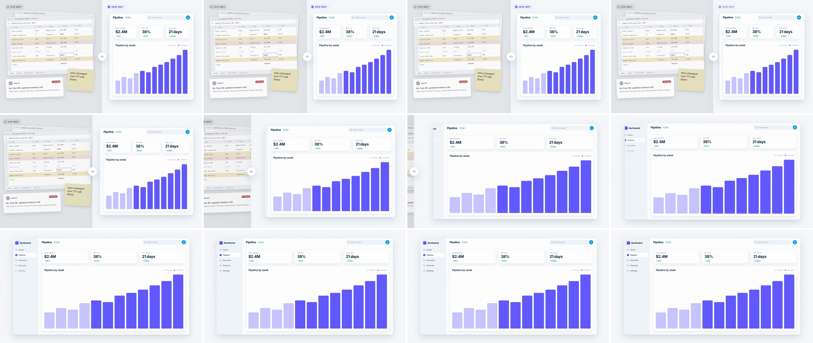

# Split-Screen Takeover (old way vs new way)

The frame is split 50/50 at a draggable divider: the old way on one side, the product on the other, each labeled. The divider is grabbed and dragged across the losing half. The winning panel's clip edge rides the divider until it covers the frame, and its UI re-lays out from a half-width card into a full app. The viewer sees the comparison and the verdict in one move: "this side wins."



## Use it when

- Old way vs new way: spreadsheet vs product, manual steps vs automation, a competitor's screen vs yours.
- Before vs after the same data: a messy export becomes a clean dashboard, or a legacy UI becomes the redesign.
- The winning side can be shown as a compact, complete half-width UI that grows into the full scene. Holding the split without the takeover is a plain comparison; the takeover is what makes it a verdict.

Avoid it when the two halves aren't the same kind of thing (a logo next to a dashboard), since the split then reads as a layout and not a comparison. To open one panel of a busy dashboard, use [container-mask-expand](../container-mask-expand/SKILL.md). For a chapter break with no comparison, use [geometric-ribbon-wipe](../geometric-ribbon-wipe/SKILL.md). To reveal the layer under the same UI, use [xray-scanline](../xray-scanline/SKILL.md).

## Anatomy (60fps)

| Beat | Frames | What happens |
| --- | --- | --- |
| Establish | −108 → −36 | Both halves build in together and are still by −44: gray spreadsheet chaos on the left, the compact Northwind app on the right, "Old way" and "New way" pills, and a white rule with a round grip at x=960. |
| Telegraph | −36 → 0 | A ring leaves the grip (−36 → −6). At −12 the grip is grabbed (scale 1 → 1.12) and winds up 26px toward the old side: the rule and the clip edge both go 960 → 986 on `power2.out`. |
| Drag | 0 → 36 | Rule and clip edge travel 986 → −80px on `power3.inOut` (GSAP's power3 is quartic): 979 at f6, 881 at f12, 453 at f18 (peak speed, about 120px/f), 25 at f24. The rule crosses x=0 at about f25 and the grip clears the frame by f27. The "New way" pill fades out over 0 → 12. The old side slides left 260px (about 25% of the rule's speed) and dims to brightness 0.82, so the new panel reads as sliding over it. |
| Re-layout | 0 → 36 | On the same clock, `#app` goes from 800×824 at (1040,128) to 1680×920 at (120,80). Its left edge stays 54 → 200px inside the rule, so it is never clipped. The KPI cards and the 12 bars widen through flex reflow and the text never scales. The sidebar drawer opens 0 → 248px from f6 to f42, with the sidebar pinned to its right edge so it slides in. |
| Land | 19 → 59 | The nav items, which the compact card never showed, arrive from x −16 on `expo.out` (f19 → f59, 2.4f stagger). The old scene and the divider are hidden at f36, when `#s2`'s clip already covers the full frame and the rule is off-frame. |

## Build it

Structure: `#s1` (old side, unscaled, carries `filter`) › `.old-cam` (parallax layer). `#s2` (new side) is a full-frame scene with `clip-path: inset(0px 0px 0px 960px)`. Its `#app` is a flex row whose box is tweened. `#divider` sits above both at `translateX(960px)` and holds the rule and grip, centered on its own x.

```js
const T = 1.8, D = 0.6;
const SPLIT = 960, WIND = 986, OUT = -80;                     // divider x in frame px; OUT clears the 76px grip and the rule's shadow
const clip = (x) => `inset(0px 0px 0px ${x}px)`;               // negative left inset is valid, so the clip can follow the rule off-frame
const COMPACT = { x: 1040, y: 128, width: 800, height: 824 }; // #app centered in the right half
const FULL = { x: 120, y: 80, width: 1680, height: 920 };     // #app as the full scene

tl.fromTo("#grip-ring", { scale: 1, opacity: 0.9 }, { scale: 1.7, opacity: 0, duration: 0.5, ease: "power2.out", immediateRender: false }, T - 0.6);
tl.fromTo("#grip", { scale: 1 }, { scale: 1.12, duration: 0.2, ease: "power2.out", immediateRender: false }, T - 0.2);
tl.fromTo("#divider", { x: SPLIT }, { x: WIND, duration: 0.2, ease: "power2.out" }, T - 0.2);
tl.fromTo("#s2", { clipPath: clip(SPLIT) }, { clipPath: clip(WIND), duration: 0.2, ease: "power2.out" }, T - 0.2);

// Rule and clip edge: same values, same ease, same start, so they can't separate.
tl.fromTo("#divider", { x: WIND }, { x: OUT, duration: D, ease: "power3.inOut", immediateRender: false }, T);
tl.fromTo("#s2", { clipPath: clip(WIND) }, { clipPath: clip(OUT), duration: D, ease: "power3.inOut", immediateRender: false }, T);
tl.to("#new-label", { opacity: 0, duration: 0.2, ease: "power1.in" }, T);
tl.fromTo(".old-cam", { x: 0 }, { x: -260, duration: D, ease: "power3.inOut" }, T);
tl.fromTo("#s1", { filter: "brightness(1)" }, { filter: "brightness(0.82)", duration: D, ease: "power2.in" }, T);

// Re-layout: tween the box, not a scale, so cards and bars reflow and type stays at size.
tl.fromTo("#app", COMPACT, { ...FULL, duration: D, ease: "power3.inOut" }, T);
tl.fromTo("#side", { width: 0 }, { width: 248, duration: D, ease: "power3.inOut" }, T + 0.1);

tl.set(["#s1", "#divider"], { visibility: "hidden" }, T + D);
tl.fromTo("#side .nav-item", { x: -16, opacity: 0 }, { x: 0, opacity: 1, duration: 0.5, stagger: 0.04, ease: "expo.out" }, T + 0.32);
```

The full working composition is in [demo.html](demo.html).

## Tuning

- **Duration.** 0.5–0.8s. `power3.inOut` holds the first and last 8f nearly still, so the visible sweep is about f8–f26. Under 0.5s the drag reads as a cut. For a calmer "slider demo" feel, use 0.8s on `power2.inOut`.
- **Wind-up.** 15–40px over 10–16f. Without it the drag has no grab. Over about 50px it reads as a bounce toward the wrong side.
- **Parallax on the losing side.** 20–30% of the rule's travel. At 0 it's a flat wipe. At 100% both halves move together and it becomes a [parallax-push](../parallax-push/SKILL.md).
- **Dim.** Brightness 0.75–0.9 on the unscaled `#s1`. Darker turns the old side muddy under the light rule.
- **Content margin.** Keep the compact app about 80px inside the rule at rest. The wind-up eats 26px of that (54px left), and the drag grows it back to 200px. Much tighter and its left edge clips during the wind-up.

## Pitfalls

- **Telegraph ring visible from frame 0.** A `fromTo` with default `immediateRender` stamps its from-state at `seek(0)`. The ring's `opacity: 0.9` showed through the whole entrance until its tween started at −36. Every `fromTo` placed after t=0 whose from-state differs from the CSS needs `immediateRender: false`.
- **Content on its own clock.** In the first render `#app` started 2f late and ran 2f longer. At mid-sweep it sat 270–400px right of the rule, so the panel read as a wipe over empty background with the UI chasing it. Put the box tween on the same start, duration and ease as the rule.
- **Rule and clip with different endpoints.** Tweening the rule to −80 and the clip to `inset(... 0px)` on the same ease lets them drift up to 80px apart near the end. Give them identical numbers. A negative inset is legal.
- **Scaling the panel instead of re-laying it out.** Scaling the 800px card ×2.1 makes 26px titles 55px and reads as a zoom. Tween `width`/`height` and let flex/grid reflow. The kit's `.bars` has a fixed 220px height, so override it to `flex: 1` or the chart won't grow vertically.
- **Drawer that wipes instead of slides.** A `width: 0 → 248` drawer with `overflow: hidden` cuts the left-anchored sidebar mid-word ("North", "Pipe") at its moving right edge. Give `#side` `display: flex; justify-content: flex-end` and the sidebar `flex: none`, so the sidebar rides the drawer's edge.
- **Tilted chaos cards losing their tilt.** GSAP writes `transform`, so a `y` entrance on a card with `transform: rotate(-1.5deg)` replaces the rotation. Tilt with the CSS `rotate` property, which composes with GSAP's transform.

## Variants

- **Cursor drag.** A cursor grabs the grip at −20, carries it to about x=600, and lets go. The divider coasts out on `expo.out`. This teaches the slider UX at the cost of 12–16f.
- **Tease, then take over.** Drag to 640, spring back to 960 (`back.out(1.4)`), hold 24f, then do the full takeover. Use it when the comparison itself is the point.
- **Vertical split for 9:16.** Old on top, new below. Tween the top inset and the divider's `y`, and re-lay out the height instead of the width.
- **Dark winner.** Put the new way on `--ink` with a light UI card. The contrast carries the verdict before the move starts.

## Sound

A soft grab click on f−12, then a short air whoosh that peaks at f18 (fastest sweep). Add a light thump at f42 when the sidebar drawer settles.
