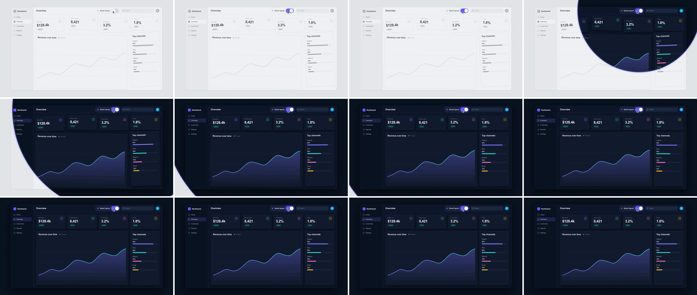

# Toggle & Theme Shift (circular state reveal)

A cursor flips a toggle, and the next scene grows out of the toggle's centre as an expanding circle. Under the circle's edge the same layout shows in a new palette and state, and once the edge passes, the cards snap into alignment. The toggle is shown as the cause: one switch changes the whole product.



## Use it when

- A single setting changes everything: "Smart layout", dark mode, focus mode, "AI clean-up", a plan-upgrade switch.
- Before/after on the *same* screen: messy → organized, raw → enriched, gray → branded.
- You want to teach the UX while changing scenes: viewers see where the switch lives and what it does. The same family as [cursor-click-expand](../cursor-click-expand/SKILL.md) and [dropdown-accordion-wipe](../dropdown-accordion-wipe/SKILL.md).

Avoid it when scene B is a different screen. The repaint only reads if the layout under the edge matches. Use [cursor-click-expand](../cursor-click-expand/SKILL.md) instead, or [split-screen-takeover](../split-screen-takeover/SKILL.md) to hold old and new side by side.

## Anatomy (30fps)

| Beat | Frames | What happens |
| --- | --- | --- |
| Telegraph | −31 → −7 | The cursor fades in and glides to the toggle (`power3.inOut`, 18f, arriving at −13). It is the only moving thing in a gray frame. |
| Press | −7 → −2 | Mouse-down: the cursor squeezes to 0.86 and the toggle to 0.94 (2f down, 2f up). A ripple spreads from −5. |
| Flip | −4.5 → 0 | The knob slides 40px (`power3.out`, 5.4f) and the track turns `#635bff`, the first colour in scene A. It is visually settled by frame 0, the frame the circle is born, and fully done at about f1. |
| Reveal | 0 → 14 | Scene B's `clip-path: circle()` grows from the toggle centre to R = 1624px on `power2.out` (cubic in GSAP): 483px at f2, 1143px at f6, ~1480px at f10. It covers the last (bottom-left) corner at ~14f; the last 4f run off-screen. A 3px lavender ring and a 22px glow ride the edge and fade over frames 7 → 18. |
| Repaint | 0 → 14 | Under the edge, scene B's cards sit at scene A's exact crooked transforms, so the edge reads as one layout being repainted, not a new screen sliding in. |
| Snap | 1 → 22 | Each B card squares up (x, y, rotation → 0, `back.out(1.4)`, 15f) once the edge clears its far corner: Conversion at 1f, Churn and Active users at ~2.5f, Revenue at ~4.5f, Top channels at 5f, the chart at 7f. The straightening ripples outward from the toggle. |
| Settle | 25 → 40 | The cursor eases 36px right and 56px down off the lit track (`power2.inOut`, 15f), so the hold shows the toggle unobstructed. |

## Build it

Structure: two scenes with identical layout boxes. `#s1` holds the "before" tokens, and `#s2` sits above it with the "after" tokens, clipped to a zero circle at the toggle. An SVG `#wave` with two circles sits above both for the edge ring. Both scenes read their card offsets from one `CARDS` table.

```css
#s1, #s2 { color: var(--ink); } /* color inherits as a computed value; token overrides alone leave old ink */
#s2 { z-index: 2; clip-path: circle(0px at 1278px 118px);
      --bg: #0b1220; --surface: #131c2f; --surface-2: #1b2640; --ink: #eef2f9; --ink-2: #b3bfd2; --accent: #7c74ff; /* + --border, --muted, --shadow */ }
.smart .toggle.on { background: #635bff; } /* same ON colour in both scenes: the circle is born inside it */
```

```js
const T = 1.8, D = 0.6;
const TOGGLE = { x: 1234, y: 94, w: 88, h: 48 };                    // toggle track in scene px; hard-code it
const OX = TOGGLE.x + TOGGLE.w / 2, OY = TOGGLE.y + TOGGLE.h / 2;   // reveal origin = toggle centre
const R = Math.hypot(Math.max(OX, 1920 - OX), Math.max(OY, 1080 - OY)) + 24; // farthest corner, not "100%"
const EASE = "power2.out";
const reach = (d) => T + D * (1 - Math.cbrt(1 - Math.min(d / R, 1)));    // inverse of power2.out (cubic): when the edge hits d
const CARDS = { k1: { mess: [-18, 14, -2.8], far: [400, 344] }, /* …one per card… */ chart: { mess: [-12, 14, 0.8], far: [400, 968] } };

// Flip: press, ripple, and the knob lands on T.
tl.to("#cursor", { scale: 0.86, duration: 0.07, ease: "power2.out", yoyo: true, repeat: 1, transformOrigin: "20% 10%" }, T - 0.22);
tl.to("#tgl", { scale: 0.94, duration: 0.07, ease: "power2.out", yoyo: true, repeat: 1 }, T - 0.22);
tl.fromTo("#ripple", { scale: 0.6, opacity: 0.55 }, { scale: 3.6, opacity: 0, duration: 0.45, ease: "power2.out", immediateRender: false }, T - 0.18);
tl.fromTo("#knob", { x: 0 }, { x: 40, duration: 0.18, ease: "power3.out" }, T - 0.15);
tl.to("#tgl", { backgroundColor: "#635bff", duration: 0.15, ease: "power2.out" }, T - 0.15);

// Reveal: px at both ends, or GSAP can't interpolate circle().
tl.set("#s2", { opacity: 1 }, T);
tl.fromTo("#s2", { clipPath: `circle(0px at ${OX}px ${OY}px)` }, { clipPath: `circle(${R}px at ${OX}px ${OY}px)`, duration: D, ease: EASE }, T);
tl.fromTo("#wave circle", { attr: { r: 0 }, opacity: 1 }, { attr: { r: R }, duration: D, ease: EASE }, T);
tl.to("#wave circle", { opacity: 0, duration: D * 0.6, ease: "power1.in" }, T + D * 0.4);
tl.set("#s1", { visibility: "hidden" }, T + D);

// Snap: B cards start at A's crooked [x, y, rotation] and square up once the edge has cleared their far corner.
Object.entries(CARDS).forEach(([k, { mess: [x, y, r], far }]) => {
  const t = reach(Math.hypot(far[0] - OX, far[1] - OY) + 32);
  tl.fromTo(`#s2 .${k}`, { x, y, rotation: r }, { x: 0, y: 0, rotation: 0, duration: 0.5, ease: "back.out(1.4)", immediateRender: true }, t);
});
tl.to("#cursor", { x: 36, y: 56, duration: 0.5, ease: "power2.inOut" }, T + D + 0.25); // clear the lit track for the hold
```

The full working composition is in [demo.html](demo.html).

## Tuning

- **Duration.** 0.5–0.7s. Under ~0.45s the circle reads as a flash. Over ~0.8s the last corner crawls in.
- **Ease.** `power2.out` (cubic) clears the last corner at ~14f. `power1.out` (quad) uses ~16f. `power3.out` (quart) clears by ~12f and wastes the tail off-screen. Change `reach()` with the ease: GSAP's powerN is degree N+1, so `power2.out` (`1 − (1 − p)³`) takes a cube root, `power1.out` a square root and `power3.out` a fourth root. The wrong root puts every radius ~40% off and fires the snaps early or late. Avoid `.inOut` eases: their first frames are a dot hidden under the cursor.
- **Origin and R.** Always the toggle centre and the distance to the farthest corner. A toggle near a frame corner pushes R towards the full diagonal (~2200px). There, D = 0.7s keeps the edge speed close to this demo's.
- **Mess amplitude.** ±10–20px and ±1.8–3°. Under ~1.5° the snap disappears at thumbnail size. Over ~4° scene A looks broken rather than untidy. With 24px gutters, keep neighbours' relative x offset under ~16px so tilted cards don't touch.
- **Ring.** A 3px stroke plus a 22px glow at 0.18 stroke-opacity. Drop the glow for a calmer cut, or both rings for a plain theme flip.

## Pitfalls

- **A gap between flip and reveal.** `power3.out` moves the knob ~94% of the way in half its duration. A 0.2s slide starting at T−0.22 looked done about 4f before the circle appeared, so it read as two events. Start the knob at T−0.15 so it lands on T.
- **fromTo paints its from-state at 0s.** The ripple's visible start (opacity 0.55) left a lavender dot on the knob through the whole establish. Set `immediateRender: false` on any later `fromTo` whose start state is visible.
- **Kit chart overflow.** `.chart-svg { width: 100% }` beats `left/right: 24px` on an absolutely positioned SVG, so the chart overflowed its card by 48px. It went unnoticed until the card tilted and the dashed line crossed the border. Use `width: calc(100% - 48px)`.
- **Text keeps the old ink.** `color` inherits from `#root` as a computed value, so redefining `--ink` on `#s2` repaints surfaces but not text. Re-declare `color: var(--ink)` on each scene.
- **Percent radius.** `circle(100%)` resolves to diagonal/√2 (~1558px here), which falls ~40px short of the far corner from an off-centre origin. Mixing % and px also won't interpolate. Compute R in px.
- **Snapping too early tears.** If a B card squares up while the edge still crosses it, its revealed half moves while A's half stays crooked, and the card splits at the edge. Gate each snap on `reach(farCorner + 32px)`. The +32 covers the tilted corner, which sits up to ~20px past the square one.

## Variants

- **Plain theme toggle.** Light → dark with no layout change. Drop the snap; scene B is scene A with tokens swapped.
- **Slider scrub.** A slider thumb drags across, and scene B is revealed by `clip-path: inset(0 0 0 X)` tied to the thumb's x. It works as a before/after wipe the viewer can follow.
- **Switch off.** Reverse it to show "without Northwind": the circle shrinks from R back into the knob on `power2.in`.
- **Feature unlock.** The toggle is a "Pro" switch, and new panels [bento-cascade](../bento-cascade/SKILL.md) in after the snap.

## Sound

A crisp switch click at mouse-down (frame −7), then a soft airy shimmer that swells until the edge clears the last corner (~14f). Add optional faint ticks on the card snaps.
