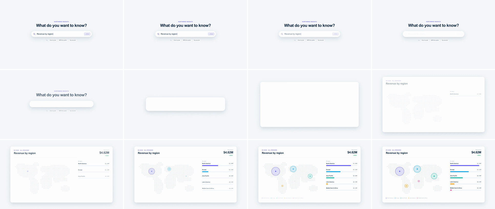

# UI-to-UI Component Morph (container transform)

One component's box changes position, width, height and corner radius until it becomes a different component. The outgoing contents clear first, the shell reshapes as one continuous surface, and the incoming contents arrive only once the new shape has nearly settled. It tells the viewer "this didn't take you somewhere else. The thing you used turned into the answer."



## Use it when

- A small input or trigger produces a big result: a search query becomes the results panel, an "Ask AI" bar becomes the generated report, a button becomes a modal and then a page.
- A collapsed widget becomes its full view: a KPI chip becomes the chart card, a toast becomes the inbox.
- Both states share a surface (same fill, border and elevation), so the shell can be one element the whole way.
- For a return trip, run the same tweens backwards. If a click starts it, add a cursor first with [cursor-click-expand](../cursor-click-expand/SKILL.md).

Avoid it when the object keeps its identity and only moves or resizes. That is a [shared-element](../shared-element/SKILL.md). Avoid it when the two surfaces differ in colour or material: the continuous shell gives the trick away. For organic or icon-shaped sources, use [icon-to-scene-morph](../icon-to-scene-morph/SKILL.md) or [liquid-blob-morph](../liquid-blob-morph/SKILL.md). Use [container-mask-expand](../container-mask-expand/SKILL.md) when the frame should *reveal* content that already exists.

## Anatomy (60fps)

| Beat | Frames | What happens |
| --- | --- | --- |
| Telegraph | −16 → 0 | The Enter key chip lights up in indigo, then the bar takes a 12f press (scale 0.985 yoyo). |
| Clear | 0 → 10 | The search contents (icon, query, key chip) fade out while the shell has barely moved. power4.inOut covers under 2% of the distance in its first 25% of time. From frame 4 to 17 the headline and suggestion chips slide 28px away and fade as the shell's edges approach. |
| Stretch | 0 → 39 | The shell's real box morphs from 960×96 r48 to 1600×880 r28. Width and x run 39f on `power4.inOut`. Height, y and radius start 6f later and land on the same frame, so mid-move it is a wide, flat bar (about 1175×175 at frame 18) and not a scaled-up pill. |
| Gate | 25 | Height is 80% settled (`SETTLED`). The middle of the panel is clear of the moving edges. Width is about 91% settled, so the sides are about 28px short, but the top and bottom edges are still about 80px short. |
| Fill | 25 → 84 | Centre out. The dot map fades up and the region rows stagger in from frame 25. Title and total rise in (`expo.out`) at frame 29, once the top edge has room. Then the rule draws, bubbles pop (`back.out(1.6)`), bar fills grow, and the legend comes in last. |

## Build it

Structure: `#shell` (absolute, `overflow: hidden`, carries surface, border, shadow and radius) › `.q` (search contents, anchored to the bar's edges) + `.panel` (a fixed 1600×880 layer pinned to the shell's centre with negative margins, so content doesn't drift while the box settles).

```js
const T = 1.7, D = 0.65;
const BAR = { left: 480, top: 484, width: 960, height: 96, borderRadius: 48 };    // = #shell CSS; hard-coded, not measured
const PANEL = { left: 160, top: 100, width: 1600, height: 880, borderRadius: 28 }; // the target component's box
const EASE = "power4.inOut";
const LAG = 0.1;                                        // height trails width by 6f: the bar stretches open, it doesn't zoom
const SETTLED = T + LAG + (D - LAG) * 0.583;            // power4.inOut reaches 80% at t = 0.583

tl.to("#kbd", { backgroundColor: "#eeedff", borderColor: "#635bff", color: "#4b44d6", duration: 0.1, ease: "power2.out" }, T - 0.26);
tl.to("#shell", { scale: 0.985, duration: 0.1, ease: "power2.out", yoyo: true, repeat: 1 }, T - 0.22);

// Real width/height/radius (scale would stretch the border, shadow and corners); position on x/y, which is sub-pixel.
tl.fromTo("#shell", { x: 0, width: BAR.width }, { x: PANEL.left - BAR.left, width: PANEL.width, duration: D, ease: EASE, immediateRender: false }, T);
tl.fromTo("#shell", { y: 0, height: BAR.height, borderRadius: BAR.borderRadius },
  { y: PANEL.top - BAR.top, height: PANEL.height, borderRadius: PANEL.borderRadius, duration: D - LAG, ease: EASE, immediateRender: false }, T + LAG);

tl.to(".q", { opacity: 0, duration: D * 0.25, ease: "power1.out" }, T);                       // out in the first quarter
tl.to(".ask", { y: -28, opacity: 0, duration: D * 0.35, ease: "power2.in" }, T + 0.06);        // neighbours give way
tl.to(".chips", { y: 28, opacity: 0, duration: D * 0.35, ease: "power2.in" }, T + 0.06);

// Incoming content only after the shape is ~80% settled, centre out: edge content waits 4f for the edges.
tl.fromTo("#land", { opacity: 0, y: 12 }, { opacity: 1, y: 0, duration: 0.5, ease: "power2.out" }, SETTLED);
tl.fromTo(".rows > *", { y: 14, opacity: 0 }, { y: 0, opacity: 1, duration: 0.45, stagger: 0.04, ease: "expo.out" }, SETTLED + 0.02);
tl.fromTo(".p-head, .p-stat", { y: 16, opacity: 0 }, { y: 0, opacity: 1, duration: 0.5, stagger: 0.04, ease: "expo.out" }, SETTLED + 0.06);
tl.fromTo(".bubble", { scale: 0, transformOrigin: "50% 50%" }, { scale: 1, duration: 0.5, stagger: 0.05, ease: "back.out(1.6)" }, SETTLED + 0.16);
tl.fromTo(".fill", { scaleX: 0, transformOrigin: "0% 50%" }, { scaleX: 1, duration: 0.6, stagger: 0.05, ease: "power3.out" }, SETTLED + 0.18);
tl.fromTo(".rule", { scaleX: 0, transformOrigin: "0% 50%" }, { scaleX: 1, duration: 0.5, ease: "expo.out" }, SETTLED + 0.1);
tl.fromTo(".legend", { opacity: 0 }, { opacity: 1, duration: 0.4, ease: "power1.out" }, SETTLED + 0.3);
```

The full working composition is in [demo.html](demo.html).

## Tuning

- **Duration.** 0.55–0.75s. Under 0.55s the content-out → shape → content-in sequence collapses into a pop. Over 0.75s the empty shell hangs on screen.
- **Lag (`LAG`, 0.06–0.15s).** At 0 the box grows evenly and reads as a zoom. Over 0.15s width and height separate into two moves (an L-shaped grow). Lead with the axis that changes least, so the big axis gets the payoff.
- **Content gate.** Start the incoming content at 70–85% shape progress, centre first. Earlier, the moving edges clip it. Later, the finished panel sits empty for a beat.
- **Ease.** `power4.inOut` is the default. `expo.inOut` makes a harder snap with a longer still start. Give the incoming content `expo.out` so the landing decelerates.
- **End radius.** Tween radius in px to the target component's real radius. Going from a pill (r = h/2) to r28 is what makes the shell stop reading as a search bar.

## Pitfalls

- **Uniform growth reads as a scale-up.** The first build tweened every property on one curve, from a centred bar to a centred panel. The middle frames were just a bigger white rectangle. The 6f height lag is what makes it a stretch.
- **`left`/`top` fail strict lint.** `gsap_non_transform_motion` rejects them: they snap to whole pixels and stutter on the slow tail. Move position with `x`/`y` and keep only width, height and radius as layout tweens. Lint missed the problem when the props came through a spread (`{ ...PANEL }`), so don't rely on lint to catch it.
- **The dead start of inOut eases.** power4.inOut covers under 4% of the distance in its first 30% of time. Fade the outgoing content inside that window and don't add a hold before `T`, or the empty pill reads as a stall.
- **Neighbours sliced mid-word.** The growing top edge cut through the headline for a couple of frames. Push neighbours out (frames 4–17) instead of letting the shell's edge wipe across text.
- **Edge content at the gate.** At 80% the top and bottom edges are still ~80px short. With the title first at `SETTLED`, its eyebrow (48px from the panel top) appeared pressed against the still-moving top edge. Start middle content at the gate and anything within ~80px of an edge 4f later.
- **Content anchored to the corner drifts.** Children positioned from the shell's top-left ride the edge for the last few frames. Pin a fixed-size inner layer to the shell's centre with negative margins (not `translate(-50%)`, which conflicts with GSAP transforms).
- **Crossfading two boxes.** Swapping a bar element for a panel element shows a double border and shadow. Animate one element the whole way.

## Variants

- **Button → modal → full screen.** Chain two shell tweens: a button grows to a 720×480 r20 modal, holds about 0.6s, then grows to 1920×1080 r0.
- **Chip → filter panel.** A filter pill grows down into a dropdown panel. Use a shorter 0.5s duration. Width still leads, because it changes least.
- **Collapse.** Swap `BAR` and `PANEL`. The panel contents leave in the first 25%, and the bar contents return after 80%. This works for "save → toast".

## Sound

A soft synth swell rising through the stretch, peaking on frame 25 when the content starts filling, plus a crisp key click on the press at frame −13.
