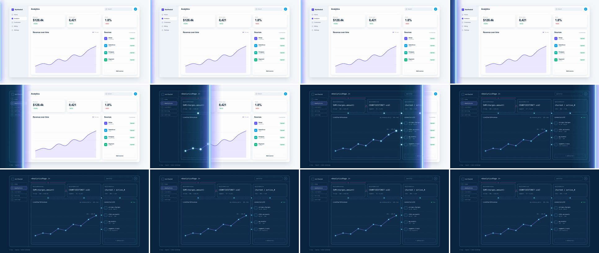

# X-Ray Scanline (scanline pass-through)

A bright laser line sweeps left to right across scene A. Behind the line, scene B is the *same layout* redrawn as an x-ray: outlined boxes, component names, the queries behind each number, the data feeding each card. One value drives both the line's position and scene B's clip edge, so the reveal sits exactly under the line. It tells the viewer "this is what's underneath."



## Use it when

- The story moves from the polished surface to how it works: dashboard → data model, page → components, KPI → the query behind it.
- Dev-tool, API, data or infra products, where the wiring is the selling point.
- An AI feature "reads" a screen: scene B is the screen annotated with what the model found.
- Follow it with [ui-deep-zoom](../ui-deep-zoom/SKILL.md) into one x-ray node: the scan reveals the wiring, then the zoom dives into one data source.

Avoid it when scene B isn't the same layout. A scanline between two unrelated screens is just a wipe and wastes the alignment. Use [geometric-ribbon-wipe](../geometric-ribbon-wipe/SKILL.md), or [light-sweep](../light-sweep/SKILL.md) for a softer, glow-led change.

## Anatomy (30fps)

| Beat | Frames | What happens |
| --- | --- | --- |
| Telegraph | −8 → 0 | The scanner powers on at the left frame edge. The 4px core grows from its vertical centre (`scaleY` 0 → 1, 9f `expo.out`) and the bloom fades in from −6. The eye lands on the edge before anything moves. |
| Accelerate | 0 → 12 | `--x` runs 0 → 2000 on `power2.inOut`. The line and scene B's `clip-path` edge both read `--x`. The bloom stretches 1 → 2.4× in step with speed. The line reaches frame centre at f12, its peak speed (~250 px/frame). |
| Pings | 9 → 15 | Each data node in scene B flashes white at 2.6× the moment the line crosses its `cx`, then settles over 15f (`expo.out`). The x-ray looks like it's being scanned, not just uncovered. |
| Exit | 12 → 19 | The line decelerates and leaves the right edge at ~f19. Scene A is hidden at that crossing. |
| Fade | 18 → 24 | The scanner layer fades out (`power2.out`), so the afterglow and the off-screen bloom don't stop on the right edge. |
| Hold | 24 → 75 | Scene B holds. The dashed data bus keeps flowing, so the x-ray reads as live. |

## Build it

Structure: `#s1` (skin) under `#s2` (x-ray, an inline SVG drawn in scene px with the same boxes) under `#scan` (core + bloom + trail). Hard-code every box in scene A's CSS and trace the same numbers in scene B.

```css
#root { --x: 0; } /* scanline centre in px */
#s2   { clip-path: inset(0 max(0px, calc((1920 - var(--x)) * 1px)) 0 0); }
#scan { position: absolute; left: 0; top: 0; width: 0; height: 1080px; opacity: 0; transform: translateX(calc(var(--x) * 1px)); }
```

```js
const T = 1.5, D = 0.8;
const X0 = 0, X1 = 2000; // X1 clears the frame by the bloom's half-width, so the line exits instead of parking
// GSAP power2 is CUBIC (4p³ in the first half). This inverse gives the time the line reaches x.
const inv = (y) => (y < 0.5 ? Math.cbrt(y / 4) : 1 - Math.cbrt(2 * (1 - y)) / 2);
const tCross = (x) => T + D * inv((x - X0) / (X1 - X0));

tl.fromTo("#scan", { opacity: 0 }, { opacity: 1, duration: 0.1, ease: "power1.out" }, T - 0.27);
tl.fromTo(".scan-core", { scaleY: 0 }, { scaleY: 1, duration: 0.3, ease: "expo.out" }, T - 0.27);
tl.fromTo(".scan-glow", { opacity: 0 }, { opacity: 1, duration: 0.2, ease: "power1.out" }, T - 0.2);

tl.set("#s2", { opacity: 1 }, T);                      // still clipped to zero width
tl.fromTo("#root", { "--x": X0 }, { "--x": X1, duration: D, ease: "power2.inOut" }, T);
// Speed grows with (2p)² up to the midpoint, so a power1.in yoyo stretches the bloom with speed.
tl.fromTo(".scan-glow", { scaleX: 1 }, { scaleX: 2.4, duration: D / 2, ease: "power1.in", yoyo: true, repeat: 1 }, T);
tl.set("#s1", { visibility: "hidden" }, tCross(1920));
tl.to("#scan", { opacity: 0, duration: 0.2, ease: "power2.out" }, T + D - 0.2); // `to`, not a second fromTo

document.querySelectorAll("#xray .node").forEach((n) => {
  tl.fromTo(n, { scale: 2.6, fill: "#ffffff", transformOrigin: "50% 50%" },
    { scale: 1, fill: "#7dd3fc", duration: 0.5, ease: "expo.out" }, tCross(+n.getAttribute("cx")));
});
```

The full working composition is in [demo.html](demo.html), including the three-layer line (white core with stacked `box-shadow` bloom, a wide indigo/sky gradient glow, a 320px afterglow trailing over scene B).

## Tuning

- **Duration.** 0.7–0.9s. The line is on screen for only ~78% of `D` (it exits at `inv(0.96)`), so 0.8s gives a ~19f visible pass. The ease spends about 5f at each end off-screen or barely moving, which is why 24f stays within the house 10–20f rule for the visible sweep. Under 0.6s the x-ray is gone before anyone reads it.
- **Ease.** `power2.inOut` scans like a machine arm. `sine.inOut` gives a calmer, more even pass. `power3.inOut` makes a snappier one with a longer wait at the edge. If you change it, change `inv` to match.
- **Bloom stretch.** 1.8–2.6× at peak speed. Above 3× the haze washes scene A ahead of the line, and scene A looks like it's fading out before the cut.
- **`X1`.** At least `1920 +` the bloom's half-width (core shadow reaches ~95px). Exactly 1920 decelerates the line to a halt on the right edge.
- **Scene B contrast.** Dark navy (`--ink`) with sky strokes gives the strongest skin-to-bones read. A light blueprint (`--surface-2`, indigo strokes) is calmer but the line glow almost disappears against it.

## Pitfalls

- **Half-framed telegraph, scaled glow.** With `X0 = 0` the line's center sits on the frame edge during the power-on, so only half the core and bloom show; start further in if the telegraph must read strongly. The nodes' `drop-shadow` scales with the ping on purpose: the glow should grow with it.
- **Two tweens for line and mask.** Animating the line's `x` and the clip's inset separately drifts by a few px mid-sweep, and the seam shows. Drive both from one CSS variable.
- **`power2` is cubic in GSAP.** The first draft inverted the ease with `sqrt` (quadratic). Pings fired before the line reached the left-hand nodes, and scene A was hidden ~2f late. Use `cbrt`, or recompute `inv` for any other ease.
- **Card borders shift traced children.** Absolute children of a `.card` sit inside its 1px border, so the x-ray SVG traced at `card + 24px` was 1px off the chart and source rows. Swap the border for `box-shadow: 0 0 0 1px` on every container the x-ray traces (`.app` too).
- **Switching the scanner off.** `tl.set("#scan", { opacity: 0 }, T + D)` popped a dim strip of afterglow at the right edge (a luma jump of ~26), and a fade-out written as a second `fromTo` renders its `opacity: 1` at build time, showing the line from frame 0. Fade it with `to` over the last 6f on an out-ease.
- **Scene B that doesn't trace scene A.** If boxes don't line up across the line, the scan reads as a wipe to a different screen. Keep every box identical and change only the skin: fills become outlines, values become the queries behind them.

## Variants

- **Vertical scan.** Top → bottom for phone screens or long pages. Use `inset(0 0 calc((1080 - var(--y)) * 1px) 0)` and a horizontal line.
- **Lens.** A glass circle moves across the UI. `clip-path: circle(180px at calc(var(--x) * 1px) calc(var(--y) * 1px))` shows the x-ray only inside it. Good for "inspect" moments without leaving scene A.
- **Return pass.** Sweep right → left to put the skin back after explaining the wiring (`X0 = 2000`, `X1 = -80`, clip from the left).
- **AI read.** Scene B is the same screen with model annotations (entities boxed, confidence labels) instead of wireframes.

## Sound

A rising electrical shimmer that peaks as the line crosses centre (f12), with soft high ticks on each node ping (f9–15).
